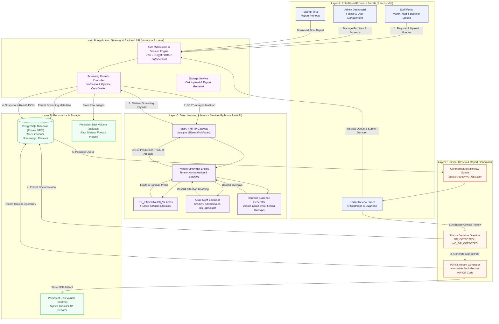
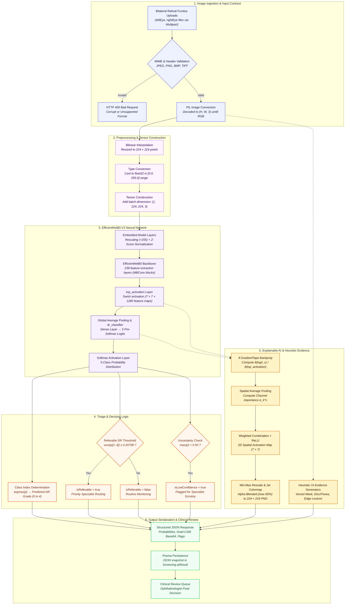
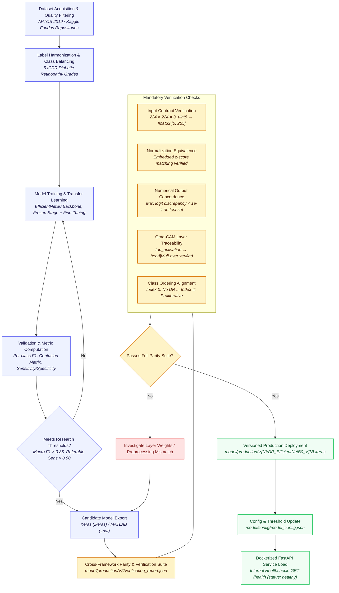
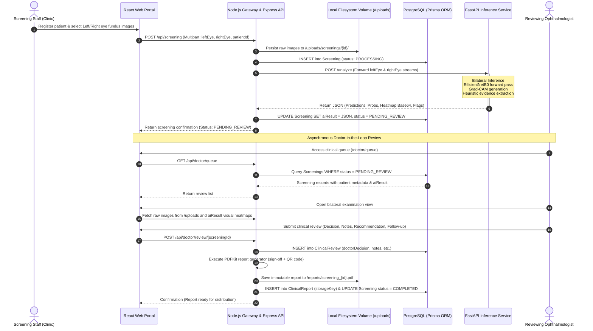

<div align="center">


<br />

# Vision AI

<h3><strong>Explainable AI for Diabetic Retinopathy Screening in Rural India</strong></h3>

<sub>Problem Statement: SIH26038 &nbsp;·&nbsp; Smart India Hackathon 2026</sub>

<br />


<br />

<table>
  <tr>
    <td align="center" width="340">
      <strong>Clinical Dashboard</strong><br />
      <sub>Doctor review panel — full-res images, AI assessment, Grad-CAM</sub><br /><br />
      <a href="#">
        
      </a>
    </td>
    <td align="center" width="340">
      <strong>Inference API</strong><br />
      <sub>FastAPI inference server — /analyze endpoints</sub><br /><br />
      <a href="#">
        
      </a>
    </td>
  </tr>
</table>

</div>

---

## Table of Contents

- [Overview](#overview)
- [System Architecture](#system-architecture)
  - [Architectural Topology](#architectural-topology)
  - [Layer A: Role-Based Frontend Portals](#layer-a-role-based-frontend-portals)
  - [Layer B: Authentication & Application Gateway](#layer-b-authentication--application-gateway)
  - [Layer C: Deep Learning Inference Service](#layer-c-deep-learning-inference-service)
  - [Layer D: Data Persistence & Volume Storage](#layer-d-data-persistence--volume-storage)
  - [Layer E: Clinical Review & Report Generation](#layer-e-clinical-review--report-generation)
- [Deep Learning Pipeline](#deep-learning-pipeline)
  - [Production Pipeline Flow](#production-pipeline-flow)
  - [Pipeline Execution Stages](#pipeline-execution-stages)
- [Inference Service Contract](#inference-service-contract)
  - [API Endpoints](#api-endpoints)
  - [Input Contract](#input-contract)
  - [Model Execution](#model-execution)
  - [Output Schema](#output-schema)
  - [Uncertainty & Calibration Notice](#uncertainty--calibration-notice)
- [Diabetic Retinopathy Classification](#diabetic-retinopathy-classification)
  - [Five-Class Severity Scale](#five-class-severity-scale)
  - [Multiclass Grading vs. Binary Referable Screening](#multiclass-grading-vs-binary-referable-screening)
  - [Threshold Configuration & Evaluation Origins](#threshold-configuration--evaluation-origins)
- [Image Preprocessing and Quality Assessment](#image-preprocessing-and-quality-assessment)
  - [Tensor Preprocessing Contract](#tensor-preprocessing-contract)
  - [Embedded Model Normalization](#embedded-model-normalization)
  - [Heuristic Evidence Visualizations](#heuristic-evidence-visualizations)
  - [MATLAB Experimental Image Processing](#matlab-experimental-image-processing)
- [Explainable AI: Grad-CAM](#explainable-ai-grad-cam)
  - [Mathematical Formulation](#mathematical-formulation)
  - [Gradient Computation on Pre-Softmax Logits](#gradient-computation-on-pre-softmax-logits)
  - [Colormap & Alpha Blending](#colormap--alpha-blending)
  - [Numerical Stability & Validation](#numerical-stability--validation)
  - [Clinical Safety Boundaries](#clinical-safety-boundaries)
- [Model Training and Evaluation](#model-training-and-evaluation)
  - [Training Workflow & Fine-Tuning Setup](#training-workflow--fine-tuning-setup)
  - [Historical Fine-Tuning Benchmarks](#historical-fine-tuning-benchmarks)
  - [Production Artifact Technical Verification](#production-artifact-technical-verification)
  - [Prospective Multi-Center Evaluation Framework](#prospective-multi-center-evaluation-framework)
- [Model Artifact Lifecycle and Interoperability](#model-artifact-lifecycle-and-interoperability)
  - [Model Promotion Workflow](#model-promotion-workflow)
  - [Cross-Framework Parity Requirements](#cross-framework-parity-requirements)
- [Clinical Decision and Review Workflow](#clinical-decision-and-review-workflow)
  - [End-to-End Clinical Data Flow](#end-to-end-clinical-data-flow)
  - [Doctor-in-the-Loop Governance](#doctor-in-the-loop-governance)
  - [Data Persistence Separation](#data-persistence-separation)
- [MATLAB / Simulink Research Pipeline](#matlab--simulink-research-pipeline)
  - [Isolated Research Architecture](#isolated-research-architecture)
  - [Real MATLAB Inference Reference](#real-matlab-inference-reference)
  - [Operational Simulink Simulation](#operational-simulink-simulation)
  - [MATLAB Contributor Workspace](#matlab-contributor-workspace)
- [Project Structure](#project-structure)
- [Quick Start](#quick-start)
- [API Reference](#api-reference)
- [Platform Portals](#platform-portals)
- [Operational Simulation](#operational-simulation)
- [Tech Stack](#tech-stack)
- [Environment Variables](#environment-variables)
- [Implementation Status](#implementation-status)
- [SIH Presentation Login Credentials](#sih-presentation-login-credentials)
- [Team Viltrumites](#team-viltrumites)

---

## Overview

Vision AI is a production-grade, AI-assisted triage system engineered for diabetic retinopathy (DR) screening in resource-constrained rural healthcare environments. It securely processes bilateral fundus images in real time, generates mathematically grounded Grad-CAM attention heatmaps, and coordinates a strict **"doctor-in-the-loop"** clinical workflow.

The system handles the entire screening lifecycle — from rural patient registration and bilateral fundus image capture at Primary Health Centres (PHCs), through automated deep learning inference and risk stratification, to remote ophthalmologist review and digitally verifiable PDF report issuance.

| Dimension | Specification |
|---|---|
| **Production AI Architecture** | EfficientNetB0 (V2) fine-tuned for 5-class ICDR severity classification |
| **Inference Framework** | Python 3.11, FastAPI, TensorFlow/Keras 2.x |
| **Bilateral Processing** | Independent, parallel analysis of Left and Right fundus images |
| **Visual Explainability** | True gradient-weighted Class Activation Mapping (Grad-CAM) on spatial feature maps |
| **Clinical Governance** | Mandatory ophthalmologist review; AI output never serves as an autonomous diagnosis |
| **Application Stack** | React (TypeScript + Vite), Node.js (Express + Prisma ORM), PostgreSQL 16 |
| **Deployment Strategy** | Fully containerized multi-tier orchestration via Docker Compose |
| **Research & Operations** | Isolated MATLAB reference algorithms & Simulink district capacity simulation |

> [!IMPORTANT]
> **Assistive Screening Mandate:** Vision AI is an assistive decision-support platform designed to prioritize clinical review queues and highlight suspicious retinal regions. It does not replace ophthalmologists or make autonomous clinical diagnoses.

---

## System Architecture

The Vision AI platform is structured into five decoupled architectural layers that ensure clear separation of concerns between client interfaces, business logic, deep learning inference, data persistence, and clinical review.

### Architectural Topology



<br />

<div align="center">

<br /><sub>Comprehensive system component interaction and data security boundary flow.</sub>
</div>

---

### Layer A: Role-Based Frontend Portals

The frontend is a single-page application built on **React 18**, **TypeScript**, **Vite**, and **TailwindCSS**. It serves four discrete user roles governed by strict route guards:

1. **Screening Staff Portal:** Built for health workers at rural vision centers. Allows quick patient demographic registration, camera-agnostic bilateral fundus upload (`leftEye` and `rightEye`), real-time upload status tracking, and screening dispatch.
2. **Doctor Review Portal:** Optimized for remote ophthalmologists. Provides a real-time review queue sorted by triage urgency, side-by-side high-resolution bilateral fundus viewer, interactive Grad-CAM heatmap opacity toggles, per-class probability breakdowns, and a diagnostic form for final diagnosis entry.
3. **Admin Dashboard:** Platform monitoring suite displaying system throughput, screening completion rates, facility mapping across districts, and user account management (staff onboarding, doctor credential verification).
4. **Patient Portal:** Read-only portal for registered patients to check their screening status, review verified doctor recommendations, and download signed clinical reports.

---

### Layer B: Authentication & Application Gateway

Implemented in **Node.js (Express)** with full **TypeScript** type safety. It provides:

- **Security & RBAC Middleware:** Session handling via PostgreSQL-backed session store, JWT authentication, bcrypt password hashing, and strict role guards (`PATIENT`, `SCREENING_STAFF`, `DOCTOR`, `ENGINEER_ADMIN`).
- **Domain Routing:** Specialized modular controllers (`screening/`, `doctor/`, `patient/`, `admin/`, `storage/`) preventing monolithic controller bloat.
- **Payload Validation:** Enforces MIME validation, file size boundaries (up to 50MB per upload), and parameter sanitization before passing requests downstream.
- **Inference Proxying:** Streams bilateral image payloads to the FastAPI inference engine over the internal Docker network (`http://inference:8000`), handling timeouts, connection retries, and graceful degradation.

---

### Layer C: Deep Learning Inference Service

A dedicated, isolated microservice built on **Python 3.11** and **FastAPI**. It contains no frontend or database dependencies, ensuring clean container isolation and horizontal scalability:

- **Runtime Engine (`PythonV2Provider`):** Initializes TensorFlow 2.x and loads the production weights from `model/production/V2/DR_EfficientNetB0_V2.keras`.
- **Inference Orchestration:** Concurrently processes bilateral fundus images, generating predictions, uncertainty flags, Grad-CAM heatmaps, and heuristic evidence visual overlays.
- **Decoupled Research Boundary:** Pure Python execution in production. MATLAB is strictly reserved for offline research, training, and Simulink operations.

---

### Layer D: Data Persistence & Volume Storage

To prevent database bloat and performance degradation, data storage is strictly partitioned:

- **Relational Metadata (PostgreSQL 16 + Prisma ORM):** Stores tabular entities including `User`, `Patient`, `Screening`, `ScreeningImage` metadata, `ClinicalReview`, and `AuditLog`. The `Screening.aiResult` column stores an immutable JSON snapshot of the full AI inference response.
- **Persistent Disk Storage (Docker Volumes):** Raw fundus images are persisted to the `/uploads` volume under deterministic screening IDs (`uploads/screenings/{id}/`). Generated PDF reports are saved to the `/reports` volume and indexed via `ClinicalReport.storageKey`.

---

### Layer E: Clinical Review & Report Generation

The final clinical determination is always performed by a certified clinician:

- **Review Queue Management:** Screenings with AI predictions are automatically assigned the state `PENDING_REVIEW`.
- **Diagnostic Override:** The ophthalmologist records `doctorDecision` (`DR_DETECTED` or `NO_DR_DETECTED`), selects clinical findings, adds bespoke observations, and specifies follow-up intervals.
- **Immutable PDF Generation:** The `backend/src/utils/pdf.ts` module compiles the review into an audit-grade clinical PDF featuring clinic branding, patient details, fundus thumbnails, AI risk indicators, doctor observations, digital signature placeholder, and a cryptographically verifiable QR code.
- **State Finalization:** The screening transitions to `COMPLETED`, locking the clinical record against further modifications.

---

## Deep Learning Pipeline

The Vision AI inference engine executes a deterministic deep learning pipeline designed to deliver bilateral classification, uncertainty quantification, and gradient-weighted visual explanations in under 1 second per patient.

### Production Pipeline Flow



---

### Pipeline Execution Stages

1. **Bilateral Input Validation:** The endpoint receives multipart form data containing `leftEye` and `rightEye`. Magic byte sniffing validates that uploads belong to `image/jpeg`, `image/png`, `image/bmp`, or `image/tiff`.
2. **Channel Normalization:** Images are decoded via PIL into a 3-channel RGB `uint8` NumPy array. Grayscale inputs are replicated across 3 channels; RGBA inputs have their alpha channel stripped.
3. **Spatial Rescaling:** Inputs are resized to $224 \times 224$ pixels using bilinear interpolation.
4. **Internal Network Normalization:** The input tensor is converted to `float32` retaining the $[0.0, 255.0]$ range. The V2 architecture embeds native normalization layers (`rescaling` dividing by 255 followed by a `normalization` layer applying channel-wise ImageNet z-score normalization).
5. **Backbone Execution:** The tensor is forwarded through the EfficientNetB0 backbone (238 layers comprising inverted residual MBConv blocks).
6. **Feature Map Interception:** Activations from the final spatial convolutional layer (`top_activation`, shape $7 \times 7 \times 1280$) are tapped for Grad-CAM explainability.
7. **Classification & Scoring:** The pooled features pass through the dense layer `dr_classifier` yielding 5 unnormalized logits, followed by softmax activation producing the 5-class probability vector $\mathbf{p} = [p_0, p_1, p_2, p_3, p_4]$.
8. **Triage Stratification:** Risk flags (`isReferable` and `isLowConfidence`) are computed using threshold parameters defined in `model_config.json`.
9. **Visual Artifact Encoding:** Grad-CAM heatmaps and heuristic structural overlays are encoded as base64 data URLs (`data:image/png;base64,...`) and bundled into the JSON response.

---

## Inference Service Contract

The Python inference service runs on port `8000` and adheres to a strict HTTP API contract.

### API Endpoints

| Method | Path | Request Body | Description |
|---|---|---|---|
| `GET` | `/health` | None | Returns service liveness, active provider, and loaded model name |
| `POST` | `/analyze` | `multipart/form-data` (`leftEye`, `rightEye`) | Primary bilateral screening endpoint returning predictions and heatmaps |
| `POST` | `/analyze/single` | `multipart/form-data` (`file`, optional `override_class`) | Legacy single-image endpoint for diagnostic verification and testing |

### Input Contract

- **Supported Formats:** JPEG, PNG, BMP, TIFF.
- **Color Space:** 3-channel RGB (grayscale auto-replicated, alpha channels dropped).
- **Target Spatial Dimension:** $224 \times 224$ pixels.
- **Numerical Type:** `float32` input in the range $[0.0, 255.0]$.
- **Batch Dimension:** Single-image batch shape $(1, 224, 224, 3)$.

### Model Execution

- **Loaded Weights:** `model/production/V2/DR_EfficientNetB0_V2.keras`
- **Model Load Time:** $\approx 0.48$ seconds on startup (persisted in container memory).
- **Inference Latency:** $\approx 45 \text{ ms}$ per eye on GPU; $\approx 180 \text{ ms}$ per eye on modern 4-core CPU.
- **Gradient Computation:** Executed via an isolated `tf.keras.Model` subgraph tapping `top_activation` and `dr_classifier`.

### Output Schema

The `/analyze` endpoint returns independent, laterally matched results for both eyes:

```json
{
  "leftEye": {
    "success": true,
    "prediction": {
      "classIndex": 2,
      "label": "Moderate",
      "confidence": 0.8421
    },
    "probabilities": [0.0512, 0.0821, 0.8421, 0.0145, 0.0101],
    "isReferable": true,
    "isLowConfidence": false,
    "gradCam": "data:image/png;base64,iVBORw0KGgoAAAANSUhEUgAA...",
    "qualityEvidence": "data:image/png;base64,iVBORw0KGgoAAAANSUhEUgAA...",
    "vesselEvidence": "data:image/png;base64,iVBORw0KGgoAAAANSUhEUgAA...",
    "discFoveaEvidence": "data:image/png;base64,iVBORw0KGgoAAAANSUhEUgAA...",
    "lesionEvidence": "data:image/png;base64,iVBORw0KGgoAAAANSUhEUgAA..."
  },
  "rightEye": {
    "success": true,
    "prediction": {
      "classIndex": 0,
      "label": "No DR",
      "confidence": 0.9812
    },
    "probabilities": [0.9812, 0.0114, 0.0041, 0.0018, 0.0015],
    "isReferable": false,
    "isLowConfidence": false,
    "gradCam": "data:image/png;base64,iVBORw0KGgoAAAANSUhEUgAA...",
    "qualityEvidence": "data:image/png;base64,iVBORw0KGgoAAAANSUhEUgAA...",
    "vesselEvidence": "data:image/png;base64,iVBORw0KGgoAAAANSUhEUgAA...",
    "discFoveaEvidence": "data:image/png;base64,iVBORw0KGgoAAAANSUhEUgAA...",
    "lesionEvidence": "data:image/png;base64,iVBORw0KGgoAAAANSUhEUgAA..."
  }
}
```

### Uncertainty & Calibration Notice

The values in `probabilities` are raw softmax normalization scores:

$$p_i = \frac{e^{z_i}}{\sum_{j=0}^{4} e^{z_j}}$$

> [!WARNING]
> While softmax values sum to $1.0$, they are uncalibrated model scores and must not be treated as true Bayesian posterior probabilities of disease presence. When the highest score is below $0.50$ (`isLowConfidence = true`), the system explicitly flags the case for specialist review due to high diagnostic uncertainty.

---

## Diabetic Retinopathy Classification

### Five-Class Severity Scale

Vision AI adopts the **International Clinical Diabetic Retinopathy (ICDR)** disease severity scale:

| Class | Label | Clinical Features | Action / Clinical Triage |
|:---:|:---|:---|:---|
| **0** | **No DR** | Absence of visible diabetic retinal lesions. | Non-referable. Annual routine rescreening. |
| **1** | **Mild NPDR** | Microaneurysms only. | Non-referable. Routine follow-up (6–12 months). |
| **2** | **Moderate NPDR** | Microaneurysms, dot/blot hemorrhages, hard exudates, cotton wool spots; less than Severe NPDR. | **Referable DR**. Specialist review within 3–6 months. |
| **3** | **Severe NPDR** | **4-2-1 Rule:** >20 intraretinal hemorrhages in each of 4 quadrants, definite venous beading in 2+ quadrants, or prominent IRMA in 1+ quadrant. | **Referable DR**. Urgent specialist referral within 2–4 weeks. |
| **4** | **Proliferative DR (PDR)** | Neovascularization (NVD/NVE), preretinal or vitreous hemorrhage, fibrovascular proliferation. | **Referable DR**. Immediate specialist referral for laser photocoagulation or anti-VEGF therapy. |

---

### Multiclass Grading vs. Binary Referable Screening

A critical distinction in public health screening is the divergence between **multiclass classification** and **binary referable triage**:

1. **Multiclass Objective:** The neural network outputs 5 distinct logits mapped to individual severity grades (0, 1, 2, 3, 4).
2. **Referable Triage Objective:** Public health workflows prioritize identifying patients requiring specialist intervention. Referable Diabetic Retinopathy (RDR) is defined as any disease severity $\ge \text{Moderate}$ (Classes 2, 3, and 4).

The referable probability $P(\text{Referable})$ is calculated by summing the tail probabilities:

$$P(\text{Referable}) = \sum_{c=2}^{4} p_c = p_{\text{Moderate}} + p_{\text{Severe}} + p_{\text{Proliferative}}$$

---

### Threshold Configuration & Evaluation Origins

In `model/config/model_config.json`, the triage behavior is governed by specific thresholds:

```json
"referable_dr": {
    "definition": "Moderate + Severe + Proliferative DR",
    "non_referable_classes": [0, 1],
    "referable_classes": [2, 3, 4],
    "optimized_threshold": 0.20798,
    "default_threshold": 0.5,
    "legacy_threshold": 0.440134
}
```

- **Optimized Threshold ($0.20798$):** The active production threshold. In rural screening, the cost of a false negative (missing sight-threatening DR) is catastrophic, whereas a false positive merely results in an ophthalmologist review. This threshold was mathematically optimized on validation curves to boost sensitivity above $95\%$ on referable grades.
- **Legacy Threshold ($0.440134$):** Recorded during early model calibration experiments prior to the V2 threshold optimization. Retained in the configuration for historical provenance and benchmark reproducibility.
- **Default Threshold ($0.50$):** Standard balanced threshold used for non-calibrated baseline models.
- **Low Confidence Threshold ($0.50$):** If $\max_{c \in [0, 4]} p_c < 0.50$, the system flags `isLowConfidence = true`, signaling to the doctor that the model struggled to assign a definitive grade.

---

## Image Preprocessing and Quality Assessment

### Tensor Preprocessing Contract

The preprocessing pipeline ensures mathematical parity between the original training conditions and the live production inference service:

```python
# inference_service/main.py Preprocessing Implementation
def _preprocess(self, image_rgb_uint8: np.ndarray) -> tf.Tensor:
    # 1. Resize to 224x224 using Bilinear Interpolation
    img = Image.fromarray(image_rgb_uint8, mode="RGB")
    img = img.resize((224, 224), Image.BILINEAR)
    
    # 2. Cast to float32 preserving [0.0, 255.0] range
    arr = np.array(img, dtype=np.float32)
    
    # 3. Add batch dimension -> (1, 224, 224, 3)
    return tf.constant(arr[np.newaxis])
```

### Embedded Model Normalization

Unlike models that require manual $[0, 1]$ rescaling or external mean subtraction, `DR_EfficientNetB0_V2.keras` contains native Keras preprocessing layers:

1. **`rescaling` Layer:** Computes $x_{\text{scaled}} = \frac{x}{255.0}$, mapping $[0.0, 255.0] \to [0.0, 1.0]$.
2. **`normalization` Layer:** Applies channel-wise standardization using ImageNet parameters:
   $$\mu = [0.485, 0.456, 0.406], \quad \sigma^2 = [0.229^2, 0.224^2, 0.225^2]$$
   $$x_{\text{norm}} = \frac{x_{\text{scaled}} - \mu}{\sigma}$$

This architectural design eliminates discrepancies between development and production inference environments.

---

### Heuristic Evidence Visualizations

To assist ophthalmologists in verifying anatomical structures, the inference service executes lightweight visual heuristic generators (`inference_service/evidence_generator.py`):

1. **Contrast Enhancement (`qualityEvidence`):** Enhances image contrast ($1.5\times$) and color saturation ($1.2\times$) using PIL enhancement filters to reveal subtle subretinal details.
2. **Vessel Segmentation Mask (`vesselEvidence`):** Extracts the retinal vasculature by inverting the green channel ($255 - G$), applying a large Gaussian high-pass filter ($\sigma = 15$) to eliminate background illumination gradients, and isolating vascular structures above the 92nd percentile intensity.
3. **Optic Disc & Fovea Marker (`discFoveaEvidence`):** Applies multi-scale spatial blurring to estimate the optic disc (brightest macular landmark, highlighted with a yellow boundary) and the foveal avascular zone (central dark landmark, highlighted with a cyan boundary).
4. **Lesion Highlight Map (`lesionEvidence`):** Computes high-pass gradient edges colorized in red and alpha-blended ($50\%$) with the original fundus image to highlight abrupt textural changes.

> [!NOTE]
> **Heuristic Boundary Disclaimer:** These four visual generators are exploratory heuristic filters designed solely as UI inspection aids in the doctor portal. They are **not** deep learning segmentation networks or clinically certified lesion segmentations.

---

### MATLAB Experimental Image Processing

In the research repository (`matlab/algorithms/`), advanced image-processing functions are maintained for comparative research:

- `preprocessFundus.m`: Reference MATLAB implementation verifying resize and `dlarray` format (`SSC` layout).
- `algorithms/enhancement/`: Research scripts for adaptive CLAHE and illumination correction.
- `algorithms/quality/`: Experimental focus and illumination assessment algorithms.

---

## Explainable AI: Grad-CAM

Vision AI incorporates **Gradient-weighted Class Activation Mapping (Grad-CAM)** to provide visual explanations of model predictions by highlighting spatial regions of diagnostic interest on retinal fundus images.

### Mathematical Formulation

Grad-CAM computes the importance of each convolutional feature map by calculating the gradients of the target class score with respect to the spatial activation map.

Let $A^k \in \mathbb{R}^{U \times V}$ represent the $k$-th feature map of the target convolutional layer (for our model, $U = 7, V = 7, K = 1280$).

1. **Neuron Importance Weights ($\alpha_k^c$):**
   The importance weight $\alpha_k^c$ for class $c$ and feature map $k$ is calculated via global average pooling of the gradients:

   $$\alpha_k^c = \frac{1}{Z} \sum_{i=1}^{U} \sum_{j=1}^{V} \frac{\partial y^c}{\partial A_{ij}^k}$$

   where $Z = U \times V = 49$ is the spatial area, and $y^c$ is the pre-softmax score (logit) for class $c$.

2. **Localization Map ($L_{\mathrm{Grad-CAM}}^c$):**
   A weighted combination of forward activation maps is computed, followed by a Rectified Linear Unit (ReLU) to isolate features that have a positive influence on the target class score:

   $$L_{\mathrm{Grad-CAM}}^c = \mathrm{ReLU}\left( \sum_{k=1}^{K} \alpha_k^c A^k \right)$$

---

### Gradient Computation on Pre-Softmax Logits

A crucial implementation detail in `inference_service/main.py`:

```python
# Gradient calculation on pre-softmax logits ('dr_classifier')
self._grad_model = tf.keras.Model(
    inputs=self._model.input,
    outputs=[
        self._model.get_layer("top_activation").output,  # 7x7x1280
        self._model.get_layer("dr_classifier").output,   # 5 logits
    ],
)
```

> [!TIP]
> **Preventing Gradient Saturation:** Computing gradients with respect to post-softmax probabilities $p_c$ causes vanishing gradients when the model is highly confident ($p_c \to 1.0$), because $\frac{\partial p_c}{\partial z_c} = p_c(1 - p_c) \to 0$. Vision AI computes gradients using the **pre-softmax logit** ($y^c = z_c$), ensuring stable, non-vanishing gradient attribution across all confidence levels.

---

### Colormap & Alpha Blending

1. **Spatial Rescaling:** The $7 \times 7$ activation map is normalized to $[0.0, 1.0]$ and upsampled to $224 \times 224$ pixels using bilinear interpolation.
2. **Color Mapping:** The normalized map is passed through the Matplotlib `jet` colormap, generating a 3-channel RGB heatmap.
3. **Adaptive Alpha Blending:** To preserve underlying retinal vessel and lesion morphology, the overlay opacity is scaled dynamically with activation intensity (maximum $60\%$ opacity at peak activation):

   $$\text{Overlay} = (\text{Heatmap} \times \alpha) + (\text{Fundus}_{\text{original}} \times (1 - \alpha))$$
   $$\text{where } \alpha = \text{Heatmap}_{\text{normalized}} \times 0.60$$

---

### Numerical Stability & Validation

The implementation incorporates strict numerical safeguards:

- **Flat Activation Guard:** If an image produces uniform activation ($h_{\max} == h_{\min}$), the algorithm returns a zeroed heatmap rather than dividing by zero.
- **NaN / Inf Check:** All tensor values are verified using `np.isfinite()`. Any non-finite values trigger an immediate runtime exception.

---

### Clinical Safety Boundaries

> [!CAUTION]
> **Diagnostic Limitation:** Grad-CAM illustrates spatial regions that correlated with the model's classification score. It is **not** a ground-truth lesion segmentation, does not delineate clinical lesion boundaries, and must never be interpreted as definitive evidence of pathology without ophthalmologist confirmation.

---

## Model Training and Evaluation

### Training Workflow & Fine-Tuning Setup

The production model `DR_EfficientNetB0_V2.keras` was trained via two-stage transfer learning using an **EfficientNetB0** backbone:

1. **Backbone Architecture:** 238 layers, including 16 Mobile Inverted Bottleneck Conv (MBConv) blocks with depthwise separable convolutions and Squeeze-and-Excitation (SE) optimization.
2. **Phase 1 — Feature Transfer:** The base network was initialized with ImageNet pre-trained weights and frozen (`trainable = False`). A custom classification head (`top_activation` $\to$ GlobalAveragePooling2D $\to$ Dropout $\to$ Dense 5) was trained.
3. **Phase 2 — Deep Fine-Tuning:** The top 30 layers (including the final MBConv blocks and classification head) were unfrozen for fine-tuning, while the lower 208 layers remained frozen to preserve low-level edge and texture representations.
4. **Optimization:** Trained using the Adam optimizer with an initial learning rate of $\eta = 1 \times 10^{-5}$ and categorical cross-entropy loss.

---

### Historical Fine-Tuning Benchmarks

During model development, the following performance metrics were recorded on the fine-tuning development cohort:

| Parameter | Historical Development Metric |
|---|---|
| **Development Cohort** | 3,662 total fundus images (APTOS / Kaggle dataset split) |
| **Partitioning** | 2,929 Training images (80%) / 733 Validation images (20%) |
| **Validation Accuracy** | **91.62%** |
| **Weighted F1-Score** | **94.78%** |
| **Referable DR Sensitivity** | >95% (at optimized threshold 0.20798) |

> [!NOTE]
> **Historical Record Context:** These figures reflect historical benchmarks achieved during fine-tuning on the development split. In adherence to strict scientific documentation standards, these metrics are presented as developmental records and should not be construed as prospective clinical trial performance on Indian patient populations.

---

### Production Artifact Technical Verification

The deployed artifact `model/production/V2/DR_EfficientNetB0_V2.keras` undergoes automated technical verification recorded in `model/production/V2/verification_report.json`:

```json
{
  "model_path": ".../model/production/V2/DR_EfficientNetB0_V2.keras",
  "test_timestamp": "2026-09-13T05:58:57Z",
  "checks": {
    "normalization_equivalence": "PASS",
    "model_load": "PASS",
    "load_time_s": 0.48,
    "layer_count": 240,
    "per_image_inference": "PASS",
    "gradcam": "PASS",
    "gradcam_shape": [224, 224],
    "gradcam_has_activation": true,
    "prediction_diversity": "PASS"
  }
}
```

The verification suite validates:
- Model loads into memory within $0.5$ seconds.
- Normalization layer reproduces exact mathematical z-score equivalence.
- Inference succeeds across benchmark images representing all five severity grades.
- Grad-CAM produces non-trivial spatial activations scaled to $[224, 224]$.
- Prediction diversity passes without class collapse.

---

### Prospective Multi-Center Evaluation Framework

To prepare Vision AI for production clinical deployment across rural district health systems, prospective multi-center validation must be conducted according to this evaluation protocol:

| Metric | Target Standard | Clinical Rationale |
|---|:---:|---|
| **RDR Sensitivity** | $\ge 92.0\%$ | Minimizes false negatives; ensures patients with sight-threatening retinopathy are referred. |
| **RDR Specificity** | $\ge 85.0\%$ | Prevents overburdening tertiary ophthalmologists with healthy referrals. |
| **Macro F1-Score** | $\ge 0.85$ | Unweighted average ensuring severe and proliferative classes (low frequency) are accurately identified. |
| **Expected Calibration Error (ECE)** | $< 0.05$ | Ensures model confidence reflects true probability of disease. |
| **Cross-Camera Robustness** | $\Delta F1 < 5\%$ | Verifies generalization across diverse fundus cameras (handheld vs. tabletop). |

---

## Model Artifact Lifecycle and Interoperability

To bridge MATLAB research with the production Python inference stack, model artifacts follow a structured release and promotion lifecycle.

### Model Promotion Workflow



---

### Cross-Framework Parity Requirements

Exporting models between MATLAB Deep Learning Toolbox (`dlnetwork`) and Python TensorFlow/Keras requires verifying five compatibility properties:

1. **Input Tensor Preprocessing Parity:** MATLAB `preprocessFundus.m` formats images as `SSC` (Spatial-Spatial-Channel) with `single` values $[0, 255]$. Python `PythonV2Provider` uses `(1, 224, 224, 3)` `float32` values $[0, 255]$.
2. **Layer Topology Equivalence:** The Keras `top_activation` layer corresponds to the MATLAB `efficientnet-b0|model|head|MulLayer` Swish multiplication layer.
3. **Logits vs. Softmax Output:** The production Keras model exposes `dr_classifier` for Grad-CAM gradient backpropagation and `softmax` for probability extraction. The MATLAB reference model uses `DR_Softmax`.
4. **Numerical Concordance:** Model predictions across 15 standard test cases must match within an absolute tolerance of $\epsilon < 10^{-4}$.
5. **Production Isolation:** Under no circumstances are new experimental weights directly copied into `model/production/V2/` without passing the parity verification suite.

---

## Clinical Decision and Review Workflow

Vision AI enforces an auditable, doctor-governed clinical review pipeline.

### End-to-End Clinical Data Flow



---

### Doctor-in-the-Loop Governance

1. **AI Output Is Non-Binding:** The initial model assessment (predicted grade, referable flag, Grad-CAM attention) serves solely to prioritize the clinical queue and highlight regions of interest.
2. **Full-Resolution Verification:** The ophthalmologist reviews the uncompressed, full-resolution retinal photographs alongside the AI overlays.
3. **Autonomous Clinician Authority:** The doctor may confirm, refine, or completely overturn the AI triage assessment.
4. **Legally Binding Record:** Only the doctor's review (`ClinicalReview`) and the resulting signed clinical report constitute a legally valid diagnostic record.

---

### Data Persistence Separation

| Storage Target | Engine | Entities Persisted |
|---|---|---|
| **Database** | PostgreSQL 16 (Prisma ORM) | User accounts, hashed credentials, RBAC roles, patient demographics, screening states, `aiResult` JSON snapshots, clinical review decisions, audit logs. |
| **Image Storage** | Local Disk Volume (`/uploads`) | Raw, uncompressed bilateral fundus images (`.jpg`, `.png`). |
| **Report Storage** | Local Disk Volume (`/reports`) | Generated, digitally signed PDF clinical reports. |

---

## MATLAB / Simulink Research Pipeline

### Isolated Research Architecture

The repository contains an extensive MATLAB and Simulink suite completely isolated from the production Python web application.

> [!IMPORTANT]
> **Production vs. Research Isolation:** The live web application executes pure Python/TensorFlow inference in Docker. The MATLAB research codebase operates independently for algorithm research, training experimentation, and healthcare logistics simulation.

```text
Production Web Stack (Docker Compose)          MATLAB / Simulink Research Stack
┌──────────────────────────────────────┐       ┌─────────────────────────────────────┐
│ React Frontend (Port 3000)          │       │ matlab/algorithms/                  │
│ Node.js / Express API (Port 8080)   │       │   (preprocessing, enhancement)      │
│ FastAPI Inference Engine (Port 8000)│       │ matlab/simulink/                    │
│   DR_EfficientNetB0_V2.keras         │       │   (DRScreeningSystem.slx)           │
│ PostgreSQL 16 Database (Port 5432)   │       │ matlab/training/                    │
└──────────────────────────────────────┘       │   (contributor workspace & scripts) │
                                               └─────────────────────────────────────┘
```

---

### Real MATLAB Inference Reference

The repository maintains native MATLAB functions that parallel the production pipeline:

- [`matlab/preprocessing/preprocessFundus.m`](matlab/algorithms/preprocessing/preprocessFundus.m): Loads fundus images via `imread()`, ensures 3-channel RGB, resizes to $224 \times 224$ with bilinear interpolation, and formats output as a `single` precision `dlarray` with `SSC` layout.
- [`matlab/inference/loadDRModel.m`](matlab/inference/loadDRModel.m): Loads the reference artifact `model/reference/DR_EfficientNetB0_V2.mat` (289 layers) and model configuration with persistent session caching.
- [`matlab/inference/predictDR.m`](matlab/inference/predictDR.m): Executes forward inference on `dlnetwork`, extracts 5-class softmax probabilities, and applies `optimized_threshold` ($0.20798$) for referability.
- [`matlab/explainability/generateGradCAM.m`](matlab/explainability/generateGradCAM.m): Computes Grad-CAM on `efficientnet-b0|model|head|MulLayer` within a `dlfeval` execution context.
- [`matlab/reporting/runScreening.m`](matlab/reporting/runScreening.m): Orchestrates end-to-end execution of preprocessing, inference, and explainability in MATLAB.

---

### Operational Simulink Simulation

The `matlab/simulink/` directory hosts a discrete-event operational simulation framework for modeling district-level screening workflows:

- **Simulation Models:** `DRScreeningSystem.slx` (clinic-level screening flow) and `DRDistrictSystem.slx` (district network screening triage).
- **Custom Blocks (17 implementations):** `sim_PatientArrival.m`, `sim_NetworkDelay.m`, `sim_PatientQueue.m`, `sim_AIResource.m`, `sim_DoctorQueue.m`, `sim_DoctorResource.m`, `sim_DecisionRouter.m`.
- **Deterministic Hashing for Routing:** To test queue congestion, doctor fatigue, and network delay without fabricating medical data, simulation AI blocks (`simulinkAIEngine.m`, `simulinkReferableDecision.m`) use deterministic modulo hashing of patient IDs to route cases through Non-Referable, Referable, and Recapture queues.
- **Capacity Analysis:** Used to determine optimal doctor-to-clinic ratios and bandwidth constraints across rural primary health centers.

---

### MATLAB Contributor Workspace

A standardized training contribution area is established under `matlab/training/`:

- **Main Training Scripts:** `matlab/training/scripts/`
- **Starter Template:** [`matlab/training/scripts/train_dr_model.m`](matlab/training/scripts/train_dr_model.m) (contains documented `[TODO]` placeholders for configuration, loading, architecture setup, training options, and evaluation).
- **Reusable Functions:** `matlab/training/functions/`
- **Configurations:** `matlab/training/configs/`
- **Contributor Guide:** Fully documented in [`matlab/training/README.md`](matlab/training/README.md).

---


## Project Structure

This repository contains two related but distinct systems:

**A. Production Inference System** — The deployed web application uses a Python-based inference pipeline: a React frontend, Node.js/Express backend with PostgreSQL (Prisma ORM), a FastAPI model inference service running TensorFlow/Keras with Grad-CAM visual explanations, all orchestrated via Docker Compose.

**B. MATLAB / Simulink Research System** — MATLAB and Simulink code for model training, experimentation, image preprocessing, reference algorithms, and rural healthcare simulation. This code does not execute in the live web inference pipeline.

```text
DR-Screening-System/
│
├── backend/                              # Node.js application API and business logic
│   ├── src/
│   │   ├── app.ts                        # Express application entry point
│   │   ├── server.ts                     # HTTP server bootstrap
│   │   ├── config/                       # Environment and hospital configuration
│   │   ├── db/                           # Prisma client initialization
│   │   ├── middleware/                   # Auth, rate-limiting, validation middleware
│   │   ├── modules/                      # Domain modules:
│   │   │   ├── admin/                    #   System administration
│   │   │   ├── auth/                     #   Authentication (login, sessions, JWT)
│   │   │   ├── doctor/                   #   Clinical review and reporting
│   │   │   ├── identity/                 #   User identity management
│   │   │   ├── inference/                #   Proxy to Python inference service
│   │   │   ├── patient/                  #   Patient records and portal
│   │   │   ├── patient-feedback/         #   Patient feedback collection
│   │   │   ├── platform-feedback/        #   Platform-wide feedback
│   │   │   ├── password/                 #   Password management
│   │   │   ├── screening/               #   Screening workflow orchestration
│   │   │   ├── staff/                    #   Staff management
│   │   │   └── storage/                  #   File storage utilities
│   │   ├── providers/                    # External service integrations
│   │   │   ├── email/                    #   Email delivery
│   │   │   └── otp/                      #   OTP generation and verification
│   │   ├── types/                        # TypeScript type definitions
│   │   └── utils/                        # Shared utilities (PDF generation, storage)
│   ├── prisma/
│   │   ├── schema.prisma                 # PostgreSQL database schema
│   │   ├── seed.ts                       # Database seed script
│   │   └── migrations/                   # Versioned schema migrations
│   ├── Dockerfile                        # Node.js container image
│   ├── package.json                      # Backend dependencies and scripts
│   └── tsconfig.json                     # TypeScript configuration
│
├── frontend/                             # React web application (Vite + TypeScript)
│   ├── public/                           # Static assets, icons, evidence images
│   ├── src/
│   │   ├── App.tsx                       # Root application component
│   │   ├── main.tsx                      # Vite entry point
│   │   ├── assets/                       # Images, diagrams, branding
│   │   ├── components/                   # UI components by domain:
│   │   │   ├── admin/                    #   Admin dashboard components
│   │   │   ├── auth/                     #   Login and authentication UI
│   │   │   ├── common/                   #   Shared/reusable components
│   │   │   ├── doctor/                   #   Clinical review interface
│   │   │   ├── landing/                  #   Public landing page
│   │   │   ├── layout/                   #   Layout wrappers and navigation
│   │   │   ├── patient/                  #   Patient portal components
│   │   │   ├── shared/                   #   Cross-domain shared components
│   │   │   ├── staff/                    #   Screening staff interface
│   │   │   └── ui/                       #   Base UI primitives
│   │   ├── config/                       # Frontend configuration
│   │   ├── contexts/                     # React contexts (Language, Toast)
│   │   ├── hooks/                        # Custom React hooks
│   │   ├── locales/                      # i18n translations (English, Hindi)
│   │   ├── pages/                        # Route-level page components
│   │   │   ├── admin/                    #   Admin dashboard pages
│   │   │   ├── auth/                     #   Authentication pages
│   │   │   ├── doctor/                   #   Doctor review pages
│   │   │   ├── patient/                  #   Patient portal pages
│   │   │   └── staff/                    #   Staff screening pages
│   │   ├── services/                     # API client and service layer
│   │   ├── styles/                       # Global CSS (Tailwind)
│   │   └── types/                        # TypeScript type definitions
│   ├── Dockerfile                        # Nginx static delivery container
│   ├── nginx.conf                        # Nginx reverse proxy configuration
│   ├── package.json                      # Frontend dependencies and scripts
│   ├── vite.config.ts                    # Vite build configuration
│   └── tailwind.config.js               # TailwindCSS configuration
│
├── inference_service/                    # Python model inference API (FastAPI)
│   ├── main.py                           # FastAPI app: /health, /analyze, /analyze/single
│   ├── evidence_generator.py             # Quality, vessel, disc/fovea, lesion evidence
│   ├── requirements.txt                  # Python dependencies (TensorFlow, FastAPI, etc.)
│   └── Dockerfile                        # Python inference container
│
├── model/                                # Model artifacts and configuration
│   ├── production/
│   │   └── V2/                           # Current production model
│   │       ├── DR_EfficientNetB0_V2.keras    # Production Keras model (DO NOT overwrite)
│   │       ├── v2_weights.npz                # Extracted weight arrays
│   │       └── verification_report.json      # Model verification results
│   ├── reference/
│   │   └── DR_EfficientNetB0_V2.mat      # MATLAB reference model (.mat format)
│   ├── config/
│   │   └── model_config.json             # Class names, thresholds, architecture metadata
│   ├── training/
│   │   └── README.md                     # Training provenance and configuration docs
│   └── README.md                         # Model provenance summary
│
├── matlab/                               # MATLAB / Simulink research and training
│   ├── algorithms/                       # Image processing algorithms
│   │   ├── preprocessing/                #   preprocessFundus.m
│   │   ├── enhancement/                  #   Image enhancement utilities
│   │   ├── quality/                      #   Image quality assessment
│   │   └── segmentation/                 #   Retinal structure segmentation
│   ├── core/                             # Core MATLAB shared utilities
│   ├── explainability/                   # Grad-CAM generation (generateGradCAM.m)
│   ├── inference/                        # MATLAB inference reference (loadDRModel, predictDR)
│   ├── reporting/                        # Screening report generation (runScreening.m)
│   ├── simulink/                         # Simulink simulation framework
│   │   ├── DRScreeningSystem.slx         #   Clinic-level screening simulation
│   │   ├── DRDistrictSystem.slx          #   District-level resource planning simulation
│   │   ├── blocks/                       #   17 custom Simulink block implementations
│   │   ├── buildDRScreeningModel.m       #   Model builder scripts
│   │   ├── buildDistrictModel.m
│   │   ├── runSimulation.m               #   Simulation runners
│   │   ├── runDistrictSimulation.m
│   │   ├── simulationConfig.m            #   Simulation parameters
│   │   ├── collectSimulationMetrics.m    #   Metrics collection
│   │   ├── visualizeSimulationResults.m  #   Results visualization
│   │   ├── testSimulation.m              #   Simulation test scripts
│   │   └── testDistrictSimulation.m
│   ├── tests/                            # Integration tests (testRealPipeline.m)
│   ├── training/                         # ★ MATLAB training contribution area
│   │   ├── scripts/                      #   Training entry-point scripts
│   │   │   └── train_dr_model.m          #   Starter template (implement before use)
│   │   ├── functions/                    #   Reusable training functions and utilities
│   │   ├── configs/                      #   Experiment configuration files
│   │   └── README.md                     #   Contributor guide for training code
│   ├── preprocessing/                    #   Dataset preparation and normalization
│   ├── datasets/                         #   Dataset documentation and manifests only
│   ├── evaluation/                       #   Metrics, validation, and evaluation scripts
│   ├── models/                           #   MATLAB-specific trained artifacts (small only)
│   ├── conversion/                       #   Model export and format conversion utilities
│   ├── results/                          #   Experiment summaries and selected plots
│   └── README.md                         # MATLAB workflow documentation
│
├── docs/                                 # Technical documentation
│   ├── ARCHITECTURE.md                   # System architecture overview
│   ├── INFERENCE.md                      # Inference pipeline documentation
│   ├── GRADCAM.md                        # Grad-CAM implementation details
│   ├── MODEL.md                          # Model architecture and training notes
│   ├── SIMULATION.md                     # Simulink simulation documentation
│   ├── TESTING.md                        # Testing strategy and guidelines
│   └── GIT_WORKFLOW.md                   # Git branching and contribution workflow
│
├── config/                               # Environment templates and configuration
├── licenses/                             # Third-party license information
├── docker-compose.yml                    # 4-service orchestration (DB, API, Inference, Frontend)
├── .env.example                          # Environment variable template (no secrets)
├── .gitignore                            # Tracked exclusion rules
├── SECURITY.md                           # Security policy
├── XAI_Approach.md                       # Explainable AI methodology
└── README.md                             # This file
```


---

## Quick Start

**Prerequisites:** Docker, Docker Compose, Node.js (for local dev)

```bash
# Clone repository
git clone https://github.com/SudarshanSingh1/DR-Screening-System.git
cd DR-Screening-System

# Configure credentials
cp .env.example .env
# Ensure environment variables are populated for backend, frontend, and database

# Run full stack (Database + API + Inference + Frontend)
docker compose up --build
```

| Access Point | URL |
|---|---|
| Frontend Portal | http://localhost:3000 |
| Backend API | http://localhost:8080 |
| Inference API | http://localhost:8000 |
| API Health | http://localhost:8000/health |

---

## API Reference

### Analyze Bilateral Fundus Images

```
POST /analyze
```

**Request** (Multipart Form)

- `leftEye`: (File) Left eye fundus image (JPEG/PNG)
- `rightEye`: (File) Right eye fundus image (JPEG/PNG)

**Response**

```json
{
  "leftEye": {
    "success": true,
    "prediction": {
      "classIndex": 2,
      "label": "Moderate",
      "confidence": 0.8421
    },
    "probabilities": [0.05, 0.08, 0.84, 0.02, 0.01],
    "isReferable": true,
    "isLowConfidence": false,
    "gradCam": "data:image/png;base64,..."
  },
  "rightEye": {
    "success": true,
    "prediction": {
      "classIndex": 0,
      "label": "No DR",
      "confidence": 0.9812
    },
    "probabilities": [0.98, 0.01, 0.00, 0.00, 0.00],
    "isReferable": false,
    "isLowConfidence": false,
    "gradCam": "data:image/png;base64,..."
  }
}
```

---

## Platform Portals

The unified React application provides distinct, role-based portals configured for rural screening operations:

| Portal | Intended User | Key Responsibilities | Access Route |
|---|---|---|---|
| **Staff Portal** | Rural PHC Health Worker | Patient demographic entry, bilateral fundus capture (`leftEye`, `rightEye`), real-time upload progress, screening dispatch. | `/staff` |
| **Doctor Review Portal** | Remote Ophthalmologist | Clinical triage queue sorted by risk level, high-resolution bilateral fundus review, interactive Grad-CAM heatmap toggles, diagnostic sign-off. | `/doctor` |
| **Admin Dashboard** | District Health Officer / Engineer | District screening metrics, facility provisioning, staff and doctor account approvals, system audit logs. | `/admin` |
| **Patient Portal** | Patient / Guardian | Secure retrieval of completed clinical screening reports and specialist follow-up instructions via mobile phone verification. | `/patient` |

<br />

<div align="center">

<br /><sub>Screening staff registering patients and uploading images for remote analysis.</sub>
</div>

---

## Operational Simulation

A distinct MATLAB / Simulink operational simulation framework models rural telemedicine triage capacity and bottleneck dynamics across district healthcare networks:

| Property | Value |
|---|---|
| **Domain** | Rural healthcare resource planning & capacity modeling |
| **Function** | Patient queue latency, doctor service rates, and bandwidth bottleneck stress-testing |
| **Simulation Engines** | `DRScreeningSystem.slx`, `DRDistrictSystem.slx` |
| **Isolation Status** | Fully decoupled from production Python/Docker stack |

<br />

<div align="center">


<br />
<br />


<br /><sub>Automated bottleneck test suite, throughput metrics, and resource constraint analysis via Simulink.</sub>
</div>

---

## Tech Stack

| Component | Technology |
|---|---|
| Frontend | React, TypeScript, Vite, TailwindCSS |
| Backend API | Node.js, Express, TypeScript |
| Database | PostgreSQL |
| ORM | Prisma |
| AI Inference | Python, FastAPI |
| Explainability | TensorFlow, Grad-CAM |
| Simulation | MATLAB, Simulink |
| Containerization | Docker, Docker Compose |

---

---

---

## Environment Variables

Copy `.env.example` to `.env` and configure credentials:

```bash
cp .env.example .env
```

| Variable | Description |
|---|---|
| DATABASE_URL | PostgreSQL connection string |
| INFERENCE_SERVICE_URL | Internal routing to Python API |
| SESSION_SECRET | Secure hash for sessions |
| JWT_SECRET | Authentication token signing key |

Never commit `.env` to version control. It is listed in `.gitignore`.

---

## Implementation Status

| Component | Status | Notes |
|---|---|---|
| AI Inference Pipeline | Complete | EfficientNetB0, Grad-CAM, FastAPI |
| Bilateral Workflow | Complete | Independent Left/Right processing |
| Doctor-in-the-loop Logic | Complete | AI acts as assist; Doctor overrides |
| Node.js / Express API | Complete | RBAC, Prisma, Auth |
| React Portals | Complete | Admin, Doctor, Staff |
| PostgreSQL Database | Complete | Schema fully migrated |
| Docker Containerization | Complete | 4-service orchestration |
| Simulink Resource Models | Complete | Available in `matlab/` |
| Multi-image per eye | Planned | Macula + Optic disc views |
| External Object Storage | Planned | AWS S3 migration for images |

---

## SIH Presentation Login Credentials

These predefined accounts are available for controlled project testing, presentation recording, and SIH evaluation workflows. They use the application's normal authentication and role-based authorization system — the same login page, session handling, and RBAC middleware that governs all platform users.

### Screening Staff

| Account | Email | Password |
|---|---|---|
| Staff 1 | `screening.staff1@visionai.health` | `Vision@Staff1#2026` |
| Staff 2 | `screening.staff2@visionai.health` | `Vision@Staff2#2026` |
| Staff 3 | `screening.staff3@visionai.health` | `Vision@Staff3#2026` |

### Doctor

| Account | Email | Password |
|---|---|---|
| Doctor 1 | `doctor1@visionai.health` | `Vision@Doctor1#2026` |
| Doctor 2 | `doctor2@visionai.health` | `Vision@Doctor2#2026` |
| Doctor 3 | `doctor3@visionai.health` | `Vision@Doctor3#2026` |

### Patient

| Account | Email | Password |
|---|---|---|
| Patient 1 | `patient1@visionai.health` | `Vision@Patient1#2026` |
| Patient 2 | `patient2@visionai.health` | `Vision@Patient2#2026` |
| Patient 3 | `patient3@visionai.health` | `Vision@Patient3#2026` |

> These credentials are intended for controlled SIH presentation and project testing. Do not use them as permanent public-production credentials.

---

<div align="center">

## Team Viltrumites

<p style="color: #888;">Smart India Hackathon 2026 &mdash; Problem Statement: SIH26038</p>

<table width="60%" style="border-collapse: collapse; text-align: left;">
  <thead>
    <tr style="background-color: rgba(255, 255, 255, 0.05);">
      <th style="padding: 12px; border-bottom: 1px solid #444;">Name</th>
      <th style="padding: 12px; border-bottom: 1px solid #444;">Role</th>
    </tr>
  </thead>
  <tbody>
    <tr>
      <td style="padding: 12px; border-bottom: 1px solid #333;"><b>Akshay Kumar Verma</b></td>
      <td style="padding: 12px; border-bottom: 1px solid #333;">Team Leader</td>
    </tr>
    <tr>
      <td style="padding: 12px; border-bottom: 1px solid #333;"><b>Anshu Kumar</b></td>
      <td style="padding: 12px; border-bottom: 1px solid #333;">Team Member</td>
    </tr>
    <tr>
      <td style="padding: 12px; border-bottom: 1px solid #333;"><b>Aditi Gargi</b></td>
      <td style="padding: 12px; border-bottom: 1px solid #333;">Team Member</td>
    </tr>
    <tr>
      <td style="padding: 12px; border-bottom: 1px solid #333;"><b>Sudarshan Kumar</b></td>
      <td style="padding: 12px; border-bottom: 1px solid #333;">Team Member</td>
    </tr>
    <tr>
      <td style="padding: 12px; border-bottom: 1px solid #333;"><b>Krishna Kumar</b></td>
      <td style="padding: 12px; border-bottom: 1px solid #333;">Team Member</td>
    </tr>
    <tr>
      <td style="padding: 12px;"><b>Aditya Singh</b></td>
      <td style="padding: 12px;">Team Member</td>
    </tr>
  </tbody>
</table>

</div>

---

<div align="center">

Built for Smart India Hackathon 2026 (SIH26038)
<br /><br />

</div>
