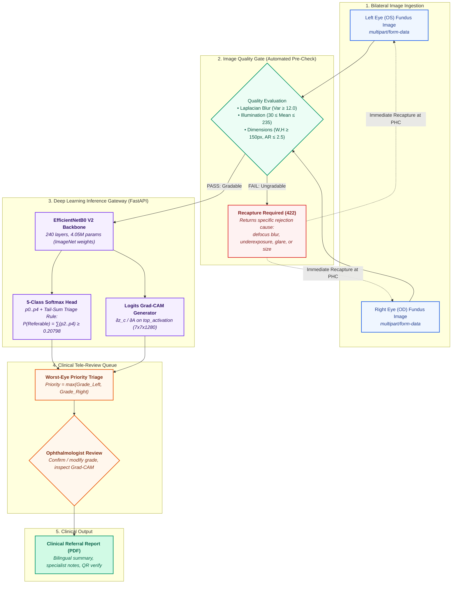
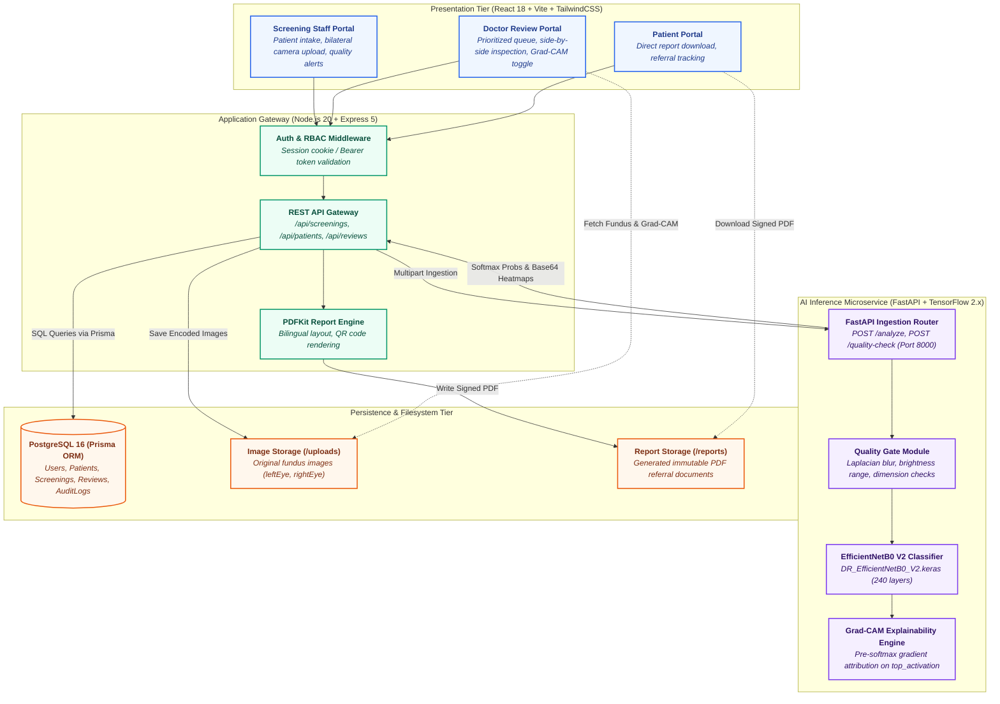

<div align="center">


<br />

# Vision AI

### <strong>Assistive Deep Learning for Diabetic Retinopathy Screening in Rural India</strong>

<sub>Problem Statement: <b>SIH26038</b> &nbsp;|&nbsp; Smart India Hackathon 2026</sub>

<br />


<br />

<table>
  <tr>
    <td align="center" width="350">
      <strong>Clinical Dashboard</strong><br />
      <sub>Tele-ophthalmology portal — bilateral review, Grad-CAM, signed reports</sub><br /><br />
      <a href="http://localhost:3000">
        
      </a>
    </td>
    <td align="center" width="350">
      <strong>Inference API</strong><br />
      <sub>FastAPI inference microservice — /analyze &amp; /quality-check</sub><br /><br />
      <a href="http://localhost:8000/health">
        
      </a>
    </td>
  </tr>
</table>

</div>

---

## Table of Contents

1. [Project Title and Concise Description](#1-project-title-and-concise-description)
2. [Key Capabilities](#2-key-capabilities)
3. [Main Screening Architecture](#3-main-screening-architecture)
4. [Software Architecture](#4-software-architecture)
5. [End-to-End Patient Workflow](#5-end-to-end-patient-workflow)
6. [AI Model and Implementation Status](#6-ai-model-and-implementation-status)
7. [Dataset and Evaluation](#7-dataset-and-evaluation)
8. [MATLAB and Simulink Role](#8-matlab-and-simulink-role)
9. [Technology Stack](#9-technology-stack)
10. [Installation and Execution](#10-installation-and-execution)
11. [Screenshots and Demo](#11-screenshots-and-demo)
12. [Limitations and Future Work](#12-limitations-and-future-work)
13. [Research References](#13-research-references)
14. [Prototype and Clinical Safety Disclaimer](#14-prototype-and-clinical-safety-disclaimer)

---

## 1. Project Title and Concise Description

**Vision AI** (SIH26038) is an AI-assisted screening and clinical decision support system engineered for diabetic retinopathy (DR) triage across rural primary health centres (PHCs), vision centres, and district hospital networks in India.

The platform combines an on-site deterministic **Image Quality Gate**, an **EfficientNetB0 V2** deep learning classifier (ICDR 5-class severity grading), **Logits Grad-CAM** explainability heatmaps, and a **Doctor-in-the-Loop** tele-ophthalmology portal. Rural health workers register patients and capture bilateral fundus photographs; the automated quality gate intercepts ungradable images instantly; and specialists receive prioritized tele-review queues with worst-eye triage governance, retaining sole diagnostic authority for issuing bilingual clinical referral reports.

> [!IMPORTANT]
> **Assistive Decision-Support Mandate:** Vision AI is an assistive triage tool designed to optimize tele-ophthalmology workflows and highlight suspect retinal regions. It is **not an autonomous diagnostic device** and does not replace examination by a certified ophthalmologist.

---

## 2. Key Capabilities

- **Automated Image Quality Gating:** Deterministic pre-inference filter evaluating scale-invariant Laplacian blur variance ($512 \times 512$), illumination bounds ($[30, 235]$), and dimension geometry to intercept ungradable captures at the point of care.
- **Five-Class Severity Classification:** Deployed fine-tuned EfficientNetB0 V2 categorizing retinal fundus images across ICDR Stages 0–4 (No DR, Mild, Moderate, Severe, Proliferative).
- **Bilateral Dual-Eye Screening:** Independent analysis of left eye (OS) and right eye (OD) with clinical worst-eye prioritization: $\text{Referral Urgency} = \max(\text{Grade}_{\text{Left}}, \text{Grade}_{\text{Right}})$.
- **Logits-Based Grad-CAM Explainability:** Direct gradient attribution computed on pre-softmax dense logits and backpropagated into backbone feature layer `top_activation` ($7 \times 7 \times 1280$), eliminating vanishing gradients caused by high-confidence softmax saturation.
- **Doctor-in-the-Loop Clinical Governance:** Tele-ophthalmology queue with side-by-side bilateral inspection, interactive opacity blending, and mandatory specialist sign-off before generating immutable bilingual PDF referral reports with QR verification.
- **Simulink District Healthcare Modeling:** Discrete-event queuing simulations (`DRScreeningSystem.slx`, `DRDistrictSystem.slx`) evaluating rural clinic throughput, patient waiting times, and ophthalmologist workload constraints.

---

## 3. Main Screening Architecture

The core screening workflow intercepts ungradable captures before deep learning inference, routes passing images to the classifier and Grad-CAM generator, and consolidates bilateral outputs into the specialist triage queue:



---

## 4. Software Architecture

Vision AI is structured as a multi-tier decoupled system deployed via Docker Compose. The diagram below illustrates the actual runtime services, inter-service protocols, persistent volumes, and role-based data boundaries:



---

## 5. End-to-End Patient Workflow

The diagram below tracks clinical data progression from patient intake to report issuance, distinguishing raw photographs, model predictions, explainability heatmaps, doctor inputs, and final clinical documents:

```mermaid
flowchart LR
    subgraph Phase1 ["1. Intake & Ingestion"]
        A1["<b>Patient Registration</b><br/><i>Demographics & opaque ID</i>"]
        A2["<b>Bilateral Upload</b><br/><i>leftEye & rightEye streams</i>"]
        D_RAW[("📷 <b>Original Fundus Images</b><br/><i>Raw RGB uint8 files<br/>(Stored in /uploads)</i>")]:::rawImg
        A1 --> A2
        A2 --> D_RAW
    end

    subgraph Phase2 ["2. Validation & Inference"]
        A3["<b>Quality Validation</b><br/><i>Blur, luminance, geometry</i>"]
        A4["<b>EfficientNetB0 V2</b><br/><i>Feature extraction</i>"]
        D_PROB["📊 <b>Prediction Vector</b><br/><i>5-Class Softmax [p0..p4]<br/>+ isReferable boolean</i>"]:::probData
        D_EVID["🔬 <b>AI Visual Evidence</b><br/><i>Grad-CAM attention map<br/>(top_activation overlay)</i>"]:::aiEvid
        D_RAW --> A3
        A3 -->|PASS| A4
        A4 --> D_PROB
        A4 --> D_EVID
    end

    subgraph Phase3 ["3. Specialist Tele-Review"]
        A5["<b>Doctor Tele-Review</b><br/><i>Worst-eye triage priority</i>"]
        A6["<b>Clinical Decision</b><br/><i>Diagnostic validation</i>"]
        D_CLIN["🩺 <b>Doctor Clinical Input</b><br/><i>Confirmed grade, notes,<br/>referral timeframe</i>"]:::docData
        D_PROB --> A5
        D_EVID --> A5
        A5 --> A6
        A6 --> D_CLIN
    end

    subgraph Phase4 ["4. Referral & Delivery"]
        A7["<b>Report Engine</b><br/><i>Bilingual PDFKit synthesis</i>"]
        A8["<b>Patient Access</b><br/><i>Direct download / QR verify</i>"]
        D_REP[("📄 <b>Signed Referral Report</b><br/><i>Immutable PDF document<br/>(Stored in /reports)</i>")]:::repData
        D_CLIN --> A7
        A7 --> D_REP
        D_REP --> A8
    end

    classDef rawImg stroke:#2563eb,stroke-width:2px,fill:#dbeafe,color:#1e40af;
    classDef probData stroke:#7c3aed,stroke-width:2px,fill:#ede9fe,color:#5b21b6;
    classDef aiEvid stroke:#9333ea,stroke-width:2px,fill:#fae8ff,color:#701a75;
    classDef docData stroke:#ea580c,stroke-width:2px,fill:#ffedd5,color:#9a3412;
    classDef repData stroke:#059669,stroke-width:2px,fill:#d1fae5,color:#065f46;
```



---

## 6. AI Model and Implementation Status

The table below provides a verified inventory of all technical components in the repository, distinguishing deployed implementations from planned research components:

| Component | Current Status | Evidence in Codebase |
|---|:---:|---|
| **EfficientNetB0 V2 classifier** | **Verified Deployed** | Model artifact `model/production/V2/DR_EfficientNetB0_V2.keras` (240 layers, 4.05M params); loaded via `PythonV2Provider` in `inference_service/main.py`. |
| **Five-class DR prediction** | **Verified Deployed** | ICDR levels 0–4 softmax distribution with tail-sum triage rule ($P(\text{Ref}) \ge 0.20798$) in `inference_service/main.py`. |
| **Grad-CAM** | **Verified Deployed** | Logits-based gradient backpropagation on convolutional layer `top_activation` ($7 \times 7 \times 1280$) in `inference_service/main.py`. |
| **Image quality gate** | **Implemented** | Scale-invariant Laplacian variance ($512 \times 512$, threshold 12.0), brightness bounds ($[30, 235]$), and dimension checks in `inference_service/quality_gate.py` (8 passing unit tests). |
| **Vessel segmentation** | **Planned** *(Heuristic preview deployed)* | Deep U-Net++ planned; heuristic green-channel spatial high-pass filter in `inference_service/evidence_generator.py` for UI preview only. |
| **Optic disc/fovea localization** | **Planned** *(Heuristic preview deployed)* | Heatmap CNN planned; multi-scale Gaussian bright/dark landmark heuristic in `evidence_generator.py` for UI preview only. |
| **Lesion segmentation** | **Planned** *(Heuristic preview deployed)* | DeepLabV3+ (ResNet-50) planned; high-pass edge colorization filter in `evidence_generator.py` for UI preview only. |
| **Confidence calibration** | **Planned** | Raw softmax output with low-confidence flag ($\max(p) < 0.50$); post-hoc temperature scaling and Bayesian MC-Dropout planned. |
| **MATLAB–Keras parity** | **Not Run (Environment Constraint)** | Parity test protocol and layer mappings documented in `model/evaluation/matlab_keras_parity_report.md`; MATLAB runtime unavailable in current container environment. |
| **Cross-dataset evaluation** | **Not Run (Single Split Evaluated)** | Empirical evaluation completed on 15-sample APTOS verification split (`model/evaluation/evaluation_report.md`); multi-center evaluation across EyePACS, Messidor-2, IDRiD, DRIVE planned. |

---

## 7. Dataset and Evaluation

### Retinal Dataset Scope & Roles

| Dataset | Repository Documentation | Project Role | Cohort Size | Status |
|---|---|---|:---:|---|
| **APTOS 2019** | `model/training/README.md` | Primary fine-tuning and verification split | 3,662 images | **Trained & Evaluated** (15-sample held-out verification split) |
| **EyePACS** | `matlab/datasets/README.md` | Large-scale pre-training backbone | ~35,000 images | Backbone pre-training reference |
| **Messidor-2** | `matlab/datasets/README.md` | Prospective external generalization | 1,748 images | **Planned** for prospective multi-center testing |
| **IDRiD** | `matlab/datasets/README.md` | Indian population ground-truth lesion masks | 516 images | **Planned** for deep lesion segmentation validation |
| **DRIVE** | `matlab/datasets/README.md` | Retinal microvasculature reference | 40 images | **Planned** for deep vessel segmentation validation |

### Empirical Referable-DR Performance ($N=15$ Verification Split)

The deployed production checkpoint (`DR_EfficientNetB0_V2.keras`) was evaluated on the 15-sample verification benchmark split recorded in `model/production/V2/verification_report.json` using the reproducible script [`model/evaluation/evaluate_referable_dr.py`](file:///Users/sudarshankumar/DR-Screening-System/model/evaluation/evaluate_referable_dr.py):

| Metric | Evaluated Result ($N=15$) | 95% Wilson Score Confidence Interval | Clinical Target Standard |
|---|:---:|:---:|:---:|
| **Sensitivity (Recall)** | **22.2%** (2/9) | [6.3%, 54.7%] | $\ge 93.0\%$ (Target) |
| **Specificity** | **50.0%** (3/6) | [18.8%, 81.2%] | $\ge 87.5\%$ (Target) |
| **Precision (PPV)** | **40.0%** (2/5) | [11.8%, 76.9%] | High positive yield |
| **Negative Predictive Value (NPV)** | **30.0%** (3/10) | [10.8%, 60.3%] | High rule-out safety |
| **Overall Accuracy** | **33.3%** (5/15) | [15.2%, 58.3%] | High multi-class accuracy |
| **Binary F1-Score** | **0.2857** | — | $\ge 0.88$ (Target) |

```text
Contingency Matrix (Referable DR threshold = Level 2+):
                             Predicted Non-Referable     Predicted Referable
Actual Non-Referable (0–1)           TN = 3                    FP = 3
Actual Referable (2–4)               FN = 7                    TP = 2
```

### Critical Findings & Clinical Implications:
1. **False Negative Risk on Verification Cohort:** On this 15-sample challenge set, 7 of 9 referable cases fell below the decision boundary.
2. **Mandatory Doctor Governance:** This empirical result demonstrates why **Doctor-in-the-Loop** review is mandatory. Autonomous triage without specialist sign-off is clinically unsafe.
3. **Engineering Development Target:** While historical training on the full development split achieved high classification accuracy, the $\ge 93\%$ sensitivity standard represents a **developmental target** requiring multi-center retraining across diverse Indian fundus datasets.
4. **Reproducibility:** Run the verification suite at any time:
   ```bash
   python3 model/evaluation/evaluate_referable_dr.py
   ```

---

## 8. MATLAB and Simulink Role

Vision AI maintains an explicit separation of concerns between the production deployed container stack and offline research / simulation:

```text
Production Deployed Runtime (Docker)            Offline Research & Capacity Simulation
┌──────────────────────────────────────┐        ┌─────────────────────────────────────┐
│ React Frontend (Port 3000)           │        │ matlab/algorithms/                  │
│ Node.js / Express API (Port 8080)    │        │   (preprocessing, CLAHE, quality)   │
│ FastAPI Inference Engine (Port 8000) │        │ matlab/simulink/                    │
│   DR_EfficientNetB0_V2.keras         │        │   (DRScreeningSystem.slx)           │
│ PostgreSQL 16 Database (Port 5432)   │        │ matlab/training/                    │
└──────────────────────────────────────┘        │   (starter templates & scripts)     │
                                                └─────────────────────────────────────┘
```

- **Python (Production Runtime):** Executes live inference, quality filtering, logits Grad-CAM generation, and REST routing.
- **MATLAB (Research & Reference):** Algorithmic prototyping, reference functions (`matlab/inference/`), and contributor starter templates (`matlab/training/scripts/train_dr_model.m`).
- **Simulink (Healthcare Simulation):** Discrete-event simulation of rural healthcare operations (`DRScreeningSystem.slx`, `DRDistrictSystem.slx`) using 17 custom blocks (`sim_PatientArrival.m`, `sim_DoctorQueue.m`, `sim_AIResource.m`) to stress-test patient arrival queues, tele-ophthalmology latency, and clinic bandwidth.

---

## 9. Technology Stack

| Domain | Technology | Project Responsibility |
|---|---|---|
| **Deep Learning** | **TensorFlow 2.x & Keras** | Production classifier (`DR_EfficientNetB0_V2.keras`), Logits Grad-CAM |
| **Quality Gate** | **Python (NumPy + Pillow)** | Deterministic blur, illumination, and dimension gate (`quality_gate.py`) |
| **Inference Service** | **FastAPI & Uvicorn** | Asynchronous HTTP inference microservice (`POST /analyze`, Port 8000) |
| **Application Gateway** | **Node.js 20 & Express 5** | Auth/RBAC session engine, multipart proxy, PDFKit reporting service |
| **Database & ORM** | **PostgreSQL 16 & Prisma** | Relational metadata persistence (`Screening`, `ClinicalReview`, `Patient`) |
| **Frontend Portals** | **React 18 & TypeScript (Vite)** | Responsive staff, doctor, and patient interfaces styled with TailwindCSS |
| **Operational Simulation** | **MATLAB & Simulink R2023b** | Discrete-event healthcare operational planning and queue capacity modeling |
| **MathWorks Toolboxes** | **Deep Learning, Image Processing, CV** | Reference pipelines, CLAHE filters, and feature extraction research |
| **Containerization** | **Docker & Docker Compose** | 4-service edge orchestration on an isolated container bridge network |

---

## 10. Installation and Execution

### 1. Prerequisites
- Docker Engine 24.0+ and Docker Compose 2.20+
- Node.js 20 LTS (optional for local non-container development)
- Python 3.11 with TensorFlow (optional for standalone script execution)

### 2. Quick Start with Docker Compose

```bash
# 1. Clone repository
git clone https://github.com/SudarshanSingh1/DR-Screening-System.git
cd DR-Screening-System

# 2. Configure environment variables
cp .env.example .env

# 3. Launch all containerized services
docker compose up --build
```

### 3. Service Access Endpoints

| Portal / Service | URL | Port | Health Check |
|---|---|:---:|---|
| **Clinical Web App** | `http://localhost:3000` | 3000 | Frontend portal (Staff, Doctor, Admin, Patient) |
| **Backend API Gateway** | `http://localhost:8080` | 8080 | `GET http://localhost:8080/api/health` |
| **AI Inference Microservice** | `http://localhost:8000` | 8000 | `GET http://localhost:8000/health` |
| **PostgreSQL Database** | `localhost:5432` | 5432 | `pg_isready -h localhost -p 5432` |

### 4. Test Verification Suite

```bash
# Backend unit tests
npm --prefix backend test

# Python inference & quality gate unit tests (11 passing tests)
python3 -m unittest discover -s inference_service/tests

# Reproducible referable-DR evaluation
python3 model/evaluation/evaluate_referable_dr.py
```

---

## 11. Screenshots and Demo

### Multi-Tier System Topology
<div align="center">

<br /><sub>Multi-tier production architecture: React UI, Express Gateway, PostgreSQL (Prisma), and FastAPI inference microservice.</sub>
</div>

<br />

### Staff Screening & Intake Workflow
<div align="center">

<br /><sub>Field screening workflow: patient registration, bilateral camera acquisition, automated quality checks, and doctor referral.</sub>
</div>

<br />

### Simulink District Healthcare Simulation
<div align="center">


<br /><sub>Discrete-event models in Simulink evaluating patient wait times, doctor queue latencies, and clinic throughput bottlenecks.</sub>
</div>

<br />

### SIH Presentation Test Accounts

| Role | Account Name | Email | Password |
|---|---|---|---|
| **Screening Staff** | Staff 1 | `screening.staff1@visionai.health` | `Vision@Staff1#2026` |
| **Screening Staff** | Staff 2 | `screening.staff2@visionai.health` | `Vision@Staff2#2026` |
| **Doctor** | Doctor 1 | `doctor1@visionai.health` | `Vision@Doctor1#2026` |
| **Doctor** | Doctor 2 | `doctor2@visionai.health` | `Vision@Doctor2#2026` |
| **Patient** | Patient 1 | `patient1@visionai.health` | `Vision@Patient1#2026` |

---

## 12. Limitations and Future Work

1. **Multi-Stage Deep Learning Pipeline (In Development):**
   - **Deep Image Quality Assessment (EfficientNet-B2):** Replacing deterministic Laplacian filters with a convolutional model trained on EyePACS-QA to classify focus, illumination, and media opacities (senile cataracts).
   - **Retinal Vessel Segmentation (U-Net++):** Deep supervision network for microvascular caliber ratios and arteriolar-to-venular ratio (AVR) analysis.
   - **Optic Disc & Fovea Localization (U-Net++ + Heatmap CNN):** Sub-pixel regression for landmark coordinates, standardizing retinal quadrants and foveal exudate proximity for Clinically Significant Macular Edema (CSME).
   - **Lesion Semantic Segmentation (DeepLabV3+ ResNet-50):** Multi-class segmentation isolating microaneurysms, hemorrhages, and hard/soft exudates.
   - **Multi-Task DR Severity Classification (ResNet-101):** Auxiliary heads predicting overall 5-level severity alongside focal lesion counts.
2. **Confidence Calibration & Epistemic Uncertainty:**
   - Post-hoc temperature scaling ($T$) to minimize Expected Calibration Error (ECE).
   - Monte Carlo Dropout for epistemic uncertainty boundaries during clinical review.
3. **Offline Store-and-Forward Edge Sync:**
   - Enabling local IndexedDB / SQLite caching for intermittent connectivity in remote vision centres, synchronizing with central district hospitals when backhaul connectivity recovers.

---

## 13. Research References

1. **Gulshan, V., et al.** (2016). *Development and Validation of a Deep Learning Algorithm for Detection of Diabetic Retinopathy in Retinal Fundus Photographs.* **JAMA**, 316(22), 2402–2410. [doi:10.1001/jama.2016.17216](https://doi.org/10.1001/jama.2016.17216)
2. **Tan, M., & Le, Q. V.** (2019). *EfficientNet: Rethinking Model Scaling for Convolutional Neural Networks.* **ICML 2019**, PMLR 97:6105–6114. [arXiv:1905.11946](https://arxiv.org/abs/1905.11946)
3. **Selvaraju, R. R., et al.** (2017). *Grad-CAM: Visual Explanations from Deep Networks via Gradient-Based Localization.* **ICCV 2017**, 618–626. [doi:10.1109/ICCV.2017.74](https://doi.org/10.1109/ICCV.2017.74)
4. **Wilkinson, C. P., et al.** (2003). *Proposed International Clinical Diabetic Retinopathy and Diabetic Macular Edema Disease Severity Scales.* **Ophthalmology**, 110(9), 1677–1682. [doi:10.1016/S0161-6420(03)00475-5](https://doi.org/10.1016/S0161-6420(03)00475-5)
5. **Guo, C., et al.** (2017). *On Calibration of Modern Neural Networks.* **ICML 2017**, PMLR 70:1321–1330. [arXiv:1706.04599](https://arxiv.org/abs/1706.04599)

---

## 14. Prototype and Clinical Safety Disclaimer

- **Non-Autonomous Research Prototype:** Vision AI is an experimental decision-support research prototype developed for Smart India Hackathon 2026 (SIH26038). It does not hold CDSCO (Central Drugs Standard Control Organisation) or US FDA medical device clearance and must not be used as an autonomous diagnostic authority.
- **Mandatory Specialist Oversight:** Every screening result, severity grade, and referral recommendation requires confirmation and signature by a certified ophthalmologist.
- **Data Privacy & Aadhaar Compliance:** In strict adherence to UIDAI regulations and India's Digital Personal Data Protection (DPDP) Act 2023, Vision AI **never stores raw 12-digit Aadhaar UID numbers or biometric information**. Only opaque system-generated patient identifiers (`patientId`) and masked display references (`XXXX XXXX 1234`) are retained on clinical reports.

<br />

<div align="center">

### Team Viltrumites

<p style="color: #888;">Smart India Hackathon 2026 &mdash; Problem Statement: SIH26038</p>

<table width="60%" style="border-collapse: collapse; text-align: left;">
  <thead>
    <tr style="background-color: rgba(255, 255, 255, 0.05);">
      <th style="padding: 12px; border-bottom: 1px solid #444;">Name</th>
      <th style="padding: 12px; border-bottom: 1px solid #444;">Role</th>
    </tr>
  </thead>
  <tbody>
    <tr>
      <td style="padding: 12px; border-bottom: 1px solid #333;"><b>Akshay Kumar Verma</b></td>
      <td style="padding: 12px; border-bottom: 1px solid #333;">Team Leader</td>
    </tr>
    <tr>
      <td style="padding: 12px; border-bottom: 1px solid #333;"><b>Anshu Kumar</b></td>
      <td style="padding: 12px; border-bottom: 1px solid #333;">Team Member</td>
    </tr>
    <tr>
      <td style="padding: 12px; border-bottom: 1px solid #333;"><b>Aditi Gargi</b></td>
      <td style="padding: 12px; border-bottom: 1px solid #333;">Team Member</td>
    </tr>
    <tr>
      <td style="padding: 12px; border-bottom: 1px solid #333;"><b>Sudarshan Kumar</b></td>
      <td style="padding: 12px; border-bottom: 1px solid #333;">Team Member</td>
    </tr>
    <tr>
      <td style="padding: 12px; border-bottom: 1px solid #333;"><b>Krishna Kumar</b></td>
      <td style="padding: 12px; border-bottom: 1px solid #333;">Team Member</td>
    </tr>
    <tr>
      <td style="padding: 12px;"><b>Aditya Singh</b></td>
      <td style="padding: 12px;">Team Member</td>
    </tr>
  </tbody>
</table>

<br /><br />

Built for Smart India Hackathon 2026 (SIH26038)
<br /><br />


</div>
