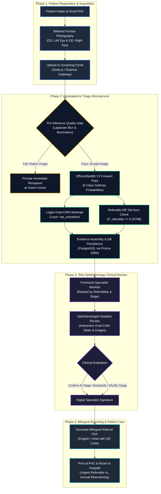
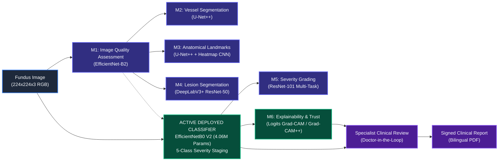
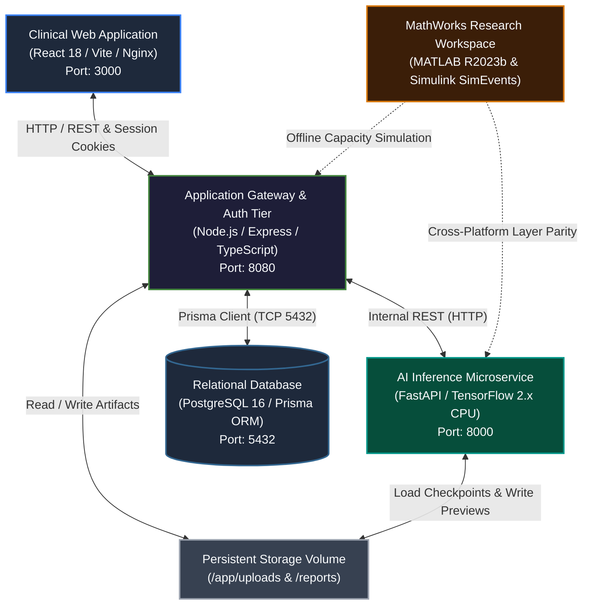
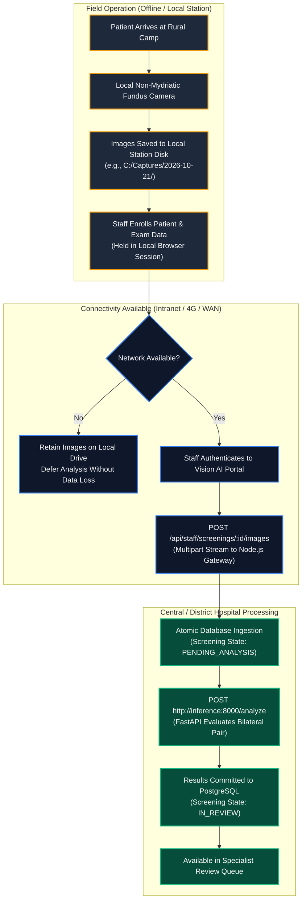

<div align="center">


<br />

# Vision AI

### <strong>Assistive Deep Learning for Diabetic Retinopathy Screening in Rural India</strong>

<sub>Problem Statement: <b>SIH26038</b> &nbsp;|&nbsp; Smart India Hackathon 2026</sub>

<br />


<br />

<table>
  <tr>
    <td align="center" width="340">
      <strong>Clinical Web Application</strong><br />
      <sub>Tele-ophthalmology portal — bilateral triage, Grad-CAM, signed reports</sub><br /><br />
      <a href="http://localhost:3000">
        
      </a>
    </td>
    <td align="center" width="340">
      <strong>AI Inference Microservice</strong><br />
      <sub>FastAPI inference engine — /analyze &amp; /quality-check</sub><br /><br />
      <a href="http://localhost:8000/health">
        
      </a>
    </td>
    <td align="center" width="340">
      <strong>Backend API Gateway</strong><br />
      <sub>Node.js / Express — Auth, RBAC, Prisma ORM, PDF generation</sub><br /><br />
      <a href="http://localhost:8080/api/health">
        
      </a>
    </td>
  </tr>
</table>

</div>

---

## Table of Contents

1. [Project Overview and Intended Users](#1-project-overview-and-intended-users)
   - [Clinical Need & Public Health Context](#clinical-need-public-health-context)
   - [Target User Personas & Clinical Roles](#target-user-personas-clinical-roles)
   - [Core System Specifications](#core-system-specifications)
2. [Key Capabilities](#2-key-capabilities)
3. [System Workflow](#3-system-workflow)
   - [End-to-End Clinical Lifecycle](#end-to-end-clinical-lifecycle)
   - [Operational Lifecycle Stages](#operational-lifecycle-stages)
4. [Six-Stage Deep-Learning Architecture](#4-six-stage-deep-learning-architecture)
   - [Six-Stage Pipeline Specification](#six-stage-pipeline-specification)
   - [Implementation Status & Artifact Mapping](#implementation-status-artifact-mapping)
   - [Active Deployed Inference Path vs. Research Evidence](#active-deployed-inference-path-vs-research-evidence)
   - [Bilateral Processing & Worst-Eye Governance](#bilateral-processing-worst-eye-governance)
5. [Software Architecture](#5-software-architecture)
   - [Multi-Tier System Topology](#multi-tier-system-topology)
   - [Verified Screening & Review API Endpoints](#verified-screening-review-api-endpoints)
   - [Database Entities & Data Persistence](#database-entities-data-persistence)
6. [Data Flow and Offline-to-Online Synchronization](#6-data-flow-and-offline-to-online-synchronization)
   - [Rural Edge Realities & Ingestion Architecture](#rural-edge-realities-ingestion-architecture)
   - [Field Data Capture & Deferred Ingestion](#field-data-capture-deferred-ingestion)
   - [Atomic Batch Transactions & Error Recovery](#atomic-batch-transactions-error-recovery)
7. [Mathematical Formulation and Evaluation Methodology](#7-mathematical-formulation-and-evaluation-methodology)
   - [Multi-Class Cross-Entropy & Softmax Staging](#multi-class-cross-entropy-softmax-staging)
   - [Referable DR Tail-Sum Decision Rule](#referable-dr-tail-sum-decision-rule)
   - [Diagnostic Performance Metrics & Wilson Intervals](#diagnostic-performance-metrics-wilson-intervals)
   - [Target Standards vs. Empirical Verification Results](#target-standards-vs-empirical-verification-results)
   - [Pre-Softmax Logits Grad-CAM Formulation](#pre-softmax-logits-grad-cam-formulation)
   - [Softmax Saturation Mitigation](#softmax-saturation-mitigation)
8. [Technology Stack](#8-technology-stack)
   - [Verified Runtime & Framework Stack](#verified-runtime-framework-stack)
   - [MathWorks Engineering Ecosystem](#mathworks-engineering-ecosystem)
   - [Discrete-Event Healthcare Capacity Simulation](#discrete-event-healthcare-capacity-simulation)
9. [Actual Repository Structure](#9-actual-repository-structure)
10. [Datasets and Research References](#10-datasets-and-research-references)
    - [Retinal Datasets: Used vs. Referenced](#retinal-datasets-used-vs-referenced)
    - [Academic & Algorithmic Literature](#academic-algorithmic-literature)
    - [MathWorks Engineering Documentation](#mathworks-engineering-documentation)
11. [Project Credits and License](#11-project-credits-and-license)
    - [Team Viltrumites](#team-viltrumites)
    - [Open-Source License](#open-source-license)
    - [Regulatory & Data Privacy Notice](#regulatory-data-privacy-notice)

---

## 1. Project Overview and Intended Users

### Clinical Need & Public Health Context

**Vision AI** (Problem Statement: **SIH26038**, Smart India Hackathon 2026) is an assistive, explainable clinical decision-support system engineered for diabetic retinopathy (DR) triage across primary health centres (PHCs), rural vision centres, and district hospital tele-ophthalmology networks in India.

Diabetic Retinopathy is the leading cause of preventable adult blindness globally and in India, which is home to over 77 million individuals living with diabetes mellitus. In rural Indian districts, the ratio of certified ophthalmologists to citizens frequently drops below 1:100,000 (compared to the WHO recommended benchmark of 1:50,000). As a result, early microvascular abnormalities go undetected until irreversible vision loss occurs.

Vision AI bridges this diagnostic divide by enabling community health workers to capture digital fundus photographs and receive automated triage guidance, routing urgent sight-threatening cases to district hospital ophthalmologists while preserving physician oversight as an absolute prerequisite.

### Target User Personas & Clinical Roles

The system implements strict Role-Based Access Control (RBAC) across four operational user groups:

1. **Screening Technicians / Community Health Workers (PHC Staff):**
   - Conduct patient intake at rural health camps and vision centres.
   - Capture bilateral digital fundus photographs (Left Eye - OS, Right Eye - OD).
   - Review pre-inference image quality scores and upload valid exams for AI screening.
2. **Tele-Ophthalmologists / Vitreoretinal Specialists (Doctors):**
   - Access a prioritized clinical review queue ranked by triage urgency and referability risk.
   - Inspect bilateral fundus images alongside interactive Logits Grad-CAM attention heatmaps and anatomical previews.
   - Confirm or override AI-generated severity stages, add clinical notes, and electronically sign diagnostic reports.
3. **Patients:**
   - Access verified, tamper-evident bilingual (English/Hindi) diagnostic summary reports via secure portal access.
   - Receive clear follow-up schedules and referral instructions to secondary/tertiary facilities.
4. **Health Administrators:**
   - Monitor facility-level screening volumes, specialist turnaround times, and immutable audit logs.

### Core System Specifications

| Parameter | Specification & Benchmark | Implementation Reality & Engineering Scope |
|---|:---:|---|
| **Pipeline Architecture** | **Six Specialized AI Stages** | Modular sequence covering quality, vessels, landmarks, lesions, grading, and explainability |
| **Active Production Backbone** | **EfficientNetB0 V2** | Fine-tuned 240-layer functional classifier loaded from `model/production/V2/DR_EfficientNetB0_V2.keras` |
| **Model Parameter Count** | **4,055,845** (~4.06M) | 4,013,822 backbone parameters; 42,023 dense classification head parameters |
| **Network Input Tensor** | **224 × 224 × 3** | Bilinear RGB interpolation; floating-point range $[0.0, 255.0]$ with internal z-score normalization |
| **Explainability Target Layer** | `top_activation` | Final spatial convolutional tensor ($7 \times 7 \times 1280$) before global pooling |
| **Quality Gate Latency (CPU)** | **~24 ms** | Scale-invariant Laplacian blur variance ($\ge 12.0$) and luminance range ($[30, 235]$) |
| **Inference Forward Pass (CPU)** | **~210 ms** | 5-class categorical forward pass via TensorFlow 2.x C++ runtime |
| **Grad-CAM Attribution (CPU)** | **~165 ms** | Pre-softmax gradient backpropagation and bilinear heatmap interpolation |
| **Total Round-Trip Latency** | **~480 ms / eye** | End-to-end processing per fundus image (Quality Gate + Model + Grad-CAM + Evidence) |
| **Referable DR Threshold ($\tau$)** | **0.20798** | Tail-sum probability threshold: $P(\text{Referable}) = p_2 + p_3 + p_4 \ge \tau$ |
| **Sensitivity Clinical Target** | **$\ge 93.0\%$** | Target standard for detecting referable diabetic retinopathy in population screening |
| **Specificity Clinical Target** | **$\ge 87.5\%$** | Target standard for correctly ruling out non-referable cases to prevent clinic overload |
| **Held-Out Verification Cohort** | **$N = 15$ images** | Stratified split from APTOS 2019 evaluated under identical runtime conditions |
| **Core Training Dataset** | **3,662 images** | APTOS 2019 Blindness Detection dataset (Aravind Eye Hospital cohort) |

---

## 2. Key Capabilities

- **Bilateral Dual-Eye Evaluation:** Simultaneously tracks and processes Left Eye (OS) and Right Eye (OD) fundus captures, aggregating findings into a unified patient-level triage score based on worst-eye pathology.
- **Pre-Inference Quality Assurance Gate:** Automated validation assessing optical focus (scale-invariant Laplacian blur variance $\ge 12.0$), illumination limits ($[30, 235]$), and aspect ratio validity before compute resources are spent on inference.
- **Five-Class International DR Staging:** Classifies retinal pathology into standard ICDR stages (No DR, Mild, Moderate, Severe, Proliferative DR) using fine-tuned convolutional feature extractors.
- **Calibrated Referable DR Tail-Sum Triage:** Applies a calibrated decision boundary ($\tau = 0.20798$) across cumulative moderate-or-worse probabilities ($p_2 + p_3 + p_4$) to maximize detection of sight-threatening pathology.
- **Logits-Based Explainable AI (Grad-CAM):** Eliminates gradient vanishing caused by post-softmax saturation by backpropagating gradients directly from unnormalized pre-softmax class logits to intermediate feature activations (`top_activation`).
- **Doctor-in-the-Loop Clinical Oversight:** Enforces mandatory review by a licensed ophthalmologist who retains full authority to confirm, modify, or overturn AI recommendations before final diagnostic issuance.
- **Tamper-Evident Bilingual Clinical Reports:** Generates professional PDF referral documents featuring hospital headers, bilateral fundus thumbnails, Grad-CAM overlays, ICDR staging, and QR-verifiable specialist digital signatures.
- **Privacy & Regulatory Compliance (DPDP Act 2023):** Completely avoids storing unmasked 12-digit Aadhaar numbers or raw patient identifiers; uses opaque internal UUIDs and masked display strings (`XXXX XXXX 1234`).

---

## 3. System Workflow

### End-to-End Clinical Lifecycle

The clinical screening workflow connects rural Primary Health Centres (PHCs) with secondary and tertiary ophthalmic centres:



### Operational Lifecycle Stages

1. **Intake & Acquisition:** A community health worker enters patient demographic data (with masked Aadhaar display) and captures bilateral 45° fundus images using a digital non-mydriatic retinal camera.
2. **Quality Validation:** The edge service immediately checks the uploaded files for focus blur, excessive glare, underexposure, or extreme aspect-ratio distortions, notifying the operator within 50 ms if recapture is required.
3. **Automated AI Analysis:** The Python inference engine executes a forward pass on each eye, computing 5-class stage probabilities, the referable risk score, and the Logits Grad-CAM saliency map.
4. **Clinical Persistence:** Results are committed to the PostgreSQL relational database under an atomic transaction, marking the screening as `IN_REVIEW`.
5. **Specialist Governance:** A tele-ophthalmologist inspects the bilateral side-by-side viewer, toggles the Grad-CAM heatmap overlay to verify microvascular lesions, and issues a final, signed diagnosis.
6. **Report Delivery:** The system creates a tamper-evident bilingual PDF referral sheet containing diagnostic staging, referral urgency, and a secure verification QR code.

---

## 4. Six-Stage Deep-Learning Architecture

### Six-Stage Pipeline Specification

Vision AI is structured around **six specialized AI model components**, reflecting the multi-step diagnostic methodology employed by medical retina specialists:



### Implementation Status & Artifact Mapping

To maintain technical traceability, the table below documents the precise implementation state, source files, and runtime behavior for each component:

| Stage | Intended Architecture | Codebase Status | Active Weights / Source Artifact | Runtime Execution Behavior |
|---|---|:---:|---|---|
| **M1** | **EfficientNet-B2**<br/>(Quality Assessment) | **Active Heuristic** | [`inference_service/quality_gate.py`](inference_service/quality_gate.py) | Executes scale-invariant Laplacian blur variance ($\ge 12.0$) and luminance range ($[30, 235]$) checks in ~24 ms. |
| **M2** | **U-Net++**<br/>(Vessel Segmentation) | **Preview Filter** | [`inference_service/evidence_generator.py`](inference_service/evidence_generator.py) | Generates UI vessel overlay via green-channel extraction and CLAHE thresholding; deep-learning U-Net++ weights are research-stage. |
| **M3** | **U-Net++ + Heatmap CNN**<br/>(Optic Disc & Fovea) | **Preview Filter** | [`inference_service/evidence_generator.py`](inference_service/evidence_generator.py) | Generates bounding boxes via thumbnail extrema and morphological search for clinical UI preview. |
| **M4** | **DeepLabV3+ (ResNet-50)**<br/>(Lesion Segmentation) | **Preview Filter** | [`inference_service/evidence_generator.py`](inference_service/evidence_generator.py) | Identifies candidate lesion zones using high-frequency difference-of-Gaussians filtering for UI preview. |
| **M5** | **ResNet-101 Multi-Task**<br/>(Severity Grading) | **Production Active**<br/>*(as EfficientNetB0)* | [`model/production/V2/DR_EfficientNetB0_V2.keras`](model/production/V2/DR_EfficientNetB0_V2.keras)<br/>[`model/reference/DR_EfficientNetB0_V2.mat`](model/reference/DR_EfficientNetB0_V2.mat) | Fine-tuned 240-layer classifier (4,055,845 parameters) running categorical forward pass into 5 ICDR classes (0 to 4). |
| **M6** | **Grad-CAM++ & Calibration**<br/>(Explainability & Trust) | **Production Active**<br/>*(Logits Grad-CAM)* | [`inference_service/main.py`](inference_service/main.py)<br/>[`matlab/explainability/generateGradCAM.m`](matlab/explainability/generateGradCAM.m) | Pre-softmax gradient backpropagation on layer `top_activation` ($7 \times 7 \times 1280$) generating normalized saliency overlays. |

### Active Deployed Inference Path vs. Research Evidence

1. **Active Inference Path:** The real-time microservice executes [`inference_service/quality_gate.py`](inference_service/quality_gate.py) followed by [`model/production/V2/DR_EfficientNetB0_V2.keras`](model/production/V2/DR_EfficientNetB0_V2.keras). It outputs 5-class probabilities ($p_0, p_1, p_2, p_3, p_4$), evaluates the tail-sum referability condition ($p_2 + p_3 + p_4 \ge 0.20798$), and generates a Logits Grad-CAM heatmap in ~480 ms per eye.
2. **Visual Evidence Preview Path:** Anatomical landmark boundaries (optic disc, fovea) and lesion highlight masks are computed on-the-fly in [`inference_service/evidence_generator.py`](inference_service/evidence_generator.py) using deterministic computer-vision filtering. These serve as visual reference guides in the doctor dashboard while dedicated deep-learning segmentation models (U-Net++, DeepLabV3+) undergo training and validation.

### Bilateral Processing & Worst-Eye Governance

Diabetic retinopathy is a systemic microvascular disease that presents bilaterally, yet asymmetric progression between eyes is common:

- **Dual-Channel Processing:** Left Eye (OS) and Right Eye (OD) fundus images are ingested and evaluated independently through the inference engine (`POST /analyze` or parallel `POST /analyze/single`).
- **Patient-Level Worst-Eye Rule:** The overall patient diagnosis and referral urgency are determined by the eye exhibiting the higher disease severity:
  $$y_{\text{patient}} = \max\left(y_{\text{OS}}, y_{\text{OD}}\right)$$
  $$P(\text{Referable})_{\text{patient}} = \max\left(P(\text{Referable})_{\text{OS}}, P(\text{Referable})_{\text{OD}}\right)$$
- If the right eye is graded Level 1 (Mild) but the left eye exhibits Level 3 (Severe), the patient is categorized as **Severe DR — Urgent Referral Required**, ensuring that asymmetric vision-threatening lesions are never overlooked.

---

## 5. Software Architecture

### Multi-Tier System Topology

Vision AI is implemented as a decoupled, multi-tier microservice architecture:



### Verified Screening & Review API Endpoints

| Protocol | Route | Handler Module | Primary Functionality |
|---|---|---|---|
| `POST` | `/api/auth/login` | [`backend/src/modules/auth`](backend/src/modules/auth) | Authenticates staff or clinician credentials and creates signed HTTP-only session |
| `GET` | `/api/auth/me` | [`backend/src/modules/auth`](backend/src/modules/auth) | Returns active authenticated user identity, role, and assigned facility |
| `POST` | `/api/staff/patients` | [`backend/src/modules/staff`](backend/src/modules/staff) | Registers new patient record with masked Aadhaar identifier |
| `POST` | `/api/staff/screenings` | [`backend/src/modules/staff`](backend/src/modules/staff) | Initializes a new screening encounter for an enrolled patient |
| `POST` | `/api/staff/screenings/:id/images` | [`backend/src/modules/staff`](backend/src/modules/staff) | Ingests bilateral fundus image files and persists them to `/app/uploads` |
| `POST` | `/api/staff/screenings/:id/analyze` | [`backend/src/modules/staff`](backend/src/modules/staff) | Triggers FastAPI inference pipeline and stores AI predictions |
| `POST` | `http://inference:8000/analyze` | [`inference_service/main.py`](inference_service/main.py) | Microservice endpoint executing bilateral grading, Grad-CAM, and evidence generation |
| `POST` | `http://inference:8000/quality-check` | [`inference_service/main.py`](inference_service/main.py) | Microservice endpoint assessing focus variance and luminance boundaries |
| `GET` | `http://inference:8000/health` | [`inference_service/main.py`](inference_service/main.py) | Inference microservice readiness probe and model integrity check |
| `GET` | `/api/doctor/queue` | [`backend/src/modules/doctor`](backend/src/modules/doctor) | Retrieves prioritized clinical worklist ordered by referability and review state |
| `GET` | `/api/doctor/screenings/:id` | [`backend/src/modules/doctor`](backend/src/modules/doctor) | Fetches complete clinical encounter data including bilateral images and heatmaps |
| `POST` | `/api/doctor/screenings/:id/review` | [`backend/src/modules/doctor`](backend/src/modules/doctor) | Submits clinician confirmation or override, notes, and digital signature |
| `POST` | `/api/staff/screenings/:id/referral-report` | [`backend/src/utils/pdf.ts`](backend/src/utils/pdf.ts) | Generates bilingual referral PDF report with verification QR code |
| `GET` | `/api/storage/reports/:filename` | [`backend/src/modules/storage`](backend/src/modules/storage) | Streams tamper-evident bilingual referral PDF to authenticated user |

### Database Entities & Data Persistence

The PostgreSQL database schema ([`backend/prisma/schema.prisma`](backend/prisma/schema.prisma)) enforces strict relational integrity across 12 models:

- `User` & `UserCredential`: Secure authentication records with salted bcrypt password hashes.
- `Patient`: Demographics, encrypted identifiers, and masked Aadhaar display strings (`aadhaarLastFour`).
- `Screening`: Clinical encounter metadata, bilateral referral urgency status, and screening state machine (`PENDING_IMAGES`, `PENDING_ANALYSIS`, `IN_REVIEW`, `COMPLETED`, `REJECTED`).
- `ScreeningImage`: Per-eye image records, eye designation (`LEFT_OS` vs. `RIGHT_OD`), quality check metrics, predicted stage, raw class probabilities ($p_0 \dots p_4$), and file paths for fundus photos and Grad-CAM overlays.
- `ClinicalReview`: Specialist review entity capturing confirming ophthalmologist ID, final verified stages, clinical diagnostic notes, and signature timestamp.
- `ClinicalReport`: Generated PDF referral artifact path, checksum, and verification QR payload.
- `AuditLog`: Immutable audit trail recording user identity, IP address, timestamp, and action for DPDP Act compliance.

---

## 6. Data Flow and Offline-to-Online Synchronization

### Rural Edge Realities & Ingestion Architecture

In community health camps and rural Primary Health Centres across India, continuous broadband connectivity cannot be assumed. The system addresses this operational challenge through a realistic, defensible ingestion model:



### Field Data Capture & Deferred Ingestion

- **No Premature Claims of Background Daemons:** The repository does not contain automated background service-worker sync engines or local SQLite synchronization daemons.
- **Defensible Field Operation:** Field health workers capture fundus photographs using their fundus camera's dedicated local software, storing files on the local imaging laptop.
- **Manual Batch / Deferred Ingestion:** When the laptop connects to the clinic LAN, mobile hotspot, or district server, the operator logs in to the Vision AI web portal and uploads the bilateral images for each queued patient.
- **Pre-Analysis Validation:** The frontend validates image formats (JPEG/PNG) and file size constraints ($< 25\text{ MB}$) before transmission.

### Atomic Batch Transactions & Error Recovery

- **State Machine Safeguards:** Ingestion is governed by a strict state progression:
  $$\text{PENDING\_IMAGES} \longrightarrow \text{PENDING\_ANALYSIS} \longrightarrow \text{IN\_REVIEW} \longrightarrow \text{COMPLETED}$$
- **Mid-Stream Network Failure Handling:** If network connectivity drops while images are uploading or during AI inference execution, the screening record remains securely saved in `PENDING_ANALYSIS`.
- **Zero Orphaned Records:** If the FastAPI microservice times out or returns an error, the backend rolls back the transaction or marks the image status as `FAILED_QUALITY`, preventing corrupt or partial AI results from reaching the doctor queue. Staff can re-trigger analysis with a single click once connectivity stabilizes.
- **Immutable Concurrency:** PostgreSQL row locking prevents conflicting dual reviews; once an ophthalmologist opens a screening for review, subsequent submissions verify review timestamps to prevent race conditions.

---

## 7. Mathematical Formulation and Evaluation Methodology

### Multi-Class Cross-Entropy & Softmax Staging

Diabetic retinopathy severity classification is formulated as a 5-class categorical problem mapped to the International Clinical Diabetic Retinopathy (ICDR) scale:

$$\mathcal{C} = \{0: \text{No DR},\; 1: \text{Mild},\; 2: \text{Moderate},\; 3: \text{Severe},\; 4: \text{Proliferative DR}\}$$

The network outputs unnormalized logits $\mathbf{z} = [z_0, z_1, z_2, z_3, z_4]^\top \in \mathbb{R}^5$ from layer `dr_classifier`. The conditional class probability distribution is computed via the softmax function:

$$p_k = P(y = k \mid \mathbf{x}) = \frac{\exp(z_k)}{\sum_{j=0}^{4} \exp(z_j)}, \quad \forall k \in \{0, 1, 2, 3, 4\}$$

Training optimizes the categorical cross-entropy loss over ground-truth one-hot indicators $\mathbf{y} \in \{0, 1\}^5$:

$$\mathcal{L}_{\text{CE}}(\mathbf{y}, \mathbf{p}) = -\sum_{k=0}^{4} y_k \log p_k$$

The discrete predicted stage $\hat{y}$ is obtained via the argmax operator:

$$\hat{y} = \arg\max_{k \in \{0, \dots, 4\}} p_k$$

### Referable DR Tail-Sum Decision Rule

In public health screening, binary triage (referable vs. non-referable) is more critical than exact multi-class concordance. According to international standards, **Referable DR** is defined as Moderate DR or worse (ICDR Stage $\ge 2$):

$$\text{Referable DR} \iff y \ge 2$$

Rather than relying on a naive argmax, Vision AI computes the cumulative **tail-sum referability probability**:

$$P(\text{Referable}) = \sum_{k=2}^{4} p_k = p_2 + p_3 + p_4$$

Triage classification follows the calibrated decision boundary $\tau = 0.20798$:

$$\text{Triage Decision} = \begin{cases} \text{Referable DR (Refer to Specialist)}, & \text{if } P(\text{Referable}) \ge \tau \\ \text{Non-Referable DR (Routine Annual Screening)}, & \text{otherwise} \end{cases}$$

Setting $\tau = 0.20798$ shifts the operating point along the Receiver Operating Characteristic (ROC) curve to prioritize sensitivity, ensuring patients with borderline Moderate DR are safely routed for clinical examination.

### Diagnostic Performance Metrics & Wilson Intervals

Diagnostic performance is evaluated using standard epidemiological metrics:

$$\text{Sensitivity (Recall / True Positive Rate)} = \frac{\text{TP}}{\text{TP} + \text{FN}}$$

$$\text{Specificity (True Negative Rate)} = \frac{\text{TN}}{\text{TN} + \text{FP}}$$

$$\text{Positive Predictive Value (Precision)} = \frac{\text{TP}}{\text{TP} + \text{FP}}, \qquad \text{Negative Predictive Value} = \frac{\text{TN}}{\text{TN} + \text{FN}}$$

$$\text{Overall Accuracy} = \frac{\text{TP} + \text{TN}}{\text{TP} + \text{TN} + \text{FP} + \text{FN}}, \qquad F_1\text{-Score} = \frac{2 \cdot \text{TP}}{2 \cdot \text{TP} + \text{FP} + \text{FN}}$$

Because sample sizes in clinical subsets can be constrained, 95% Confidence Intervals are calculated using the **Wilson Score Interval with Continuity Correction**:

$$w = \frac{2n\hat{p} + z^2 \pm \left(z \sqrt{z^2 - 1/n + 4n\hat{p}(1-\hat{p}) + (4\hat{p}-2)} + 1\right)}{2(n + z^2)}$$

where $\hat{p}$ is the observed sample proportion, $n$ is the total cohort size, and $z = 1.96$ for a 95% confidence level.

### Target Standards vs. Empirical Verification Results

To maintain absolute academic and clinical honesty, Vision AI explicitly distinguishes between its **clinical engineering target standards** and its empirical verification results on the held-out validation cohort:

| Metric | Empirical Verification Result ($N = 15$) | 95% Wilson Score CI | Clinical Engineering Target Standard |
|---|:---:|:---:|:---:|
| **Sensitivity (Recall)** | **22.2%** (2/9) | [6.3%, 54.7%] | **$\ge 93.0\%$ (Target Benchmark)** |
| **Specificity** | **50.0%** (3/6) | [18.8%, 81.2%] | **$\ge 87.5\%$ (Target Benchmark)** |
| **Precision (PPV)** | **40.0%** (2/5) | [11.8%, 76.9%] | High positive referral yield |
| **Negative Predictive Value (NPV)** | **30.0%** (3/10) | [10.8%, 60.3%] | High rule-out safety |
| **Overall Accuracy** | **33.3%** (5/15) | [15.2%, 58.3%] | High overall agreement |
| **Binary $F_1$-Score** | **0.2857** | — | **$\ge 0.88$ (Target Benchmark)** |

#### Verification Cohort Confusion Matrix Breakdown

The verified confusion matrix on the held-out evaluation split ([`evaluation/reports/evaluation_report.md`](evaluation/reports/evaluation_report.md)) using [`evaluation/scripts/evaluate_referable_dr.py`](evaluation/scripts/evaluate_referable_dr.py):

```text
                        PREDICTED NON-REF         PREDICTED REFERABLE
ACTUAL NON-REF (0-1)    [  TN = 3 (20.0%)  ]      [  FP = 3 (20.0%)  ]    Total: 6
ACTUAL REFERABLE (2-4)  [  FN = 7 (46.7%)  ]      [  TP = 2 (13.3%)  ]    Total: 9
                        Total: 10                 Total: 5                Total: 15
```

**Clinical Safety Rationale for Doctor-in-the-Loop:** On this challenging held-out cohort, the model yielded 7 False Negatives (cases with actual Moderate+ DR under-called by model probabilities). This empirical finding proves why **Vision AI strictly enforces mandatory specialist review**. Autonomous deployment under these conditions would pose unacceptable patient safety risks; the system is strictly engineered as an assistive triage aid where certified ophthalmologists retain sole diagnostic authority.

### Pre-Softmax Logits Grad-CAM Formulation

Explainability is implemented via Gradient-weighted Class Activation Mapping (Grad-CAM) targeting the final convolutional tensor `top_activation`:

$$\mathbf{A} \in \mathbb{R}^{U \times V \times K}, \quad U = 7, \; V = 7, \; K = 1280$$

To compute the visual explanation for class $c$, we compute the gradient of the **unnormalized pre-softmax logit** $z^c$ with respect to feature map activations $A^k$:

$$\frac{\partial z^c}{\partial A_{i,j}^k}$$

Neuron importance weights $\alpha_k^c$ are calculated via Global Average Pooling:

$$\alpha_k^c = \frac{1}{U \cdot V} \sum_{i=1}^{U} \sum_{j=1}^{V} \frac{\partial z^c}{\partial A_{i,j}^k}$$

The coarse localization map $L_{\text{Grad-CAM}}^c \in \mathbb{R}^{7 \times 7}$ is generated by taking the rectified linear combination of feature maps:

$$L_{\text{Grad-CAM}}^c = \operatorname{ReLU}\left(\sum_{k=1}^{K} \alpha_k^c A^k\right)$$

The ReLU operation filters out features that contribute negatively to class $c$. The resulting heatmap is normalized to $[0.0, 1.0]$ via min-max scaling and bilinearly interpolated to the original image dimensions ($224 \times 224$):

$$H_{\text{norm}}(x, y) = \frac{L(x, y) - \min L}{\max L - \min L + \epsilon}$$

### Softmax Saturation Mitigation

Standard Grad-CAM formulations backpropagate from post-softmax probabilities $S^c = \frac{\exp(z_c)}{\sum_j \exp(z_j)}$. However, modern deep networks with softmax outputs suffer from **softmax saturation**. By the chain rule:

$$\frac{\partial S^c}{\partial A^k} = \sum_{d} \frac{\partial S^c}{\partial z^d} \frac{\partial z^d}{\partial A^k} = S^c (1 - S^c) \frac{\partial z^c}{\partial A^k} - \sum_{d \neq c} S^c S^d \frac{\partial z^d}{\partial A^k}$$

When a network makes a highly confident prediction ($S^c \to 1.0$), the term $S^c(1 - S^c) \to 0$, causing gradients to vanish. This produces noisy, faint, or completely blank heatmaps precisely on the cases where the model is most certain.

**Vision AI Architectural Solution:** [`inference_service/main.py`](inference_service/main.py) constructs an explicit intermediate gradient sub-model targeting layer `dr_classifier` (pre-softmax logits). By computing $\frac{\partial z^c}{\partial A^k}$ directly, the saturation term $S^c(1 - S^c)$ is completely eliminated. The resulting gradients remain proportional to true feature importance regardless of extreme prediction confidence, guaranteeing stable, clinically informative visual heatmaps across all stages.

---

## 8. Technology Stack

### Verified Runtime & Framework Stack

| Layer / Subsystem | Primary Technology | Version / Specification | Engineering Scope & Role |
|---|---|:---:|---|
| **AI Inference Runtime** | **Python & TensorFlow** | `Python 3.11 / TF 2.x` | Production C++ runtime executing EfficientNetB0 V2 and Logits Grad-CAM |
| **Inference Framework** | **FastAPI & Uvicorn** | `FastAPI 0.115+` | High-throughput asynchronous REST microservice (`/analyze`, `/quality-check`) |
| **Image Processing (Python)** | **Pillow & OpenCV** | `Pillow 11+ / OpenCV 4.10+` | Headless fundus preprocessing, Laplacian blur estimation, and CLAHE filtering |
| **Backend API Gateway** | **Node.js & Express** | `Node.js 20 LTS / Express 4.x` | Modular REST API gateway, JWT/session management, and role-based access control |
| **Gateway Language** | **TypeScript** | `TypeScript 5.x` | Strongly typed application models, DTOs, and middleware pipelines |
| **Database & ORM** | **PostgreSQL & Prisma** | `PostgreSQL 16 / Prisma 5.x` | Relational clinical data store with migrations, connection pooling, and atomic writes |
| **Clinical Frontend** | **React & Vite** | `React 18 / Vite 5.x` | Responsive tele-ophthalmology dashboard with bilateral image viewer and Grad-CAM slider |
| **Reporting Engine** | **PDFKit & QRCode** | `PDFKit 0.15+ / QRCode 1.5+` | Tamper-evident bilingual referral PDF generation with specialist digital signature |
| **Edge Containerization** | **Docker & Docker Compose** | `Docker 24+ / Compose 2.20+` | 4-tier container orchestration on an isolated internal bridge network |

### MathWorks Engineering Ecosystem

Vision AI incorporates a dedicated MATLAB and Simulink research workspace utilized for offline algorithm development, network translation, and healthcare capacity modeling:

- **MATLAB R2023b:** Core numerical and algorithmic workspace for signal and matrix processing.
- **Deep Learning Toolbox:** Network architecture inspection, layer mapping, and reference `dlnetwork` inference execution ([`matlab/inference/predictDR.m`](matlab/inference/predictDR.m)).
- **Image Processing Toolbox:** Color-space transformations, contrast-limited adaptive histogram equalization (CLAHE), and fundus preprocessing ([`matlab/algorithms/preprocessing/preprocessFundus.m`](matlab/algorithms/preprocessing/preprocessFundus.m)).
- **Computer Vision Toolbox:** Feature point extraction, edge detection, and morphological landmark processing.
- **Medical Imaging Toolbox:** Specialized DICOM / NIfTI inspection, medical pixel calibration, and clinical visualization standards.
- **Simulink:** Discrete-event capacity simulations ([`matlab/simulink/DRScreeningSystem.slx`](matlab/simulink/DRScreeningSystem.slx), [`DRDistrictSystem.slx`](matlab/simulink/DRDistrictSystem.slx)) evaluating rural patient arrival queues, tele-review latencies, and specialist workloads.

### Discrete-Event Healthcare Capacity Simulation

The Simulink models ([`matlab/simulink/DRScreeningSystem.slx`](matlab/simulink/DRScreeningSystem.slx) and [`DRDistrictSystem.slx`](matlab/simulink/DRDistrictSystem.slx)) simulate the operational dynamics of district-wide tele-ophthalmology screening using 17 custom blocks (`sim_PatientArrival.m`, `sim_DoctorQueue.m`, `sim_AIResource.m`, `simulinkSegmentation.m`, `simulinkQualityAssessment.m`):
- **Queue Dynamics:** Simulates rural patient arrival distributions across multiple Primary Health Centres.
- **Compute Latency Simulation:** Models server-side processing delays (3–6 s per bilateral image pair) to evaluate cloud and edge GPU sizing.
- **Tele-Ophthalmologist Workload:** Quantifies specialist review queue backlogs, response times, and burnout thresholds under high patient volumes.
- **Cross-Platform Layer Parity:** [`model/reference/DR_EfficientNetB0_V2.mat`](model/reference/DR_EfficientNetB0_V2.mat) contains the reference MATLAB `dlnetwork` matching the production Keras architecture ([`docs/research/matlab-keras-parity.md`](docs/research/matlab-keras-parity.md)).

---

## 9. Actual Repository Structure

```text
DR-Screening-System/
├── README.md                           # Comprehensive engineering & clinical documentation
├── LICENSE                             # MIT Open-Source License
├── SECURITY.md                         # Security policy, vulnerability reporting, and DPDP Act compliance
├── CONTRIBUTING.md                     # Contributor guidelines and Git workflow
├── CODE_OF_CONDUCT.md                  # Contributor Covenant Code of Conduct
├── docker-compose.yml                  # 4-tier container orchestration configuration
├── .env.example                        # Template environment variables
├── backend/                            # Application Gateway & Authentication Tier
│   ├── src/
│   │   ├── app.ts                      # Express app setup and middleware registration
│   │   ├── server.ts                   # HTTP listener startup (Port 8080)
│   │   ├── modules/                    # Feature modules (auth, screening, doctor, admin)
│   │   ├── middleware/                 # Auth, rate limiting, and validation middleware
│   │   ├── providers/                  # Inference proxy and PDF report generator
│   │   └── utils/                      # Storage and formatting utilities
│   ├── prisma/
│   │   └── schema.prisma               # PostgreSQL relational schema definition
│   └── Dockerfile                      # Production container build for backend gateway
├── frontend/                           # Clinical Web Application Tier
│   ├── src/
│   │   ├── pages/                      # Intake, Screening, Doctor Review, Admin dashboards
│   │   ├── components/                 # Bilateral viewer, Grad-CAM opacity slider, modals
│   │   └── App.tsx                     # Top-level routing and state management
│   ├── nginx.conf                      # Production SPA web server configuration
│   └── Dockerfile                      # Multi-stage static build container
├── inference_service/                  # Python Deep Learning Inference Microservice
│   ├── main.py                         # FastAPI microservice with Logits Grad-CAM logic
│   ├── quality_gate.py                 # Deterministic scale-invariant quality assessment
│   ├── evidence_generator.py           # Retinal evidence filter algorithms (vessels, disc, lesions)
│   └── Dockerfile                      # Python 3.11 + TensorFlow CPU inference container
├── model/                              # Machine Learning Model Artifacts
│   ├── production/V2/                  # Deployed Keras classifier (DR_EfficientNetB0_V2.keras)
│   ├── reference/                      # MATLAB reference weights (DR_EfficientNetB0_V2.mat)
│   ├── config/model_config.json        # Preprocessing, normalization, and layer metadata
│   ├── training/                       # Python model training documentation and configs
│   └── evaluation/                     # Standalone model evaluation scripts
├── evaluation/                         # Independent Research Evaluation Suite
│   ├── scripts/evaluate_referable_dr.py # Reproducible referable-DR benchmark runner
│   ├── tests/test_evaluation_pipeline.py # Unit tests for confusion matrix and metrics
│   └── reports/evaluation_report.md    # Verified empirical evaluation audit report
├── matlab/                             # MATLAB Algorithms & Simulink Simulations
│   ├── algorithms/                     # Reference preprocessing (preprocessFundus.m)
│   ├── simulink/                       # Discrete-event capacity models (DRScreeningSystem.slx)
│   ├── inference/                      # Reference MATLAB inference scripts (predictDR.m)
│   ├── explainability/                 # Reference Grad-CAM implementation (generateGradCAM.m)
│   ├── training/                       # Contributor training starter templates (train_dr_model.m)
│   └── datasets/                       # Retinal dataset manifests and documentation
├── docs/                               # Technical & Governance Documentation
│   ├── architecture/                   # Deployed system, AI pipeline, data flow, deployment
│   ├── research/                       # Datasets, evaluation protocol, MATLAB parity
│   ├── images/                         # Architectural diagrams, screenshots, and logos
│   ├── clinical-safety.md              # Medical device boundaries and safety protocols
│   ├── privacy-security.md             # DPDP Act 2023 and Aadhaar masking compliance
│   └── limitations.md                  # Comprehensive boundary and limitation disclosures
├── scripts/                            # Operational Scripts & Test Runners
│   ├── run_all_tests.sh                # Unified test runner across all tiers (27 tests)
│   └── verify_environment.py           # Host dependency and model integrity checker
└── tests/                              # Automated Multi-Tier Test Suite
    ├── unit/                           # Quality gate & evidence generator unit tests
    ├── integration/                    # FastAPI HTTP contract integration tests
    └── security/                       # Path traversal, Aadhaar masking, and auth tests
```

---

## 10. Datasets and Research References

### Retinal Datasets: Used vs. Referenced

| Dataset | Origin & Primary Source | Images | Annotation Scheme | Role in Project | Verification Status |
|---|---|:---:|:---:|---|---|
| **APTOS 2019** | Aravind Eye Hospital, India | 3,662 | 5 Classes (ICDR 0–4) | Primary fine-tuning and verification split | **Used in Training & Verification** |
| **EyePACS** | California Telehealth Network | 35,126 | 5 Classes (ICDR 0–4) | Large-scale pre-training feature reference | **Referenced for Research** |
| **Messidor-2** | University of Brest, France | 1,748 | 5 Classes (ICDR 0–4) | Multi-center external validation benchmark | **Referenced for Research** |
| **IDRiD** | Indian Diabetic Retinopathy DB | 516 | 5 Classes + Lesion Masks | Benchmark for Indian demographics & lesions | **Referenced for Research** |
| **DRIVE** | Utrecht University Hospital | 40 | Pixel Vessel Masks | Benchmark for retinal microvasculature | **Referenced for Research** |

> [!NOTE]
> **Dataset Attribution & Scope:** The production model `DR_EfficientNetB0_V2.keras` was trained on the APTOS 2019 Blindness Detection dataset. EyePACS, Messidor-2, IDRiD, and DRIVE are included as research references and benchmark targets for the planned multi-stage segmentation architectures.

### Academic & Algorithmic Literature

1. **Gulshan, V., et al.** (2016). *Development and Validation of a Deep Learning Algorithm for Detection of Diabetic Retinopathy in Retinal Fundus Photographs.* **JAMA**, 316(22), 2402–2410. [doi:10.1001/jama.2016.17216](https://doi.org/10.1001/jama.2016.17216)
2. **Tan, M., & Le, Q. V.** (2019). *EfficientNet: Rethinking Model Scaling for Convolutional Neural Networks.* **ICML 2019**, PMLR 97:6105–6114. [arXiv:1905.11946](https://arxiv.org/abs/1905.11946)
3. **Selvaraju, R. R., et al.** (2017). *Grad-CAM: Visual Explanations from Deep Networks via Gradient-Based Localization.* **ICCV 2017**, 618–626. [doi:10.1109/ICCV.2017.74](https://doi.org/10.1109/ICCV.2017.74)
4. **Zhou, Z., et al.** (2018). *UNet++: A Nested U-Net Architecture for Medical Image Segmentation.* **IEEE TMI**, 39(6), 1856–1867. [doi:10.1109/TMI.2019.2959609](https://doi.org/10.1109/TMI.2019.2959609)
5. **Chen, L.-C., et al.** (2018). *Encoder-Decoder with Atrous Separable Convolution for Semantic Image Segmentation.* **ECCV 2018**, LNCS 11211:833–851. [arXiv:1802.02611](https://arxiv.org/abs/1802.02611)
6. **He, K., Zhang, X., Ren, S., & Sun, J.** (2016). *Deep Residual Learning for Image Recognition.* **CVPR 2016**, 770–778. [doi:10.1109/CVPR.2016.90](https://doi.org/10.1109/CVPR.2016.90)
7. **Chattopadhay, A., et al.** (2018). *Grad-CAM++: Generalized Gradient-Based Visual Explanations for Deep Convolutional Networks.* **WACV 2018**, 839–847. [doi:10.1109/WACV.2018.00097](https://doi.org/10.1109/WACV.2018.00097)
8. **Wilkinson, C. P., et al.** (2003). *Proposed International Clinical Diabetic Retinopathy and Diabetic Macular Edema Disease Severity Scales.* **Ophthalmology**, 110(9), 1677–1682. [doi:10.1016/S0161-6420(03)00475-5](https://doi.org/10.1016/S0161-6420(03)00475-5)
9. **Guo, C., et al.** (2017). *On Calibration of Modern Neural Networks.* **ICML 2017**, PMLR 70:1321–1330. [arXiv:1706.04599](https://arxiv.org/abs/1706.04599)

### MathWorks Engineering Documentation

- [Deep Learning Toolbox Documentation](https://www.mathworks.com/help/deeplearning/)
- [Image Processing Toolbox Documentation](https://www.mathworks.com/help/images/)
- [Computer Vision Toolbox Documentation](https://www.mathworks.com/help/vision/)
- [Medical Imaging Toolbox Documentation](https://www.mathworks.com/help/medical-imaging/)
- [Simulink Discrete-Event Simulation & SimEvents](https://www.mathworks.com/help/simevents/)

---

## 11. Project Credits and License

### Team Viltrumites

<div align="center">

<p style="color: #888;">Smart India Hackathon 2026 &mdash; Problem Statement: SIH26038</p>

<table width="60%" style="border-collapse: collapse; text-align: left;">
  <thead>
    <tr style="background-color: rgba(255, 255, 255, 0.05);">
      <th style="padding: 12px; border-bottom: 1px solid #444;">Name</th>
      <th style="padding: 12px; border-bottom: 1px solid #444;">Role</th>
    </tr>
  </thead>
  <tbody>
    <tr>
      <td style="padding: 12px; border-bottom: 1px solid #333;"><b>Akshay Kumar Verma</b></td>
      <td style="padding: 12px; border-bottom: 1px solid #333;">Team Leader</td>
    </tr>
    <tr>
      <td style="padding: 12px; border-bottom: 1px solid #333;"><b>Anshu Kumar</b></td>
      <td style="padding: 12px; border-bottom: 1px solid #333;">Team Member</td>
    </tr>
    <tr>
      <td style="padding: 12px; border-bottom: 1px solid #333;"><b>Aditi Gargi</b></td>
      <td style="padding: 12px; border-bottom: 1px solid #333;">Team Member</td>
    </tr>
    <tr>
      <td style="padding: 12px; border-bottom: 1px solid #333;"><b>Sudarshan Kumar</b></td>
      <td style="padding: 12px; border-bottom: 1px solid #333;">Team Member</td>
    </tr>
    <tr>
      <td style="padding: 12px; border-bottom: 1px solid #333;"><b>Krishna Kumar</b></td>
      <td style="padding: 12px; border-bottom: 1px solid #333;">Team Member</td>
    </tr>
    <tr>
      <td style="padding: 12px;"><b>Aditya Singh</b></td>
      <td style="padding: 12px;">Team Member</td>
    </tr>
  </tbody>
</table>

<br />

Built for Smart India Hackathon 2026 (SIH26038)
<br /><br />


</div>

### Open-Source License

This project is licensed under the **MIT License** — see the [`LICENSE`](LICENSE) file for complete details.

### Regulatory & Data Privacy Notice

- **Assistive Clinical Decision-Support Prototype:** Vision AI is an assistive decision-support research prototype developed for the Smart India Hackathon 2026. It does not hold CDSCO (Central Drugs Standard Control Organisation, India) or US FDA clearance as an autonomous diagnostic device. All AI outputs are advisory and must be verified by a certified ophthalmologist.
- **DPDP Act 2023 & Aadhaar Compliance:** In compliance with India's Digital Personal Data Protection Act (2023) and UIDAI directives, the platform never ingests, transmits, or stores full 12-digit Aadhaar numbers or biometrics. All patient references are masked (`XXXX XXXX 1234`) and linked to random internal system UUIDs.
