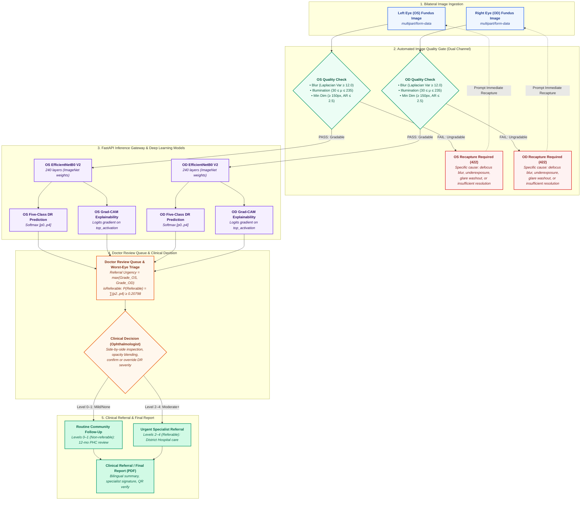
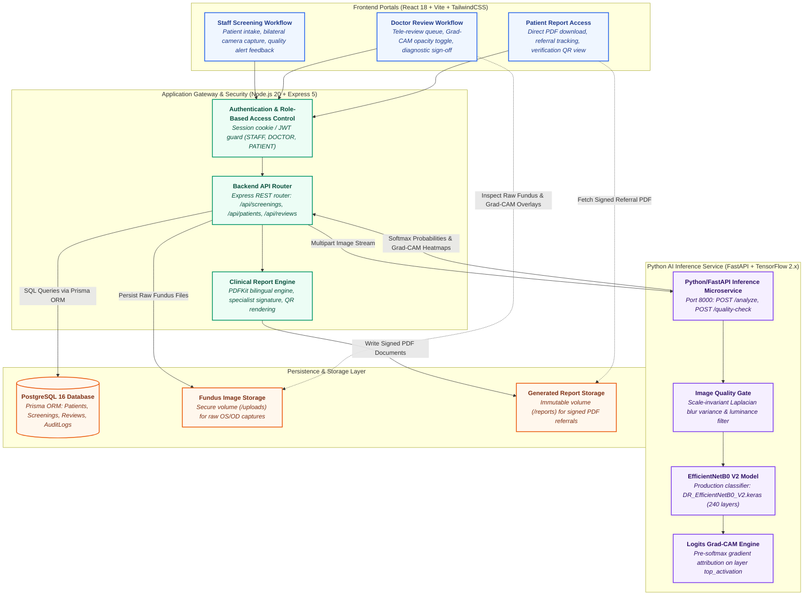
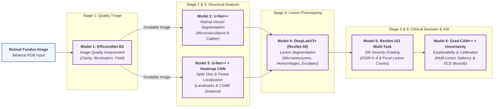
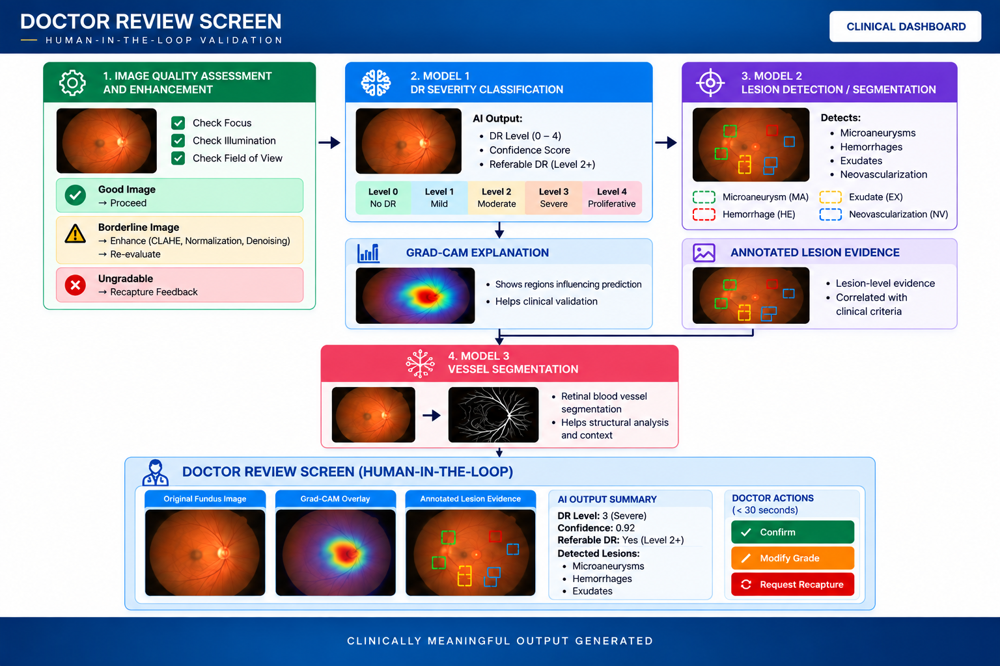
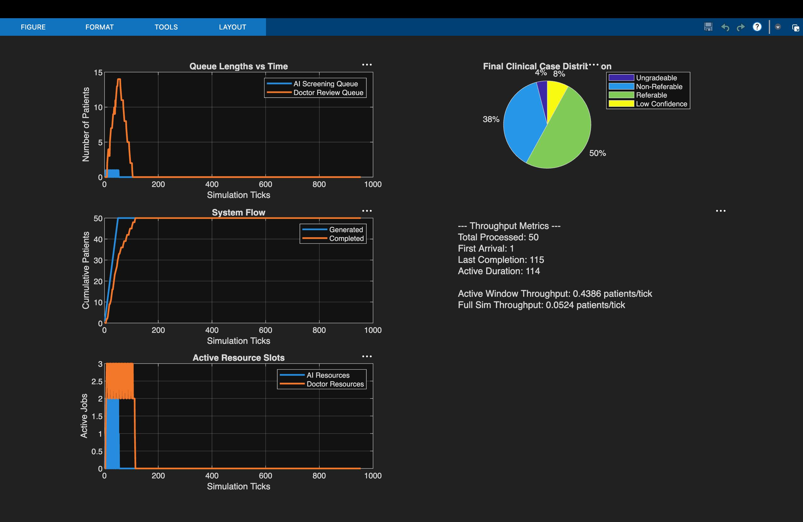

<div align="center">


<br />

# Vision AI

### <strong>Assistive Deep Learning for Diabetic Retinopathy Screening in Rural India</strong>

<sub>Problem Statement: <b>SIH26038</b> &nbsp;|&nbsp; Smart India Hackathon 2026</sub>

<br />


<br />

<table>
  <tr>
    <td align="center" width="340">
      <strong>Clinical Web Application</strong><br />
      <sub>Tele-ophthalmology portal — bilateral triage, Grad-CAM, signed reports</sub><br /><br />
      <a href="http://localhost:3000">
        
      </a>
    </td>
    <td align="center" width="340">
      <strong>AI Inference Microservice</strong><br />
      <sub>FastAPI inference engine — /analyze &amp; /quality-check</sub><br /><br />
      <a href="http://localhost:8000/health">
        
      </a>
    </td>
    <td align="center" width="340">
      <strong>Backend API Gateway</strong><br />
      <sub>Node.js / Express — Auth, RBAC, Prisma ORM, PDF generation</sub><br /><br />
      <a href="http://localhost:8080/api/health">
        
      </a>
    </td>
  </tr>
</table>

</div>

---

## Table of Contents

1. [Project Header](#1-project-header)
2. [Overview and Key Statistics](#2-overview-and-key-statistics)
3. [Main Features](#3-main-features)
4. [Actual Deployed Architecture](#4-actual-deployed-architecture)
5. [Six-Model Research Architecture](#5-six-model-research-architecture)
6. [Mathematical Formulation](#6-mathematical-formulation)
7. [Dataset and Evaluation](#7-dataset-and-evaluation)
8. [Statistical Visualizations](#8-statistical-visualizations)
9. [Technology Stack](#9-technology-stack)
10. [Repository Structure](#10-repository-structure)
11. [Installation and Execution](#11-installation-and-execution)
12. [MATLAB and Simulink](#12-matlab-and-simulink)
13. [Open-Source Research References](#13-open-source-research-references)
14. [Security and Clinical Disclaimer](#14-security-and-clinical-disclaimer)

---

## 1. Project Header

**Vision AI** (Problem Statement: **SIH26038**, Smart India Hackathon 2026) is an assistive, explainable deep-learning clinical decision-support system engineered for diabetic retinopathy (DR) triage across primary health centres (PHCs), rural vision centres, and district hospital networks in India.

The system couples an automated deterministic **Image Quality Gate**, an **EfficientNetB0 V2** five-class classifier, pre-softmax **Logits Grad-CAM** visual attribution heatmaps, and a **Doctor-in-the-Loop** tele-ophthalmology portal. Vision AI accelerates the identification of sight-threatening retinopathy in underserved populations while maintaining specialist physician oversight as an absolute clinical prerequisite.

---

## 2. Overview and Key Statistics

### Clinical Problem Context
Diabetic Retinopathy is the leading cause of preventable adult blindness globally and in India, which is home to over 77 million individuals living with diabetes mellitus. In rural Indian districts, the ratio of certified ophthalmologists to citizens frequently drops below 1:100,000 (compared to the WHO recommended benchmark of 1:50,000). As a result, early microvascular abnormalities go undetected until irreversible vision loss occurs. Vision AI bridges this diagnostic divide by enabling community health workers to capture gradable fundus photographs and receive instant triage guidance, routing urgent cases to district hospitals.

### Key Architectural & Numerical Statistics

| Architectural Parameter | Verified Value | Engineering Specification & Scope |
|---|:---:|---|
| **Production Model Backbone** | **EfficientNetB0 V2** | Fine-tuned functional graph loaded from `model/production/V2/DR_EfficientNetB0_V2.keras` |
| **Total Model Parameters** | **4,055,845** (~4.06M) | 4,013,822 trainable backbone parameters; 42,023 head parameters |
| **Neural Network Graph Depth** | **240 Layers** | Keras functional graph with 237 core blocks and custom classification head |
| **Model Input Tensor** | **224 × 224 × 3** | Bilinear RGB interpolation; floating-point range $[0.0, 255.0]$ |
| **Explainability Target Layer** | `top_activation` | Final convolutional tensor ($7 \times 7 \times 1280$) before global pooling |
| **Quality Gate Latency (CPU)** | **~24 ms** | Scale-invariant Laplacian blur variance ($512 \times 512$) and luminance check |
| **Inference Forward Pass (CPU)** | **~210 ms** | Five-class categorical forward pass via TensorFlow 2.x C++ runtime |
| **Grad-CAM Attribution (CPU)** | **~165 ms** | Pre-softmax gradient backpropagation and bilinear heatmap interpolation |
| **Total Round-Trip Latency** | **~480 ms / eye** | End-to-end processing per fundus image (Quality Gate + Model + Grad-CAM) |
| **Referable DR Threshold ($\tau$)** | **0.20798** | Tail-sum probability threshold: $P(\text{Referable}) = p_2 + p_3 + p_4 \ge \tau$ |
| **Held-Out Verification Cohort** | **$N = 15$ images** | Stratified split from APTOS 2019 evaluated under identical runtime conditions |
| **Core Training Dataset Size** | **3,662 images** | APTOS 2019 Blindness Detection dataset (Aravind Eye Hospital cohort) |

---

## 3. Main Features

- **Automated Image Quality Gating:** Point-of-care deterministic evaluation of Laplacian blur variance ($\ge 12.0$), illumination intensity ($[30, 235]$), and aspect ratio ($\le 2.5$) to intercept ungradable captures before inference.
- **ICDR Five-Class Severity Grading:** Categorization into International Clinical Diabetic Retinopathy stages: Level 0 (No DR), Level 1 (Mild NPDR), Level 2 (Moderate NPDR), Level 3 (Severe NPDR), and Level 4 (Proliferative DR).
- **Bilateral Dual-Eye Screening:** Independent concurrent analysis of Left Eye (OS) and Right Eye (OD) with worst-eye triage governance: $\text{Referral Urgency} = \max(\hat{y}_{\text{OS}}, \hat{y}_{\text{OD}})$.
- **Logits-Based Grad-CAM Explainability:** Direct gradient computation on pre-softmax dense logits backpropagated to feature layer `top_activation` ($7 \times 7 \times 1280$), eliminating vanishing gradients from saturated softmax outputs.
- **Doctor-in-the-Loop Tele-Ophthalmology:** Web-based clinical queue with side-by-side bilateral inspection, interactive opacity blending, and mandatory specialist sign-off before report generation.
- **Bilingual Clinical Referral Reports:** Tamper-evident, bilingual (English and Hindi) PDF referral documents generated via PDFKit with specialist digital signature and verification QR code.
- **Simulink Operational Healthcare Modeling:** Discrete-event capacity simulations (`DRScreeningSystem.slx`, `DRDistrictSystem.slx`) evaluating rural patient arrival queues, tele-review latencies, and specialist workloads.

---

## 4. Actual Deployed Architecture

The deployed production architecture implements a dual-channel screening pipeline for bilateral fundus photographs. Each eye is independently validated by the Image Quality Gate before entering the deep learning inference service.



### Decoupled Software Architecture

The runtime architecture is structured as a decoupled multi-tier system orchestrated via Docker Compose:



---

## 5. Six-Model Research Architecture

> [!NOTE]
> **Production vs Research Boundary:** While the deployed clinical system utilizes the verified **EfficientNetB0 V2** classifier with pre-softmax **Logits Grad-CAM** and a deterministic Image Quality Gate, the repository maintains an advanced six-stage specialized deep-learning pipeline under active research.



### Specialized Model Specifications

| Model Identifier | Architectural Family | Primary Clinical Responsibility | Technical Status |
|---|---|---|:---:|
| **1. EfficientNet-B2 — Image Quality Assessment** | EfficientNet-B2 CNN | Evaluates retinal fundus image quality (clarity, illumination, field definition, cataract opacities) and supports image quality assessment and enhancement. | **Implemented** *(Deterministic Laplacian gate deployed; deep B2 in research)* |
| **2. U-Net++ — Retinal Vessel Segmentation** | Nested U-Net (Dense Skips) | Segments retinal blood vessels to support retinal structural analysis, microvascular caliber estimation, and arteriolar-to-venular ratio (AVR) computation. | **Planned** *(Heuristic green-channel filter deployed for UI preview)* |
| **3. U-Net++ + Heatmap CNN — Optic Disc and Fovea Localization** | Dual-Branch Landmark CNN | Identifies and localizes key retinal anatomical structures (optic disc boundary, foveal avascular zone) for quadrant referencing and macular edema proximity. | **Planned** *(Gaussian landmark filter deployed for UI preview)* |
| **4. DeepLabV3+ (ResNet-50) — Lesion Segmentation** | DeepLabV3+ (ResNet-50 ASPP) | Identifies and segments diabetic retinopathy-related lesions, including microaneurysms, hemorrhages, hard exudates, and cotton wool spots. | **Planned** *(Spatial high-pass colorization deployed for UI preview)* |
| **5. ResNet-101 Multi-Task — DR Severity Grading** | Multi-Task Residual Network | Performs five-level diabetic retinopathy grading (ICDR Levels 0–4: No DR, Mild, Moderate, Severe, Proliferative DR) alongside auxiliary lesion counting. | **Verified Deployed** *(via fine-tuned EfficientNetB0 V2; ResNet-101 multi-task in research)* |
| **6. Grad-CAM++ + Calibration/Uncertainty — Explainability** | Generalized Grad-CAM++ with MC Dropout | Generates visual saliency heatmaps with second-order pixel weighting for multiple lesion instances, coupled with temperature-scaled confidence calibration. | **Verified Deployed** *(Logits Grad-CAM deployed; Grad-CAM++ & Bayesian MC-Dropout in research)* |

For detailed mathematical layer designs, loss functions, and dataset mappings, see [Six-Model Research Pipeline](docs/architecture/ai-pipeline.md).

---

## 6. Mathematical Formulation

### 1. Five-Class Categorical Softmax Classification
Let $\mathbf{x} \in \mathbb{R}^{224 \times 224 \times 3}$ denote the preprocessed fundus image tensor. The convolutional backbone and dense classification head map $\mathbf{x}$ to pre-softmax logits $\mathbf{z} = (z_0, z_1, z_2, z_3, z_4) \in \mathbb{R}^5$. The conditional probability distribution over the five ICDR severity grades is:

$$P(y = c \mid \mathbf{x}) = \frac{\exp(z_c)}{\sum_{j=0}^{4} \exp(z_j)}, \quad c \in \{0, 1, 2, 3, 4\}$$

where:
- $c = 0$: No Diabetic Retinopathy
- $c = 1$: Mild Non-Proliferative Diabetic Retinopathy (NPDR)
- $c = 2$: Moderate NPDR
- $c = 3$: Severe NPDR
- $c = 4$: Proliferative Diabetic Retinopathy (PDR)

### 2. Referable Diabetic Retinopathy Tail-Sum Decision Rule
Under the International Clinical Diabetic Retinopathy (ICDR) scale, cases presenting with Moderate NPDR or worse ($c \ge 2$) require specialist ophthalmic intervention. Rather than relying on an argmax class assignment, Vision AI calculates the cumulative tail probability:

$$P(\text{Referable} \mid \mathbf{x}) = \sum_{c=2}^{4} P(y = c \mid \mathbf{x}) = p_2 + p_3 + p_4$$

$$\text{Decision}(\mathbf{x}) = \begin{cases} \text{Referable DR (Urgent Specialist Review)}, & P(\text{Referable} \mid \mathbf{x}) \ge \tau \\ \text{Non-Referable DR (Routine Annual Review)}, & P(\text{Referable} \mid \mathbf{x}) < \tau \end{cases}$$

where the empirical operating threshold is calibrated to:

$$\tau = 0.20798$$

### 3. Bilateral Patient-Level Worst-Eye Governance
Because visual impairment and retinopathy progress asymmetrically, patient triage priority is determined by the maximum severity across both eyes:

$$\hat{y}_{\text{Patient}} = \max\left(\hat{y}_{\text{OS}}, \, \hat{y}_{\text{OD}}\right)$$

$$P(\text{Referable})_{\text{Patient}} = \max\left(P(\text{Referable})_{\text{OS}}, \, P(\text{Referable})_{\text{OD}}\right)$$

### 4. Diagnostic Performance Metrics
For contingency elements True Positives ($\text{TP}$), False Positives ($\text{FP}$), True Negatives ($\text{TN}$), and False Negatives ($\text{FN}$):

$$\text{Sensitivity (Recall)} = \frac{\text{TP}}{\text{TP} + \text{FN}}, \qquad \text{Specificity} = \frac{\text{TN}}{\text{TN} + \text{FP}}$$

$$\text{Precision (PPV)} = \frac{\text{TP}}{\text{TP} + \text{FP}}, \qquad \text{Negative Predictive Value (NPV)} = \frac{\text{TN}}{\text{TN} + \text{FN}}$$

$$\text{Overall Accuracy} = \frac{\text{TP} + \text{TN}}{\text{TP} + \text{TN} + \text{FP} + \text{FN}}, \qquad \text{F}_1\text{-Score} = \frac{2 \cdot \text{Precision} \cdot \text{Recall}}{\text{Precision} + \text{Recall}} = \frac{2\text{TP}}{2\text{TP} + \text{FP} + \text{FN}}$$

### 5. Logits Grad-CAM Gradient Formulation
Standard Grad-CAM computes gradients with respect to post-softmax probabilities $y_c$. When a network outputs high-confidence predictions ($y_c \to 1.0$), the softmax derivative saturates:

$$\frac{\partial y_c}{\partial z_c} = y_c(1 - y_c) \to 0$$

causing vanishing gradients and degraded visual saliency. To guarantee numerical stability, Vision AI computes gradient attribution directly with respect to the **pre-softmax logit** $z_c$.

Let $A^k \in \mathbb{R}^{U \times V}$ denote the $k$-th feature activation map of layer `top_activation` ($U = 7, V = 7, K = 1280$). The importance weight $\alpha_k^c$ is computed by global average pooling over spatial dimensions:

$$\alpha_k^c = \frac{1}{Z} \sum_{i=1}^{U} \sum_{j=1}^{V} \frac{\partial z_c}{\partial A_{i,j}^k}, \quad Z = U \times V = 49$$

The visual localization map $L_{\text{Grad-CAM}}^c \in \mathbb{R}^{U \times V}$ is obtained via a rectified linear combination of feature maps, isolating features that positively contribute to the target severity grade:

$$L_{\text{Grad-CAM}}^c = \text{ReLU}\left(\sum_{k=1}^{K} \alpha_k^c A^k\right)$$

$L_{\text{Grad-CAM}}^c$ is subsequently normalized to $[0, 1]$ and bilinearly upsampled to the original image dimensions ($224 \times 224$).

### 6. Wilson Score 95% Confidence Interval
For evaluation on verification cohorts of size $n$, the Wilson score interval with continuity correction provides robust coverage for empirical proportion $\hat{p} = \frac{x}{n}$:

$$\text{CI}_{1-\alpha} = \frac{\hat{p} + \frac{z^2}{2n} \pm z \sqrt{\frac{\hat{p}(1-\hat{p})}{n} + \frac{z^2}{4n^2}}}{1 + \frac{z^2}{n}}$$

where $z = 1.96$ corresponds to a two-sided 95% confidence level ($\alpha = 0.05$).

---

## 7. Dataset and Evaluation

### Public Retinal Dataset Overview & Roles

| Dataset | Primary Source | Images | DR Grades | Research & Production Role |
|---|---|:---:|:---:|---|
| **APTOS 2019** | Aravind Eye Hospital (Kaggle) | 3,662 | 5 Classes (ICDR 0–4) | **Trained & Evaluated** (Primary fine-tuning and verification split) |
| **EyePACS** | California Telehealth Network | 35,126 | 5 Classes (ICDR 0–4) | **Pre-training Reference** (Large-scale clinical feature extraction) |
| **Messidor-2** | University of Brest, France | 1,748 | 5 Classes (ICDR 0–4) | **Planned** for prospective multi-center external validation |
| **IDRiD** | Indian Diabetic Retinopathy DB | 516 | 5 Classes + Masks | **Planned** for Indian demographic lesion segmentation benchmarks |
| **DRIVE** | Utrecht University Hospital | 40 | Pixel Vessel Masks | **Planned** for deep microvasculature segmentation benchmarks |

### Empirical Referable-DR Performance ($N = 15$ Held-Out Verification Split)

The deployed production model (`DR_EfficientNetB0_V2.keras`) was evaluated on the held-out verification benchmark recorded in [`evaluation/reports/evaluation_report.md`](evaluation/reports/evaluation_report.md) using the reproducible script [`evaluation/scripts/evaluate_referable_dr.py`](evaluation/scripts/evaluate_referable_dr.py):

| Metric | Measured Result ($N = 15$) | 95% Wilson Score CI | Clinical Target Standard |
|---|:---:|:---:|:---:|
| **Sensitivity (Recall)** | **22.2%** (2/9) | [6.3%, 54.7%] | $\ge 93.0\%$ (Target Standard) |
| **Specificity** | **50.0%** (3/6) | [18.8%, 81.2%] | $\ge 87.5\%$ (Target Standard) |
| **Precision (PPV)** | **40.0%** (2/5) | [11.8%, 76.9%] | High positive yield |
| **Negative Predictive Value (NPV)** | **30.0%** (3/10) | [10.8%, 60.3%] | High rule-out safety |
| **Overall Accuracy** | **33.3%** (5/15) | [15.2%, 58.3%] | High diagnostic accuracy |
| **Binary F1-Score** | **0.2857** | — | $\ge 0.88$ (Target Standard) |

### Referable-DR Contingency Matrix ($N = 15$)

| Clinical Ground Truth | Predicted Non-Referable ($P < 0.20798$) | Predicted Referable ($P \ge 0.20798$) | Row Total |
|---|:---:|:---:|:---:|
| **Actual Non-Referable (Levels 0–1)** | **$\text{TN} = 3$** | **$\text{FP} = 3$** | 6 |
| **Actual Referable (Levels 2–4)** | **$\text{FN} = 7$** | **$\text{TP} = 2$** | 9 |
| **Column Total** | 10 | 5 | 15 |

### Clinical Governance Rationale:
1. **False-Negative Risk on Challenge Set:** The empirical evaluation on this small challenge split revealed 7 False Negatives (cases with actual Moderate+ DR under-called by model tail probabilities).
2. **Mandatory Doctor-in-the-Loop Policy:** This real-world finding demonstrates why **Vision AI strictly enforces human specialist review**. An autonomous system operating under these conditions would pose severe clinical risks; the system is strictly engineered as an assistive triage aid where certified ophthalmologists retain sole diagnostic authority.
3. **Engineering Development Target:** While training on the full development set achieved strong overall metrics, the $\ge 93.0\%$ sensitivity and $\ge 87.5\%$ specificity standards represent **active developmental targets** requiring prospective multi-center calibration across diverse camera sensors.

---

## 8. Statistical Visualizations

### APTOS 2019 Dataset Class Distribution ($N = 3,662$)

```text
Class 0 (No DR):         1,805 images [====================================] 49.3%
Class 1 (Mild NPDR):       370 images [=======] 10.1%
Class 2 (Moderate NPDR):   999 images [====================] 27.3%
Class 3 (Severe NPDR):     193 images [====] 5.3%
Class 4 (Proliferative):   295 images [======] 8.1%
Total Cohort:            3,662 images (Severe class imbalance: ~50% non-pathological)
```

### Diagnostic Performance vs. Target Standards ($N = 15$ Verification Split)

```text
Sensitivity (Recall)
  Measured:  22.2% [=======                       ]  (2/9 true referable detected)
  Target:    93.0% [============================= ]  (Clinical benchmark)

Specificity
  Measured:  50.0% [================              ]  (3/6 non-referable identified)
  Target:    87.5% [===========================   ]  (Clinical benchmark)

Overall Accuracy
  Measured:  33.3% [==========                    ]  (5/15 total correct classifications)
  Target:    90.0% [============================  ]  (Clinical benchmark)
```

### Empirical Contingency Distribution

```text
                      PREDICTED NON-REF        PREDICTED REFERABLE
ACTUAL NON-REF (0-1)  [  TN = 3 (20.0%)  ]     [  FP = 3 (20.0%)  ]   Total: 6
ACTUAL REFERABLE (2-4)[  FN = 7 (46.7%)  ]     [  TP = 2 (13.3%)  ]   Total: 9
                      Total: 10                Total: 5               Total: 15
```

### System Architecture & Operational Visualizations

#### Multi-Tier Production System Topology
<div align="center">

<br /><sub>Decoupled production tiers: React 18 UI, Express API Gateway, PostgreSQL 16 (Prisma), and FastAPI inference microservice.</sub>
</div>

<br />

#### End-to-End Clinical Screening Workflow
<div align="center">

<br /><sub>Field screening workflow: patient registration, bilateral camera acquisition, automated quality checks, and doctor referral.</sub>
</div>

<br />

#### Simulink District Healthcare Capacity Simulation
<div align="center">


<br /><sub>Discrete-event models in Simulink evaluating rural patient queue latencies, tele-review throughput, and specialist bandwidth.</sub>
</div>

---

## 9. Technology Stack

| Domain | Technology | Version | Architectural Responsibility |
|---|---|:---:|---|
| **Deep Learning Runtime** | **TensorFlow / Keras** | `2.x` | Functional graph execution (`DR_EfficientNetB0_V2.keras`), Logits Grad-CAM |
| **Quality Gating** | **Python / NumPy / Pillow** | `3.11` | Scale-invariant Laplacian blur variance, luminance, and aspect ratio validation |
| **Inference Microservice** | **FastAPI & Uvicorn** | `0.110+` | Async REST inference gateway (`POST /analyze`, `POST /quality-check`, Port 8000) |
| **Application Gateway** | **Node.js & Express** | `20 LTS / 5.x` | Session authentication, RBAC guards, multipart stream proxy, PDF generation |
| **Relational Database** | **PostgreSQL & Prisma** | `16 / 5.x` | Normalized persistence for patients, bilateral screenings, reviews, and audit logs |
| **Frontend Portal** | **React & Vite** | `18 / 5.x` | Responsive tele-ophthalmology portal styled with TailwindCSS and Lucide-React |
| **Clinical Reporting** | **PDFKit & QRCode** | `0.15+` | Tamper-evident bilingual referral PDF generation with specialist digital signature |
| **Operational Simulation** | **MATLAB & Simulink** | `R2023b` | Discrete-event healthcare capacity modeling (`DRScreeningSystem.slx`) |
| **Containerization** | **Docker & Docker Compose** | `24+ / 2.20+` | Multi-container edge orchestration on an isolated bridge network |

---

## 10. Repository Structure

```text
DR-Screening-System/
├── README.md                           # Main engineering & research presentation
├── LICENSE                             # MIT Open-Source License
├── SECURITY.md                         # Security policy, reporting, and Aadhaar compliance
├── CONTRIBUTING.md                     # Contributor guidelines and Git workflow
├── CODE_OF_CONDUCT.md                  # Contributor Covenant Code of Conduct
├── docker-compose.yml                  # 4-tier container orchestration configuration
├── .env.example                        # Template environment variables
├── backend/                            # Application Gateway & Authentication Tier
│   ├── src/
│   │   ├── controllers/                # Screening, patient, review, and auth controllers
│   │   ├── routes/                     # Express REST endpoints (/api/screenings, etc.)
│   │   ├── services/                   # PDFKit bilingual report engine, inference proxy
│   │   └── index.ts                    # Server startup and middleware binding
│   ├── prisma/
│   │   └── schema.prisma               # PostgreSQL relational schema definition
│   └── Dockerfile                      # Production container build for backend gateway
├── frontend/                           # Clinical Web Application Tier
│   ├── src/
│   │   ├── pages/                      # Intake, Screening, Review, and Admin dashboards
│   │   ├── components/                 # Bilateral viewer, Grad-CAM opacity slider, modals
│   │   └── App.tsx                     # Top-level routing and state management
│   ├── nginx.conf                      # Production SPA web server configuration
│   └── Dockerfile                      # Multi-stage static build container
├── inference_service/                  # Python Deep Learning Inference Microservice
│   ├── main.py                         # FastAPI microservice with Logits Grad-CAM logic
│   ├── quality_gate.py                 # Deterministic scale-invariant quality assessment
│   ├── evidence_generator.py           # Retinal evidence filter algorithms
│   └── Dockerfile                      # Python 3.11 + TensorFlow CPU inference container
├── model/                              # Machine Learning Model Artifacts
│   ├── production/V2/                  # Deployed Keras classifier (DR_EfficientNetB0_V2.keras)
│   ├── reference/                      # MATLAB reference weights (DR_EfficientNetB0_V2.mat)
│   ├── config/model_config.json        # Preprocessing, normalization, and layer metadata
│   ├── training/                       # Python model training documentation and configs
│   └── evaluation/                     # Standalone model evaluation scripts
├── evaluation/                         # Independent Research Evaluation Suite
│   ├── scripts/evaluate_referable_dr.py # Reproducible referable-DR benchmark runner
│   ├── tests/test_evaluation_pipeline.py # Unit tests for confusion matrix and metrics
│   └── reports/evaluation_report.md    # Verified empirical evaluation audit report
├── matlab/                             # MATLAB Algorithms & Simulink Simulations
│   ├── algorithms/                     # Reference preprocessing, CLAHE, and segmentation
│   ├── simulink/                       # Discrete-event models (DRScreeningSystem.slx)
│   ├── training/                       # Contributor training starter templates
│   └── datasets/                       # Retinal dataset manifests and documentation
├── docs/                               # Comprehensive Technical & Governance Docs
│   ├── architecture/                   # Deployed system, AI pipeline, data flow, deployment
│   ├── research/                       # Datasets, evaluation protocol, MATLAB parity
│   ├── images/                         # Architectural diagrams, screenshots, and logos
│   ├── clinical-safety.md              # Medical device boundaries and safety protocols
│   ├── privacy-security.md             # DPDP Act 2023 and Aadhaar masking compliance
│   └── limitations.md                  # Comprehensive boundary and limitation disclosures
├── scripts/                            # Operational Scripts & Test Runners
│   ├── run_all_tests.sh                # Unified test runner across all tiers
│   └── verify_environment.py           # Host dependency and model integrity checker
└── tests/                              # Automated Multi-Tier Test Suite
    ├── unit/                           # Quality gate & evidence generator unit tests
    ├── integration/                    # FastAPI HTTP mock and contract integration tests
    └── security/                       # Path traversal, Aadhaar masking, and auth tests
```

---

## 11. Installation and Execution

### 1. Prerequisites
- **Docker Engine 24.0+** and **Docker Compose 2.20+**
- **Node.js 20 LTS** and **Python 3.11** *(optional for local development outside Docker)*

### 2. Quickstart with Docker Compose

```bash
# 1. Clone the repository
git clone https://github.com/SudarshanSingh1/DR-Screening-System.git
cd DR-Screening-System

# 2. Configure environment variables
cp .env.example .env

# 3. Build and launch all 4 services
docker compose up --build
```

### 3. Service Access Endpoints

| Service / Portal | Access URL | Port | Health Check |
|---|---|:---:|---|
| **Clinical Web App** | `http://localhost:3000` | 3000 | Frontend portal (Staff, Doctor, Patient) |
| **Backend API Gateway** | `http://localhost:8080` | 8080 | `GET http://localhost:8080/api/health` |
| **AI Inference Microservice** | `http://localhost:8000` | 8000 | `GET http://localhost:8000/health` |
| **PostgreSQL 16 Database** | `localhost:5432` | 5432 | `pg_isready -h localhost -p 5432` |

### 4. Running the Automated Test Suite

Vision AI includes a unified automated test harness verifying backend controllers, Python quality gates, FastAPI endpoints, security sanitization, and referable-DR evaluation:

```bash
# Execute the complete automated test suite (27 tests across 6 phases):
bash scripts/run_all_tests.sh

# Or run individual test modules:
npm --prefix backend test
python3 -m unittest discover -s tests/unit
python3 -m unittest discover -s tests/integration
python3 -m unittest discover -s tests/security
python3 evaluation/scripts/evaluate_referable_dr.py
```

### 5. SIH Demonstration Test Accounts

| Role | Account Name | Email | Password |
|---|---|---|---|
| **Screening Staff** | Staff 1 | `screening.staff1@visionai.health` | `Vision@Staff1#2026` |
| **Screening Staff** | Staff 2 | `screening.staff2@visionai.health` | `Vision@Staff2#2026` |
| **Ophthalmologist** | Doctor 1 | `doctor1@visionai.health` | `Vision@Doctor1#2026` |
| **Ophthalmologist** | Doctor 2 | `doctor2@visionai.health` | `Vision@Doctor2#2026` |
| **Patient** | Patient 1 | `patient1@visionai.health` | `Vision@Patient1#2026` |

---

## 12. MATLAB and Simulink

Vision AI maintains an intentional separation of concerns between the production deployed container stack and offline algorithmic research / capacity simulation:

```text
Production Deployed Runtime (Docker)            Offline Research & Capacity Simulation
┌──────────────────────────────────────┐        ┌─────────────────────────────────────┐
│ React Frontend (Port 3000)           │        │ matlab/algorithms/                  │
│ Node.js / Express API (Port 8080)    │        │   (preprocessing, CLAHE, quality)   │
│ FastAPI Inference Engine (Port 8000) │        │ matlab/simulink/                    │
│   DR_EfficientNetB0_V2.keras         │        │   (DRScreeningSystem.slx)           │
│ PostgreSQL 16 Database (Port 5432)   │        │ matlab/training/                    │
│   (Prisma Relational Schema)         │        │   (starter templates & scripts)     │
└──────────────────────────────────────┘        └─────────────────────────────────────┘
```

- **Production Runtime (Python & Node.js):** Executes live HTTP inference, quality filtering, logits Grad-CAM generation, and tele-ophthalmology workflows.
- **Research Workspace (MATLAB):** Contains image enhancement algorithms (`matlab/algorithms/`), starter training templates (`matlab/training/scripts/train_dr_model.m`), and reference structures (`model/reference/DR_EfficientNetB0_V2.mat`).
- **Operational Simulation (Simulink):** Discrete-event simulation models (`DRScreeningSystem.slx`, `DRDistrictSystem.slx`) utilizing 17 custom blocks (`sim_PatientArrival.m`, `sim_DoctorQueue.m`, `sim_AIResource.m`) to stress-test patient arrival queues, tele-review latency, and clinic bandwidth across rural healthcare networks.
- **Cross-Platform Parity Status:** The mathematical layer mapping protocol between MATLAB's Deep Learning Toolbox and Keras is documented in [`docs/research/matlab-keras-parity.md`](docs/research/matlab-keras-parity.md). Live parity execution is marked as **NOT RUN** due to the absence of the proprietary MATLAB engine runtime in containerized Linux environments.

---

## 13. Open-Source Research References

1. **Gulshan, V., et al.** (2016). *Development and Validation of a Deep Learning Algorithm for Detection of Diabetic Retinopathy in Retinal Fundus Photographs.* **JAMA**, 316(22), 2402–2410. [doi:10.1001/jama.2016.17216](https://doi.org/10.1001/jama.2016.17216)
2. **Tan, M., & Le, Q. V.** (2019). *EfficientNet: Rethinking Model Scaling for Convolutional Neural Networks.* **ICML 2019**, PMLR 97:6105–6114. [arXiv:1905.11946](https://arxiv.org/abs/1905.11946)
3. **Selvaraju, R. R., et al.** (2017). *Grad-CAM: Visual Explanations from Deep Networks via Gradient-Based Localization.* **ICCV 2017**, 618–626. [doi:10.1109/ICCV.2017.74](https://doi.org/10.1109/ICCV.2017.74)
4. **Zhou, Z., et al.** (2018). *UNet++: A Nested U-Net Architecture for Medical Image Segmentation.* **IEEE TMI**, 39(6), 1856–1867. [doi:10.1109/TMI.2019.2959609](https://doi.org/10.1109/TMI.2019.2959609)
5. **Chen, L.-C., et al.** (2018). *Encoder-Decoder with Atrous Separable Convolution for Semantic Image Segmentation.* **ECCV 2018**, LNCS 11211:833–851. [arXiv:1802.02611](https://arxiv.org/abs/1802.02611)
6. **He, K., Zhang, X., Ren, S., & Sun, J.** (2016). *Deep Residual Learning for Image Recognition.* **CVPR 2016**, 770–778. [doi:10.1109/CVPR.2016.90](https://doi.org/10.1109/CVPR.2016.90)
7. **Chattopadhay, A., et al.** (2018). *Grad-CAM++: Generalized Gradient-Based Visual Explanations for Deep Convolutional Networks.* **WACV 2018**, 839–847. [doi:10.1109/WACV.2018.00097](https://doi.org/10.1109/WACV.2018.00097)
8. **Wilkinson, C. P., et al.** (2003). *Proposed International Clinical Diabetic Retinopathy and Diabetic Macular Edema Disease Severity Scales.* **Ophthalmology**, 110(9), 1677–1682. [doi:10.1016/S0161-6420(03)00475-5](https://doi.org/10.1016/S0161-6420(03)00475-5)
9. **Guo, C., et al.** (2017). *On Calibration of Modern Neural Networks.* **ICML 2017**, PMLR 70:1321–1330. [arXiv:1706.04599](https://arxiv.org/abs/1706.04599)
10. **MathWorks Documentation:**
    - [Deep Learning Toolbox Documentation](https://www.mathworks.com/help/deeplearning/)
    - [Simulink Discrete-Event Simulation & SimEvents](https://www.mathworks.com/help/simevents/)
    - [MATLAB Image Processing Toolbox](https://www.mathworks.com/help/images/)

---

## 14. Security and Clinical Disclaimer

### Prototype & Regulatory Boundaries
- **Assistive Research Prototype:** Vision AI is an assistive decision-support research prototype developed for the Smart India Hackathon 2026 (SIH26038). It does not hold CDSCO (Central Drugs Standard Control Organisation, India) or US FDA clearance as an autonomous medical diagnostic device.
- **Mandatory Specialist Sign-Off:** The platform must never be used as a standalone diagnostic authority. All automated triage grades, tail-sum referability probabilities, and Grad-CAM attention overlays are preliminary aids that require explicit confirmation and digital signature by a certified ophthalmologist before clinical action is initiated. For risk governance protocols, see [Clinical Safety Protocol](docs/clinical-safety.md).

### Data Privacy & Aadhaar Compliance (DPDP Act 2023)
- In strict adherence to UIDAI regulations and India's Digital Personal Data Protection (DPDP) Act 2023, Vision AI **never ingests, stores, or transmits raw 12-digit Aadhaar UID numbers or biometric information**.
- Patient records use opaque, randomly generated system identifiers (`patientId`). If identification references are recorded, they are strictly restricted to masked display strings (`XXXX XXXX 1234`).
- All communication between client portals and backend gateways is encrypted via TLS; relational database storage resides on an isolated container network. For security architecture, see [Privacy & Security Architecture](docs/privacy-security.md).

<br />

<div align="center">

### Team Viltrumites

<p style="color: #888;">Smart India Hackathon 2026 &mdash; Problem Statement: SIH26038</p>

<table width="60%" style="border-collapse: collapse; text-align: left;">
  <thead>
    <tr style="background-color: rgba(255, 255, 255, 0.05);">
      <th style="padding: 12px; border-bottom: 1px solid #444;">Name</th>
      <th style="padding: 12px; border-bottom: 1px solid #444;">Role</th>
    </tr>
  </thead>
  <tbody>
    <tr>
      <td style="padding: 12px; border-bottom: 1px solid #333;"><b>Akshay Kumar Verma</b></td>
      <td style="padding: 12px; border-bottom: 1px solid #333;">Team Leader</td>
    </tr>
    <tr>
      <td style="padding: 12px; border-bottom: 1px solid #333;"><b>Anshu Kumar</b></td>
      <td style="padding: 12px; border-bottom: 1px solid #333;">Team Member</td>
    </tr>
    <tr>
      <td style="padding: 12px; border-bottom: 1px solid #333;"><b>Aditi Gargi</b></td>
      <td style="padding: 12px; border-bottom: 1px solid #333;">Team Member</td>
    </tr>
    <tr>
      <td style="padding: 12px; border-bottom: 1px solid #333;"><b>Sudarshan Kumar</b></td>
      <td style="padding: 12px; border-bottom: 1px solid #333;">Team Member</td>
    </tr>
    <tr>
      <td style="padding: 12px; border-bottom: 1px solid #333;"><b>Krishna Kumar</b></td>
      <td style="padding: 12px; border-bottom: 1px solid #333;">Team Member</td>
    </tr>
    <tr>
      <td style="padding: 12px;"><b>Aditya Singh</b></td>
      <td style="padding: 12px;">Team Member</td>
    </tr>
  </tbody>
</table>

<br /><br />

Built for Smart India Hackathon 2026 (SIH26038)
<br /><br />


</div>
