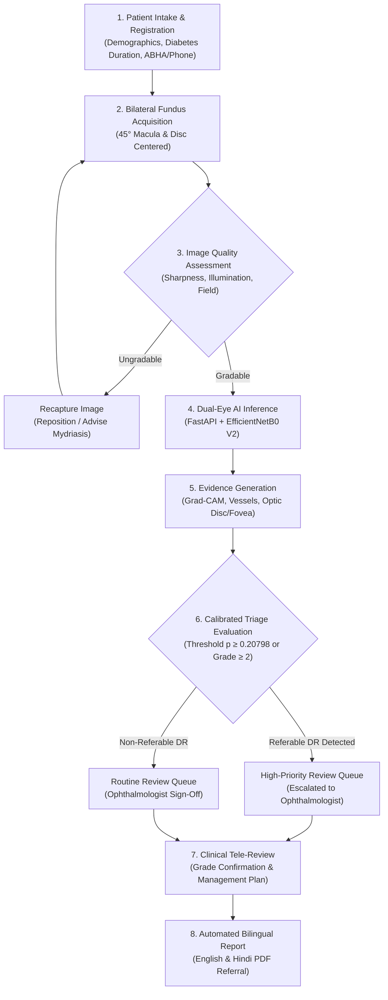

# Clinical Screening & Referral Workflow

This document specifies the operational clinical screening and referral workflow for the Vision AI Diabetic Retinopathy Screening System, specifically designed for public healthcare tiers in India (Primary Health Centres, Community Health Centres, and District Hospitals).

---

## 1. Intended Use and Operating Scope

> **IMPORTANT CLINICAL STATEMENT**  
> Vision AI is an **adjunctive screening triage and clinical decision-support tool**. It is **not** an autonomous diagnostic device and does not establish a definitive clinical diagnosis. All automated predictions, confidence intervals, and visual evidence (Grad-CAM heatmaps, vessel maps) are intended to assist qualified healthcare professionals in prioritizing patients for formal clinical examination.

### 1.1 Target Healthcare Environments
- **Primary Health Centres (PHCs) & Sub-Centres:** Resource-constrained rural clinics conducting primary community screenings.
- **Community Health Centres (CHCs):** Secondary community facilities handling initial triage and tele-consultation requests.
- **District Hospitals & Tertiary Eye Care Centres:** Specialized facilities staffed by licensed ophthalmologists providing definitive diagnosis, retinal imaging (OCT, FFA), laser photocoagulation, and anti-VEGF therapy.

### 1.2 User Roles & Operational Boundaries

| User Role | Operational Responsibility | Clinical Boundary |
|---|---|---|
| **Vision Technician / Ophthalmic Assistant** | Patient registration, bilateral fundus image capture, image quality verification, screening submission | Cannot independently confirm diagnosis or discharge high-risk patients. |
| **Reviewing Ophthalmologist** | Asynchronous tele-review of screening evidence, grade verification, clinical report validation, referral authorization | Holds sole authority for clinical grading and treatment decisions. |
| **Facility Administrator** | Staff account provisioning, facility equipment tracking, screening volume auditing | No access to patient clinical decision controls. |
| **Patient** | Accessing bilingual referral reports and scheduled follow-up reminders | Read-only access to authorized screening summaries. |

---

## 2. End-to-End Screening Protocol

---

## 3. Detailed Workflow Stages

### Stage 1: Patient Intake & Informed Consent
- Staff record patient demographics, contact details, known duration of diabetes, and systemic comorbidities (hypertension, HbA1c if known).
- Explicit bilingual informed consent (English/Hindi) is obtained for photographic retinal screening and digital record retention.

### Stage 2: Fundus Image Acquisition Requirements
To ensure model reliability and diagnostic interpretability, acquired fundus photographs must satisfy:
- **Field of View:** Minimum 45-degree non-mydriatic or mydriatic digital fundus photograph.
- **Centering:** Standard two-field protocol per eye:
  1. **Macula-centered:** Center of macula placed within the central quadrant.
  2. **Disc-centered:** Optic disc clearly visible and sharply focused.
- **Resolution & Format:** Minimum $1024 \times 1024$ native sensor capture, JPEG or PNG format, uncompressed color.

### Stage 3: Automated Evidence Generation & AI Inference
- **Resizing & Normalization:** Standardized bilinear interpolation to $224 \times 224 \times 3$, float32 $[0.0, 255.0]$ range.
- **Multi-Class Classification:** EfficientNetB0 evaluates probabilities across five International Clinical Diabetic Retinopathy (ICDR) grades:
  - `Grade 0`: No Apparent DR
  - `Grade 1`: Mild Non-Proliferative DR (Microaneurysms only)
  - `Grade 2`: Moderate Non-Proliferative DR (More than microaneurysms, less than severe)
  - `Grade 3`: Severe Non-Proliferative DR (4-2-1 rule: hemorrhages in 4 quadrants, venous beading in 2, or IRMA in 1)
  - `Grade 4`: Proliferative DR (Neovascularization or vitreous/preretinal hemorrhage)
- **Triage Thresholding:** A calibrated threshold of $p \ge 0.20798$ for any referable grade ($\text{Grade} \ge 2$) flags the screening as **Referable Diabetic Retinopathy**, prioritizing patient safety over specificity.
- **Visual Evidence:** Grad-CAM attention heatmap generated from logits gradients at layer `top_activation`, paired with vessel and disc-fovea geometric overlays.

### Stage 4: Doctor Tele-Review & Referral Pathways

| Screening Category | Criteria | Review SLA | Recommended Action |
|---|---|---|---|
| **Urgent Referral** | Proliferative DR (Grade 4) or Severe NPDR (Grade 3) | $\le 24$ hours | Immediate referral to District Hospital / Vitreoretinal specialist within 1–2 weeks. |
| **Routine Referral** | Moderate NPDR (Grade 2) or Referable Flag ($p \ge 0.20798$) | $\le 48$ hours | Referral for comprehensive slit-lamp biomicroscopy and OCT within 4–6 weeks. |
| **Early Follow-Up** | Mild NPDR (Grade 1) | $\le 5$ days | Glycemic control counseling, annual re-screening within 6–12 months. |
| **Annual Screening** | No Apparent DR (Grade 0) | $\le 7$ days | Routine annual re-screening at local PHC. |
| **Ungradable / Low Confidence** | Severe artifact or max probability $< 0.50$ | $\le 24$ hours | Direct clinical examination or repeat imaging under pharmacological dilation. |

---

## 4. Bilingual Report Generation & Patient Communication
- Once verified by the reviewing doctor, an automated referral summary is generated as a downloadable PDF.
- Key findings are presented in clear, accessible language in both English and Hindi.
- The report includes:
  - Patient identifier and screening date.
  - Reviewing doctor's name, qualification, and digital sign-off timestamp.
  - Final clinical grade and referable status.
  - Next scheduled follow-up or referral facility contact.
