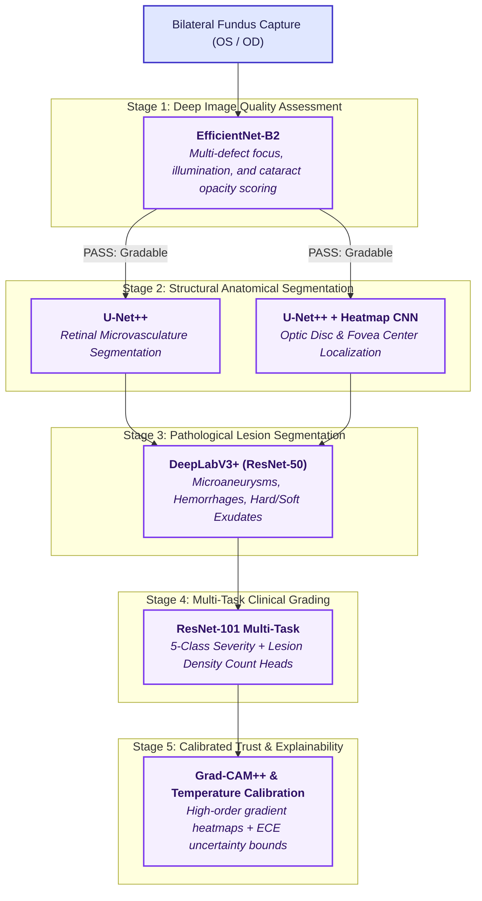

# Six-Model Research AI Pipeline — Vision AI

**Project:** Vision AI — SIH26038 | Smart India Hackathon 2026  
**Status:** Planned Research Architecture & Specifications  
**Document Scope:** Research roadmap for multi-stage deep learning specialization  

---

## 1. Overview of the Research Architecture

While the production deployed system uses a fine-tuned EfficientNetB0 V2 classifier backed by deterministic quality filtering and Logits Grad-CAM, the long-term vision of Vision AI is a modular six-stage deep learning pipeline. Each specialized model addresses a distinct diagnostic requirement of diabetic retinopathy screening.

---

## 2. Detailed Component Specifications

### 2.1 Model 1: EfficientNet-B2 — Deep Image Quality Assessment (IQA)
- **Responsibility:** Classify incoming fundus photographs as gradable or ungradable, providing granular defect classification (defocus blur, uneven illumination, camera artifact, or cataractous media opacity).
- **Architecture:** EfficientNet-B2 backbone with multi-label sigmoid output.
- **Input:** $260 \times 260 \times 3$ RGB fundus image.
- **Output:** Gradability probability $P(\text{Gradable}) \in [0, 1]$ and defect vector $[d_{\text{blur}}, d_{\text{dark}}, d_{\text{glare}}, d_{\text{cataract}}]$.
- **Target Evaluation Metrics:** Accuracy $> 96\%$, F1-score $> 0.94$, Sensitivity $> 98\%$ on EyePACS-QA and Messidor quality subsets.
- **Current Status:** **Planned**. *(Production system currently utilizes deterministic Laplacian blur and illumination checks in `inference_service/quality_gate.py`)*.

---

### 2.2 Model 2: U-Net++ — Retinal Vessel Segmentation
- **Responsibility:** Extract dense binary and multi-scale masks of retinal arterioles and venules to measure vascular caliber, tortuosity, and arteriolar-to-venular ratio (AVR).
- **Architecture:** Nested U-Net (U-Net++) with dense skip pathways and deep supervision.
- **Input:** $512 \times 512 \times 3$ green-channel enhanced fundus photograph.
- **Output:** $512 \times 512 \times 1$ binary vessel probability map.
- **Target Evaluation Metrics:** Area Under ROC (AUC) $> 0.975$, Dice Similarity Coefficient $> 0.82$ on DRIVE and STARE benchmarks.
- **Current Status:** **Planned**. *(Production system provides a heuristic green-channel inverted spatial filter preview in `inference_service/evidence_generator.py` for UI presentation only)*.

---

### 2.3 Model 3: U-Net++ + Heatmap CNN — Optic Disc & Fovea Localization
- **Responsibility:** Regress sub-pixel centroid coordinates $(x_{\text{OD}}, y_{\text{OD}})$ and $(x_{\text{fovea}}, y_{\text{fovea}})$, establishing spatial reference frames to identify the macula and detect Clinically Significant Macular Edema (CSME) based on exudate proximity.
- **Architecture:** Dual-branch network combining U-Net++ for optic disc boundary segmentation and a sub-pixel regression CNN with Gaussian heatmap loss for the foveal avascular zone (FAZ).
- **Input:** $512 \times 512 \times 3$ RGB fundus image.
- **Output:** Optic disc boundary mask + $(x, y)$ coordinate pairs with confidence radius.
- **Target Evaluation Metrics:** Mean Euclidean distance error $< 15 \text{ px}$ on IDRiD and Messidor-2.
- **Current Status:** **Planned**. *(Production system uses Gaussian bright/dark spatial centroid heuristics in `inference_service/evidence_generator.py`)*.

---

### 2.4 Model 4: DeepLabV3+ (ResNet-50) — Lesion Semantic Segmentation
- **Responsibility:** Segment and classify individual diabetic retinal micro-lesions:
  1. Microaneurysms (MAs)
  2. Intraretinal hemorrhages (dot/blot/flame)
  3. Hard exudates (lipid deposits)
  4. Soft exudates (cotton wool spots / nerve fiber infarcts)
- **Architecture:** DeepLabV3+ with Atrous Spatial Pyramid Pooling (ASPP) and ResNet-50 backbone.
- **Input:** $512 \times 512 \times 3$ RGB fundus image.
- **Output:** 4-channel segmentation tensor $[512 \times 512 \times 4]$ where each channel represents lesion probability.
- **Target Evaluation Metrics:** Per-lesion Intersection over Union (IoU) and sensitivity $> 85\%$ on IDRiD segmentation challenge split.
- **Current Status:** **Planned**. *(Production system utilizes high-pass edge colorization filter in `inference_service/evidence_generator.py` for visual display only)*.

---

### 2.5 Model 5: ResNet-101 Multi-Task — DR Severity Grading
- **Responsibility:** Predict overall 5-stage ICDR diabetic retinopathy grade simultaneously with auxiliary prediction of lesion density scores and clinical referral category.
- **Architecture:** ResNet-101 backbone with shared feature representations and split heads:
  - Head A: 5-class severity classification (Softmax).
  - Head B: Binary referable DR classification (Sigmoid).
  - Head C: Auxiliary lesion count regression (Poisson / MSE loss).
- **Input:** $512 \times 512 \times 3$ RGB fundus image.
- **Output:** Primary severity distribution $\mathbf{p} \in \mathbb{R}^5$ and referable risk score $P(\text{Ref}) \in [0, 1]$.
- **Target Evaluation Metrics:** Quadratic Weighted Kappa (QWK) $> 0.88$, Referable DR Sensitivity $> 93\%$, Specificity $> 87.5\%$ on APTOS 2019 and EyePACS validation splits.
- **Current Status:** **Planned**. *(Production system currently deploys fine-tuned EfficientNetB0 V2 with 5-class classification in `model/production/V2/DR_EfficientNetB0_V2.keras`)*.

---

### 2.6 Model 6: Grad-CAM++ with Confidence Calibration & Epistemic Uncertainty
- **Responsibility:** Provide second-order gradient-weighted visual explanations with pixel-level importance weighting, combined with post-hoc temperature scaling ($T$) and Monte Carlo Dropout for epistemic uncertainty quantification.
- **Architecture:** Grad-CAM++ backpropagation on feature maps of the primary classifier, coupled with:
  1. Platt / Temperature Scaling ($T \in \mathbb{R}^+$) to minimize Expected Calibration Error (ECE).
  2. Monte Carlo Dropout (10 forward passes at test time) to compute predictive variance $\sigma_{\text{MC}}^2$.
- **Input:** Model activations and gradient tensors.
- **Output:** Calibrated probability vector $\hat{\mathbf{p}}$, normalized activation overlay, and uncertainty score $U \in [0, 1]$.
- **Target Evaluation Metrics:** Expected Calibration Error (ECE) $< 0.05$; Grad-CAM++ localization pointing game score $> 80\%$.
- **Current Status:** **Planned**. *(Production system currently implements first-order Logits Grad-CAM on layer `top_activation` without temperature scaling or MC-Dropout)*.

---

## 3. Implementation Status Summary

| Stage | Model Name | Primary Task | Implementation Status |
|---|---|---|:---:|
| **Stage 1** | **EfficientNet-B2** | Deep Image Quality Assessment | **Planned** *(Deterministic quality gate deployed)* |
| **Stage 2** | **U-Net++** | Retinal Vessel Segmentation | **Planned** *(Heuristic preview deployed)* |
| **Stage 3** | **U-Net++ + Heatmap CNN** | Optic Disc & Fovea Localization | **Planned** *(Heuristic preview deployed)* |
| **Stage 4** | **DeepLabV3+ (ResNet-50)** | Multi-Lesion Semantic Segmentation | **Planned** *(Heuristic preview deployed)* |
| **Stage 5** | **ResNet-101 Multi-Task** | 5-Class DR Severity Grading | **Planned** *(EfficientNetB0 V2 deployed)* |
| **Stage 6** | **Grad-CAM++ & Uncertainty** | Calibrated Explainability | **Planned** *(Logits Grad-CAM deployed)* |

> [!NOTE]
> Training weights, multi-model orchestrators, and inference endpoints for Models 1–6 remain research prototypes. In accordance with clinical validation standards, no unverified models are deployed into production workflows.
