# End-to-End Data Flow Architecture — Vision AI

**Project:** Vision AI — SIH26038 | Smart India Hackathon 2026  
**Document Status:** Production Reference  

---

## 1. Overview of Clinical Data Progression

Vision AI manages sensitive health information across four sequential operational phases, from community patient intake through tele-ophthalmology sign-off to patient report retrieval.

```mermaid
flowchart LR
    subgraph Phase1 ["Phase 1: Intake & Acquisition"]
        N1["<b>1. Patient Registration</b><br/><i>Opaque ID & demographics</i>"]
        N2["<b>2. Bilateral Upload</b><br/><i>leftEye & rightEye files</i>"]
        D_RAW[("📷 <b>Original Fundus Images</b><br/><i>Raw RGB uint8 files<br/>(Disk: /uploads)</i>")]:::rawImg
        N1 --> N2
        N2 --> D_RAW
    end

    subgraph Phase2 ["Phase 2: Validation & AI Triage"]
        N3["<b>3. Image Validation</b><br/><i>Laplacian blur & brightness</i>"]
        N4["<b>4. AI Analysis</b><br/><i>EfficientNetB0 V2</i>"]
        N5["<b>5. Screening Results</b><br/><i>Automated triage triage</i>"]
        D_PROB["📊 <b>Prediction Probabilities</b><br/><i>5-Class softmax [p0..p4]<br/>+ isReferable boolean</i>"]:::probData
        D_EVID["🔬 <b>AI-Generated Evidence</b><br/><i>Grad-CAM attention overlay<br/>(top_activation heatmap)</i>"]:::aiEvid

        D_RAW --> N3
        N3 -->|PASS| N4
        N4 --> N5
        N4 --> D_PROB
        N4 --> D_EVID
    end

    subgraph Phase3 ["Phase 3: Tele-Ophthalmology Review"]
        N6["<b>6. Doctor Review</b><br/><i>Side-by-side tele-review queue</i>"]
        N7["<b>7. Clinical Decision</b><br/><i>Confirm / override diagnosis</i>"]
        D_CLIN["🩺 <b>Doctor Clinical Info</b><br/><i>Confirmed severity grade,<br/>clinical notes, referral</i>"]:::docData

        N5 --> N6
        D_PROB --> N6
        D_EVID --> N6
        N6 --> N7
        N7 --> D_CLIN
    end

    subgraph Phase4 ["Phase 4: Synthesis & Delivery"]
        N8["<b>8. Final PDF Report</b><br/><i>Bilingual report generation</i>"]
        N9["<b>9. Patient Access</b><br/><i>Portal download & QR view</i>"]
        D_REP[("📄 <b>Generated Reports</b><br/><i>Immutable signed PDF<br/>(Disk: /reports)</i>")]:::repData

        D_CLIN --> N8
        N8 --> D_REP
        D_REP --> N9
    end

    classDef rawImg stroke:#2563eb,stroke-width:2px,fill:#dbeafe,color:#1e40af;
    classDef probData stroke:#7c3aed,stroke-width:2px,fill:#ede9fe,color:#5b21b6;
    classDef aiEvid stroke:#9333ea,stroke-width:2px,fill:#fae8ff,color:#701a75;
    classDef docData stroke:#ea580c,stroke-width:2px,fill:#ffedd5,color:#9a3412;
    classDef repData stroke:#059669,stroke-width:2px,fill:#d1fae5,color:#065f46;
```

---

## 2. Characterization of Core Data Artifacts

| Data Artifact | Format / Type | Storage Destination | Sensitivity & Access Control |
|---|---|---|---|
| 📷 **Original Fundus Images** | Raw `RGB uint8` (JPEG/PNG) | Persistent container volume `/uploads/{screeningId}/` | Highly confidential. Accessible only to authenticated Screening Staff and Reviewing Doctors. |
| 📊 **Prediction Probabilities** | 5-Float Array $[p_0, p_1, p_2, p_3, p_4]$ | PostgreSQL table `Screening` (`predictionProbabilities`) | Clinical decision-support metadata. Accessible to clinicians in review queue. |
| 🔬 **AI-Generated Evidence** | Base64 PNG overlay | Ephemeral cache / PostgreSQL `Screening` | Visual explainability aid. Rendered in Doctor Portal review panel. |
| 🩺 **Doctor-Entered Clinical Info** | Structured JSON + string notes | PostgreSQL table `ClinicalReview` | Legally binding clinical diagnosis. Requires authenticated Doctor role. |
| 📄 **Generated Reports** | Signed PDF Document | Persistent container volume `/reports/{screeningId}.pdf` | Immutable clinical document with SHA-256 verification hash and verification QR code. |

---

## 3. Data Integrity & Lifecycle Rules

1. **Upload Validation:** Multipart payloads are verified for valid MIME types (`image/jpeg`, `image/png`) and file size constraints ($< 25 \text{ MB}$).
2. **Quality Gate Abort:** Failed image uploads are rejected before database commit or deep learning tensor allocation.
3. **No Direct Model Mutation:** Prediction probabilities and Grad-CAM tensors generated by FastAPI are treated as read-only audit records.
4. **Doctor Sign-Off Precondition:** The PDF report generator (`pdf.ts`) throws an authorization error if invoked without a confirmed `ClinicalReview` signed by a certified ophthalmologist.
5. **Aadhaar Privacy Protection:** Raw Aadhaar numbers are never ingested. Only opaque system identifiers (`patientId`) and masked display references (`XXXX XXXX 1234`) are retained.
