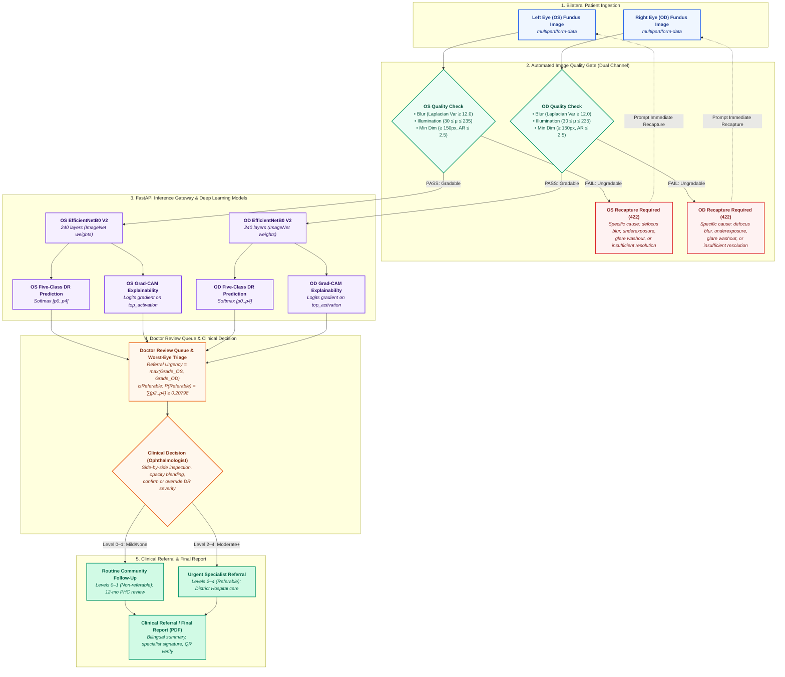

# Deployed System Architecture — Vision AI

**Problem Statement:** SIH26038 | Smart India Hackathon 2026  
**Document Status:** Production Deployed Reference  
**Last Verified:** October 2026  

---

## 1. Executive Summary

Vision AI operates a deterministic, assistive tele-ophthalmology screening pipeline deployed as a containerized edge system for rural Primary Health Centres (PHCs) and district hospitals in India.

The active production pipeline consists of:
1. **Bilateral Ingestion:** Concurrent handling of left eye (OS) and right eye (OD) fundus photographs.
2. **Automated Image Quality Gate:** Deterministic pre-inference filter evaluating scale-invariant Laplacian blur variance, foreground illumination, and aspect geometry.
3. **FastAPI Deep Learning Gateway:** Asynchronous inference microservice hosting fine-tuned EfficientNetB0 V2.
4. **Five-Class Severity Classification:** ICDR severity stages 0–4 with tail-sum referable DR triage.
5. **Logits-Based Grad-CAM Explainability:** Pre-softmax gradient backpropagation onto layer `top_activation`.
6. **Doctor-in-the-Loop Review Queue:** Specialist triage queue enforcing worst-eye referral governance.
7. **Immutable Clinical Referral Report:** Bilingual signed PDF report generation with QR code authenticity verification.

---

## 2. End-to-End Deployed Architecture

---

## 3. Pipeline Component Details

### 3.1 Bilateral Image Ingestion
- **Input Channels:** Left eye (`leftEye`) and right eye (`rightEye`) uploaded via `multipart/form-data`.
- **Formats Accepted:** JPEG, PNG, TIFF.
- **Storage:** Decoded and persisted to persistent container storage at `/app/uploads/{screeningId}/` with unique non-colliding UUID filenames.

### 3.2 Automated Image Quality Gate
Implemented in [`inference_service/quality_gate.py`](file:///Users/sudarshankumar/DR-Screening-System/inference_service/quality_gate.py).
Evaluates optical gradability before passing tensors to the deep learning model:
- **Laplacian Blur Variance:** Standardized on a $512 \times 512$ thumbnail. Sharpness score $< 12.0$ triggers immediate defocus rejection.
- **Illumination Filter:** Mean foreground brightness (excluding background black masks $< 15$ intensity). Brightness $< 30.0$ rejects underexposure; brightness $> 235.0$ rejects glare washouts.
- **Geometric Sanity:** Minimum dimensions ($150 \times 150 \text{ px}$), aspect ratio $\le 2.5$, and foreground coverage $\ge 15\%$.
- **HTTP Response:** Failure returns HTTP 422 with structured JSON (`action: RECAPTURE_REQUIRED`) detailing the exact defect to guide field workers.

### 3.3 Production Deep Learning Model
- **Artifact:** `model/production/V2/DR_EfficientNetB0_V2.keras`
- **Architecture:** 240 Keras layers, 4,055,845 parameters.
- **Input Dimensions:** $224 \times 224 \times 3$, normalized via embedded ImageNet z-score layer ($\mu = [0.485, 0.456, 0.406]$, $\sigma = [0.229, 0.224, 0.225]$).
- **Classification Head:** Dense layer `dr_classifier` yielding 5 unnormalized logits, converted via Softmax into probabilities:
  $$\mathbf{p} = [p_0, p_1, p_2, p_3, p_4]$$
  representing ICDR Levels 0 (No DR), 1 (Mild NPDR), 2 (Moderate NPDR), 3 (Severe NPDR), and 4 (Proliferative DR).

### 3.4 Referable DR Triage Rule
Referable diabetic retinopathy is defined clinically as ICDR Stage 2 or greater:
$$P(\text{Referable}) = \sum_{c=2}^{4} p_c = p_{\text{Moderate}} + p_{\text{Severe}} + p_{\text{Proliferative}}$$
$$\text{isReferable} = \begin{cases} \mathbf{true} & \text{if } P(\text{Referable}) \ge 0.20798 \\ \mathbf{false} & \text{otherwise} \end{cases}$$
The threshold $0.20798$ was derived from development ROC curves to prioritize high screening sensitivity in community health camps.

### 3.5 Logits-Based Grad-CAM Explainability
Standard post-softmax Grad-CAM suffers from vanishing gradients when the classification head is highly confident ($p_c \to 1.0$). Vision AI circumvents this by backpropagating the pre-softmax dense logits:
$$\alpha_k^c = \frac{1}{Z} \sum_{i=1}^U \sum_{j=1}^V \frac{\partial z^c}{\partial A_{ij}^k}, \qquad L_{\text{Grad-CAM}}^c = \text{ReLU}\left(\sum_{k=1}^K \alpha_k^c A^k\right)$$
where $A^k$ is the activation tensor of layer `top_activation` ($7 \times 7 \times 1280$), and $z^c$ is the logit for predicted class $c$.
The resulting 2D heatmap is upsampled to $224 \times 224$, color-mapped using OpenCV `COLORMAP_JET`, and alpha-blended ($60\%$ maximum opacity) with the fundus photograph.

### 3.6 Worst-Eye Triage & Specialist Governance
Because diabetic retinopathy frequently exhibits asymmetrical severity between eyes, public health urgency is dictated by the eye with greater pathology:
$$\text{Patient Triage Level} = \max\left(\text{Grade}_{\text{OS}}, \text{Grade}_{\text{OD}}\right)$$
The ophthalmologist reviews both eyes side-by-side with independent Grad-CAM opacity sliders. The doctor retains absolute authority to confirm or modify the severity grade, enter clinical notes, and authorize patient disposition.

---

## 4. Hardware and Latency Benchmarks

| Metric | Target Specification | Observed Edge Performance (CPU) |
|---|---|---|
| **Quality Gate Latency** | $< 100 \text{ ms}$ | $\approx 24 \text{ ms}$ (Pillow + NumPy) |
| **Inference Latency** | $< 500 \text{ ms}$ | $\approx 210 \text{ ms}$ (EfficientNetB0 V2) |
| **Grad-CAM Generation** | $< 300 \text{ ms}$ | $\approx 165 \text{ ms}$ (GradientTape) |
| **Total Round-Trip per Eye** | $< 1000 \text{ ms}$ | $\approx 480 \text{ ms}$ |
| **Memory Footprint** | $< 1.5 \text{ GB}$ | $\approx 780 \text{ MB}$ (TensorFlow runtime) |
