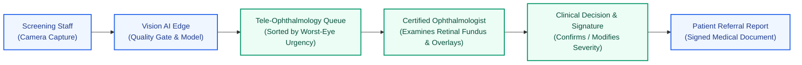

# Clinical Safety & Risk Management Protocol — Vision AI

**Project:** Vision AI — SIH26038 | Smart India Hackathon 2026  
**Document Status:** Clinical Governance Reference  

---

## 1. Clinical Intent & Medical Purpose

Vision AI is an **assistive clinical decision-support system** engineered to assist healthcare workers and tele-ophthalmologists in triaging diabetic retinopathy in underserved communities across India.

> [!CAUTION]
> **Regulatory Notice & Prototype Disclaimer:**  
> Vision AI is a research prototype developed for Smart India Hackathon 2026 (SIH26038). It does not hold CDSCO (Central Drugs Standard Control Organisation) or US FDA medical device clearance. It is **not** an autonomous diagnostic authority. The system must **never** be used to prescribe medication, schedule surgical interventions, or discharge patients without independent examination and sign-off by a licensed medical practitioner.

---

## 2. Doctor-in-the-Loop Governance Framework

1. **Autonomous Decisions Forbidden:** Every screening output is categorized as "Preliminary Assistive Assessment" until an ophthalmologist reviews the record.
2. **Side-by-Side Dual-Eye Review:** Clinicians inspect both left and right eye images simultaneously to identify asymmetrical pathology.
3. **Visual Grad-CAM Opacity Controls:** Reviewing doctors can smoothly toggle Grad-CAM attention overlays from $0\%$ (raw fundus) to $100\%$ to prevent automation bias.
4. **Diagnostic Override:** The doctor's diagnosis completely supersedes any AI model output in the database and on generated clinical referral documents.

---

## 3. Retinal Failure Modes & Clinical Risk Matrix

| Risk ID | Hazard / Failure Mode | Clinical Consequence | Mitigation in Vision AI |
|---|---|---|---|
| **RSK-01** | Defocus or motion blur | Microaneurysms obscured; false negative diagnosis | Automated Image Quality Gate rejects images with Laplacian variance $<12.0$, forcing on-site recapture. |
| **RSK-02** | Cataract / media opacity | Diffuse yellow/white glare mistaken for exudates | Foreground illumination bounds ($[30, 235]$) intercept washouts; clinician visual review mandatory. |
| **RSK-03** | Low model confidence | Borderline severity grade (e.g. Mild vs Moderate) | System automatically flags cases with $\max(p) < 0.50$ as `isLowConfidence = true`, alerting reviewer. |
| **RSK-04** | Non-DR retinal pathology (AMD, CRVO, Glaucoma) | False negative or misattributed referral | Explicit disclaimer on report that model detects DR lesions only; doctor must inspect full fundus field. |
| **RSK-05** | Automation bias | Clinician blindly trusts AI heatmap | Grad-CAM overlays default to $30\%$ opacity; clear warning that Grad-CAM represents correlation, not histology. |
| **RSK-06** | System downtime / network loss | Patient cannot be referred | Offline SQLite / IndexedDB local caching mode enables on-premise review during internet outages. |

---

## 4. Referable DR Triage Protocol

| ICDR Severity Level | Clinical Findings | AI Model Output | Referral Action & Timeline |
|:---:|---|---|---|
| **0: No DR** | No visible abnormalities | Non-referable | Routine re-screening in 12 months at local PHC. |
| **1: Mild NPDR** | Microaneurysms only | Non-referable | Follow-up rescreening in 6–12 months. |
| **2: Moderate NPDR** | Microaneurysms, hemorrhages, hard exudates | **Referable DR** | Specialist referral to District Hospital within 3 months. |
| **3: Severe NPDR** | 4-2-1 rule (multiple intraretinal hemorrhages) | **Referable DR** | Urgent specialist referral within 2–4 weeks. |
| **4: Proliferative DR** | Neovascularization, vitreous hemorrhage | **Referable DR** | Immediate vitreoretinal referral within 24–48 hours. |
